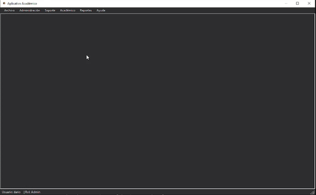

# Proyecto Final

Repositorio de la materia **Proyecto Final** de la carrera **Analista Programador a Distancia**, Facultad de Tecnología Informática, Universidad Abierta Interamericana (UAI).

## Contenido del repositorio

Este repositorio agrupa **todas las partes** que conforman el trabajo final. A continuación se describe cada una y dónde encontrarla.

| Parte | Ubicación | Descripción |
|-------|-----------|-------------|
| **Aplicación .NET** | [`src/TrabajoFinal-DarioZubaray/`](src/TrabajoFinal-DarioZubaray/) | Solución de escritorio (WinForms, **.NET 10**, `net10.0-windows`) con arquitectura en capas. Incluye su propio README. |
| **Aplicación .NET — README** | [`src/TrabajoFinal-DarioZubaray/README.md`](src/TrabajoFinal-DarioZubaray/README.md) | Documentación del proyecto .NET: clases, capas, responsabilidades, patrones (Composite, Singleton/Multiton, Decorator, Strategy) y principios SOLID. |
| **Base de datos — scripts SQL** | [`src/sql/`](src/sql/) | Scripts ordenados para crear, poblar y consultar la base de datos `DarioZubaray_TF`. Ver [`src/sql/README.md`](src/sql/README.md). |
| **Instalador** | [`installer/`](installer/) | Instalador de escritorio (Inno Setup) en dos modos: offline (self-contained) y online (descarga .NET 10 Desktop Runtime). Ver [Instalación](#instalación-exe). |
| **Diagramas (Mermaid Live)** | [`docs/mermaid-live/`](docs/mermaid-live/) | Diagramas en formato Mermaid: casos de uso, clases, ER y secuencias de login/logout. |
| **Documentación general (`docs/`)** | [`docs/README.md`](docs/README.md) | Guía de navegación del material de documentación (diagramas, modelos EA y cursada). |

### Aplicación .NET (`src/TrabajoFinal-DarioZubaray/`)

Solución con la siguiente arquitectura en capas (cada capa es un proyecto):

- **GUI** — interfaz gráfica (WinForms).
- **BLL** — lógica de negocio y servicios.
- **DAL** — acceso a datos de bajo nivel (SQL Server).
- **MPP** — capa de **mapeo**: transforma los objetos de base de datos (`DataTable`) en entidades de **BE** (y viceversa).
- **BE** — *Business Entities*: entidades, DTOs y el patrón **Composite** de roles/permisos.

Se destacan **cuatro** patrones de diseño:

- **Composite** — `RoleComponentBE` (entidad genérica abstracta), `RoleCompositeBE` (compuesto) y `PermissionLeafBE` (hoja) representan la jerarquía de roles/permisos como un árbol.
- **Singleton / Multiton** — `ServiceLocatorBLL` (singleton de servicios) y `SessionManagerBLL` (multiton de sesiones, una por usuario).
- **Decorator** — `ActivityLoggingDecoratorBLL` envuelve una actividad (`IActivityLogEntryBE`/`ActivityLogEntryBE`) y, al finalizar, guarda un registro en el **Historial de Actividad**.
- **Strategy** — `PasswordHasherBLL` elige entre algoritmos de hash intercambiables (`BcryptPasswordStrategyBLL` y `LegacySha256PasswordStrategyBLL`) para el cifrado/verificación de contraseñas.

Además, la aplicación aplica los **principios SOLID** (SRP, Open/Closed, Liskov, Interface Segregation y Dependency Inversion) — los patrones anteriores los materializan (p. ej. **Strategy** hace Open/Closed y facilita la inyección de dependencias) — todo documentado en el README del proyecto.

Para el detalle completo de clases, capas, responsabilidades y patrones, ver [`src/TrabajoFinal-DarioZubaray/README.md`](src/TrabajoFinal-DarioZubaray/README.md).

La aplicación también centraliza un **catálogo de códigos de error** por dominio (`ErrorCodesBLL`, prefijos `DB-`, `AUTH-`, `VAL-`, `BIZ-`, `GEN-`, `INT-`) con un **handler global** de excepciones en `Program.cs`. Ver la sección *"Manejo de errores y códigos de error"* en el README del proyecto .NET.

Además, aplica un **Dígito Verificador Horizontal (DVH)** sobre las tablas `users`, `evaluations` y `grades`: cada fila guarda su SHA-256 en la columna `dvh`; al iniciar, la aplicación recalcula los hashes y **bloquea el acceso** si detecta filas alteradas fuera de la app (solo el sysadmin puede auditarlas y regenerarlas). Ver la sección *"Integridad de datos (DVH)"* en el README del proyecto .NET.

### Base de datos (`src/sql/`)

Contiene los scripts para crear, poblar y consultar la base `DarioZubaray_TF`. Detalle completo en [`src/sql/README.md`](src/sql/README.md).

**Opción A (recomendada)** — un solo paso:

1. `05_v1.3.0_ScriptConsolidado.sql` — crea la base `DarioZubaray_TF` (si no existe) y la deja con el esquema y los datos finales (v1.4.0).

**Opción B** — scripts por pasos:

1. `01_v1.0.0_CreateTables.sql` — crea el esquema completo (16 tablas, con las columnas `dvh` de `users`, `evaluations` y `grades`).
2. `02_v1.0.0_SeedDemoData.sql` — carga datos iniciales: roles, permisos, usuarios (con backfill del DVH).
3. `03_v1.3.0_Incremental.sql` — migración incremental a v1.3.0: aulas/cursos/inscripciones/asistencia, tickets, entidad `students`, `evaluations`/`grades`, permisos de informes y respaldo, y el DVH (columna `users.dvh` + backfill SHA-256). Idempotente; también aplica sobre bases legadas creadas con los scripts anteriores.
4. `06_v1.4.0_DVHGradesEvaluations.sql` — migración incremental a v1.4.0: agrega `evaluations.dvh` y `grades.dvh` y calcula el backfill SHA-256 de las filas existentes. Idempotente.

**Rollback:** `04_v1.3.0_Rollback.sql` devuelve la base al estado v1 (destructivo: borra las tablas y permisos agregados; para volver a usarla, re-ejecutar `03_v1.3.0_Incremental.sql`). `07_v1.4.0_Rollback.sql` revierte la v1.4.0: elimina solo las columnas `dvh` de `evaluations` y `grades` (conservando tablas y datos); para volver a la v1.4.0, re-ejecutar `06`.

### Instalación (`.exe`)

El repositorio incluye un instalador de escritorio (Inno Setup, sin elevación de privilegios) en `installer/Output/`:

| Instalador | Descripción |
|------------|-------------|
| `Setup-TrabajoFinal-offline.exe` | Recomendado. Incluye .NET 10 runtime (no requiere internet ni .NET previo). |
| `Setup-TrabajoFinal-online.exe` | Instalador liviano; descarga e instala .NET 10 Desktop Runtime si el equipo no lo tiene. |

El asistente:

1. Pide la cadena de conexión (servidor y base de datos; por defecto `localhost\SQLEXPRESS` / `DarioZubaray_TF`) y la guarda en el `App.config` de la aplicación instalada.
2. Ejecuta los scripts `01` + `06` (crea la base y el esquema si no existen; en bases nuevas `06` solo registra la versión `1.4.0`) — nunca `02` ni `05`.
3. Ofrece lanzar la aplicación. Si la base quedó sin usuarios, la aplicación muestra el formulario de registro (CU-03) para crear la cuenta administradora; si ya hay usuarios, muestra el login (CU-01).

La instalación deja el administrador por defecto `admin` / `admin` (primer inicio y, si hace falta, desbloqueo de la auditoría DVH).

Para mantenimiento, la aplicación expone una CLI: `TrabajoFinal-DarioZubaray.exe --test-connection` (verifica la conexión, sale con 0/2) y `--bootstrap [--sql-dir <ruta>]` (ejecuta los scripts del directorio — `01` + `06` en la instalación; en desarrollo además `03` — omitiendo `02`, rollback y consolidado; sale con 0/1/2/3). El detalle de scripts y datos de prueba está en [`src/sql/README.md`](src/sql/README.md).

#### Datos de prueba

| Usuario | Contraseña | Rol |
|---------|-----------|-----|
| `admin` | `admin` | Admin (todos los permisos) — exento de bloqueo por intentos, pide código 2FA `123` |
| `dario` | `123` | Admin (todos los permisos) |
| `coord1`, `coord2`, `coord3` | `123` | Coordinador (ABMs) |
| `prof_brooks`, `prof_omh`, `prof_conway`, `prof_pareto`, `prof_amdahl`, `prof_kirchhoff`, `prof_murphy`, `prof_newton` | `123` | Profesor (asistencia, evaluaciones, tickets) |
| `user_blocked`, `user_1retry`, `user_2retry` | `admin` / `123` | Datos de prueba de bloqueo de login (inactive / reintentos) |

### Diagramas (`docs/mermaid-live/`)

Son archivos [Mermaid](https://mermaid.js.org/) que pueden visualizarse en GitHub o con herramientas que soporten el formato, como el [Mermaid Live Editor](https://mermaid.live/) (índice completo en [`docs/README.md`](docs/README.md)):

- `3.1.4.modelo-conceptual.mmd` — modelo conceptual (diagrama de clases de BE, con el Composite).
- `4.1.casos-uso-general.mmd` — diagrama general de casos de uso (Administrador, Coordinador, Profesor y Director).
- `7.clases.mmd` — diagrama de clases con el patrón Composite.
- `8.er.mmd` — modelo entidad-relación de la base.
- `4.2.8.secuencia-crear-curso.mmd` — secuencia simple de crear curso (vista de alto nivel).
- `4.2.8.secuencia-crear-curso-completo.mmd` — secuencia completa con toda la cadena: Coordinador → CourseBLL → CourseMPP → AccessDAL → SQL Server.
- `6.1.8.secuencia-login.mmd` — secuencia simple del inicio de sesión (vista de alto nivel).
- `6.1.8.secuencia-login-completo.mmd` — secuencia completa con toda la cadena: AuthBLL → UserMPP → AccessDAL → SQL Server, ActivityBLL, PermissionBLL → RoleMPP, SessionManagerBLL, AppPreferencesBLL.
- `6.2.8.secuencia-logout.mmd` — secuencia simple del cierre de sesión (vista de alto nivel).
- `6.2.8.secuencia-logout-completo.mmd` — secuencia completa: AppPreferencesBLL (archivo), SessionManagerBLL (memoria), ActivityBLL → ActivityMPP → AccessDAL → SQL Server, CultureHelperBLL, ThemeHelper.

## Enlaces útiles

- [Página de la carrera](https://uai.edu.ar/facultades/tecnolog%C3%ADa-inform%C3%A1tica/analista-programador-a-distancia/)
