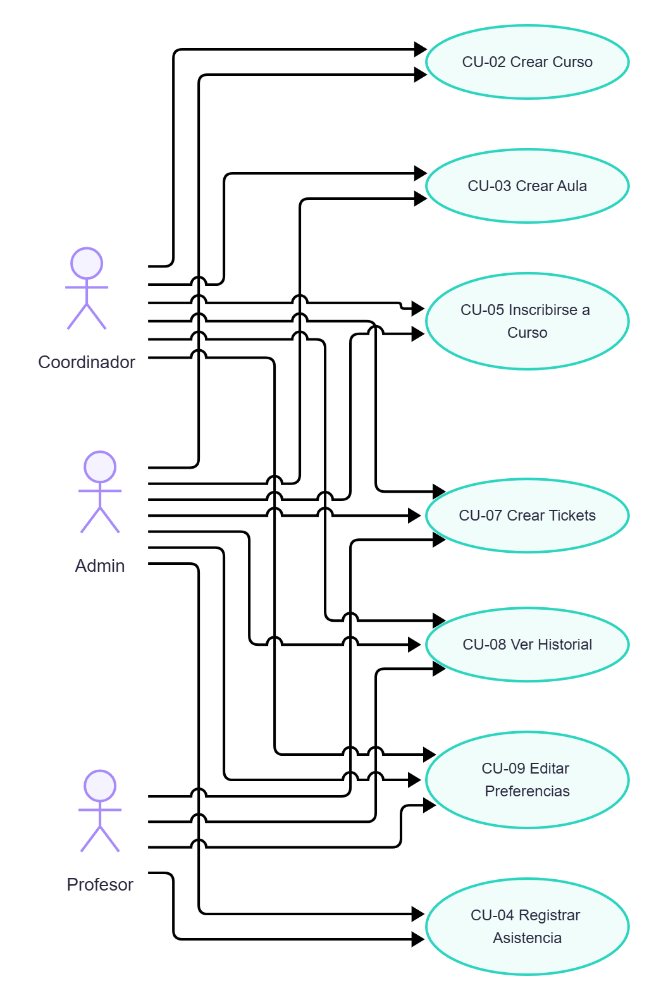

#### 4.1. Diagrama de Casos de Uso (General)



```mermaid
graph LR
    ADM["Administrador"]@{ shape: person, lbl: "Administrador" }
    COO["Coordinador"]@{ shape: person, lbl: "Coordinador" }
    PRO["Profesor"]@{ shape: person, lbl: "Profesor" }
    DIR["Director"]@{ shape: person, lbl: "Director" }

    CU01(["CU-01: Login"])
    CU06(["CU-06: Logout"])
    CU08(["CU-08: Gestionar Usuarios"])
    CU09(["CU-09: Gestionar Roles y Permisos"])
    CU13(["CU-13: Respaldo y Restauración"])
    CU02(["CU-02: Crear Curso"])
    CU03(["CU-03: Crear Aula"])
    CU05(["CU-05: Registrar Inscripción"])
    CU04(["CU-04: Registrar Asistencia"])
    CU10(["CU-10: Registrar Evaluación y Cargar Notas"])
    CU11(["CU-11: Consultar Rendimiento Académico"])
    CU12(["CU-12: Generar Informe Personalizado"])
    CU07(["CU-07: Tickets / Reclamos"])
    ALU(["Gestionar Alumnos"])

    %% Módulo Base / Sesión: todos los roles autenticados
    ADM --> CU01
    ADM --> CU06
    COO --> CU01
    COO --> CU06
    PRO --> CU01
    PRO --> CU06
    DIR --> CU01
    DIR --> CU06

    %% Módulo Administración
    ADM --> CU08
    ADM --> CU09
    ADM --> CU13
    ADM --> ALU

    %% Módulo Académico
    COO --> CU02
    COO --> CU03
    COO --> CU05
    COO --> ALU
    PRO --> CU04

    %% Módulo Evaluaciones e Informes
    PRO --> CU10
    PRO --> CU11
    COO --> CU11
    COO --> CU12
    DIR --> CU11
    DIR --> CU12

    %% Módulo Soporte
    COO --> CU07
    PRO --> CU07
```

**Actores del sistema**

| Actor | Tipo | Descripción |
| :--- | :--- | :--- |
| **Administrador** | Principal | Responsable de la operación del aplicativo (tareas de inicio y excepcionales): cuentas de acceso, roles y permisos, y respaldo/restauración de la base de datos. |
| **Coordinador** | Principal | Realiza las tareas diarias de la academia: oferta académica (cursos y aulas), inscripciones, alta de alumnos, gestión de tickets (cierre) y consulta/generación de informes. |
| **Profesor** | Principal | Operador especial del ámbito académico de sus cursos: asistencia, evaluaciones y notas; crea tickets y consulta el rendimiento de sus cursos. |
| **Director** | Principal | Supervisa el resultado académico en modo solo lectura: consulta el rendimiento y los informes personalizados de la institución. |

**Notas**

- El **Alumno no es un rol del sistema ni un actor**: no inicia sesión. Es una *entidad
  gestionada* (tabla `students`): su ABM lo realizan Coordinador y Administrador, y su
  historial académico alimenta los procesos de asistencia, evaluaciones e informes.
- La **verificación de integridad (DVH)** no es un actor: es un paso del sistema dentro
  del flujo del CU-01 Login (ver `6.1.CU-01-Login.md`).
- El **Administrador** posee todos los permisos del aplicativo; en el diagrama se lo
  representa vinculado a los casos de uso que le son exclusivos de administración.
- Fuente canónica del diagrama: [`4.1.casos-uso-general.mmd`](../mermaid-live/4.1.casos-uso-general.mmd).
