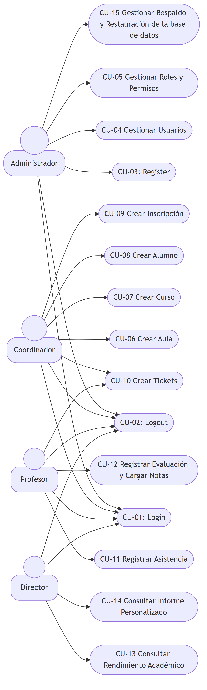

#### 4.1. Diagrama de Casos de Uso (General)



```mermaid
graph LR
    ADM["Administrador"]@{ shape: person, lbl: "Administrador" }
    COO["Coordinador"]@{ shape: person, lbl: "Coordinador" }
    PRO["Profesor"]@{ shape: person, lbl: "Profesor" }
    DIR["Director"]@{ shape: person, lbl: "Director" }

    CU01(["CU-01: Login"])
    CU02(["CU-02: Logout"])
    CU03(["CU-03: Register"])

    CU04(["CU-04 Gestionar Usuarios"])
    CU05(["CU-05 Gestionar Roles y Permisos"])
    CU06(["CU-06 Crear Aula"])
    CU07(["CU-07 Crear Curso"])
    CU08(["CU-08 Crear Alumno"])
    CU09(["CU-09 Crear Inscripción"])
    CU10(["CU-10 Crear Tickets"])

    CU11(["CU-11 Registrar Asistencia"])
    CU12(["CU-12 Registrar Evaluación y Cargar Notas"])
    CU13(["CU-13 Consultar Rendimiento Académico"])
    CU14(["CU-14 Consultar Informe Personalizado"])
    CU15(["CU-15 Gestionar Respaldo y Restauración de la base de datos"])

    %% Módulo Base / Sesión: todos los roles autenticados
    ADM --> CU01
    ADM --> CU02
    COO --> CU01
    COO --> CU02
    PRO --> CU01
    PRO --> CU02
    DIR --> CU01
    DIR --> CU02

    %% Módulo Administración
    ADM --> CU03
    ADM --> CU04
    ADM --> CU05
    ADM --> CU15

    %% Módulo Académico
    COO --> CU06
    COO --> CU07
    COO --> CU08
    COO --> CU09
    COO --> CU10

    %% Módulo Operaciones
    PRO --> CU10
    PRO --> CU11
    PRO --> CU12

    %% Módulo Reportes
    DIR --> CU13
    DIR --> CU14
```

**Actores del sistema**

| Actor | Tipo | Descripción |
| :--- | :--- | :--- |
| **Administrador** | Principal | Responsable de la operación del aplicativo (tareas de inicio y excepcionales): cuentas de acceso, roles y permisos, y respaldo/restauración de la base de datos. |
| **Coordinador** | Principal | Realiza las tareas diarias de la academia: oferta académica (cursos y aulas), inscripciones, alta de alumnos, gestión de tickets (cierre) y gestión de tickets (cierre). |
| **Profesor** | Principal | Operador especial del ámbito académico de sus cursos: asistencia, evaluaciones y notas; crea tickets . |
| **Director** | Principal | Supervisa el resultado académico en modo solo lectura: consulta el rendimiento y los informes personalizados de la institución. |

**Notas**

- El **Alumno no es un rol del sistema ni un actor**: no inicia sesión. Es una *entidad
  gestionada* (tabla `students`): su ABM lo realizan Coordinador y Administrador, y su
  historial académico alimenta los procesos de asistencia, evaluaciones e informes.
- La **verificación de integridad (DVH)** no es un actor: es un paso del sistema dentro
  del flujo del CU-01 Login (ver `6.1 CU-01 Login.md`).
- El **Administrador** posee todos los permisos del aplicativo; en el diagrama se lo
  representa vinculado a los casos de uso que le son exclusivos de administración.
- Fuente canónica del diagrama: [`4.1.casos-uso-general.mmd`](../mermaid-live/4. diagramas-caso-uso/4.1.casos-uso-general.mmd).
