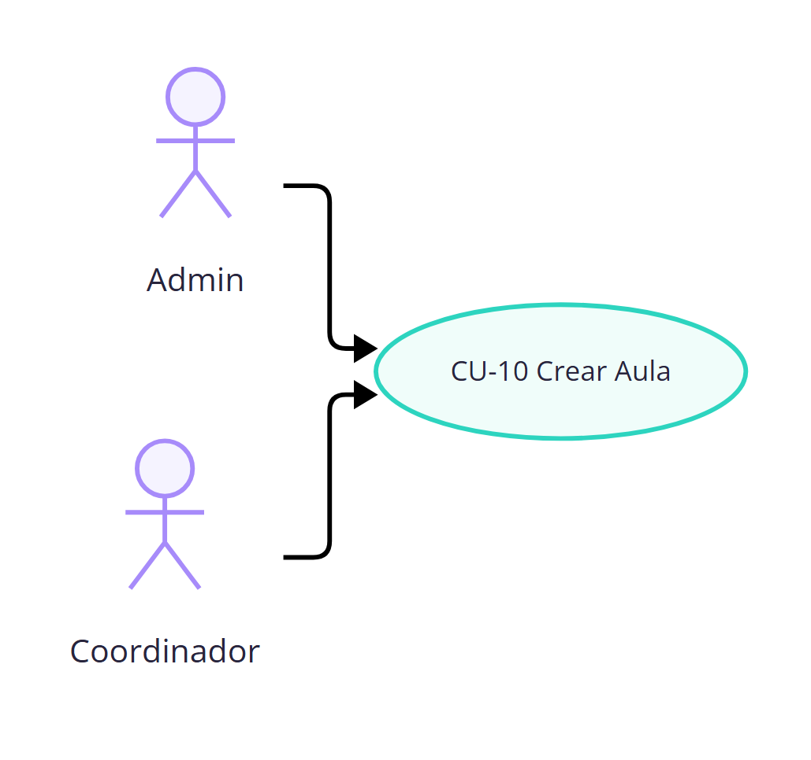
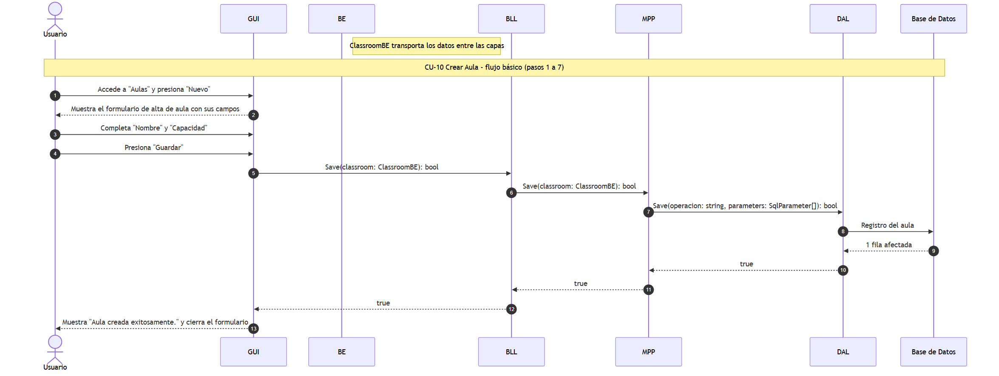
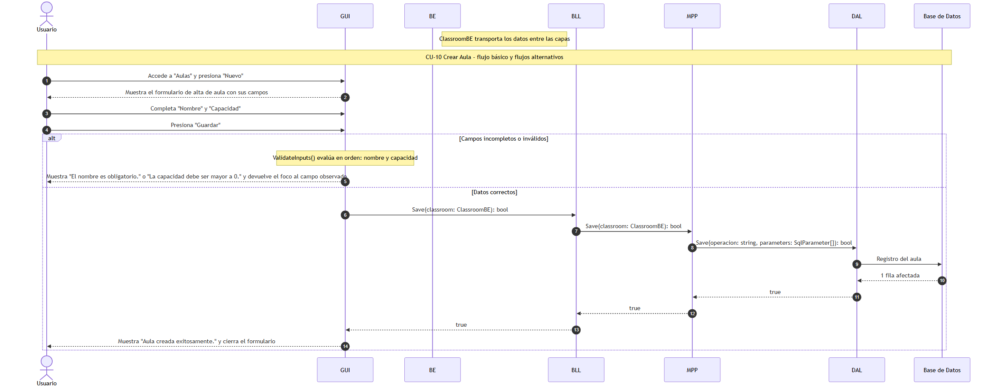
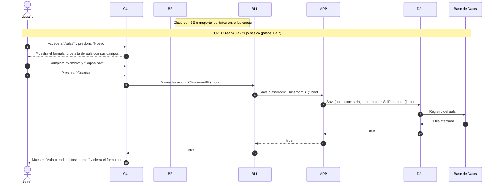
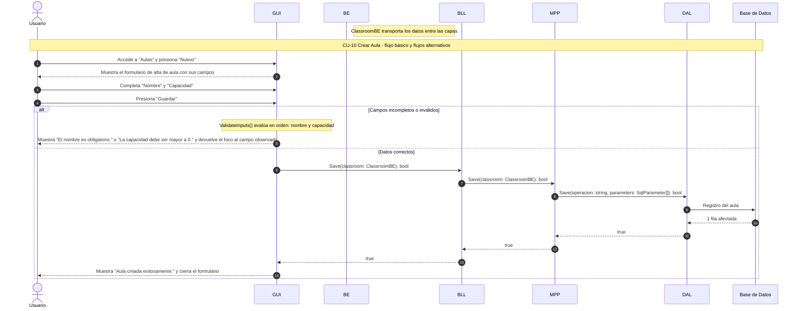

#### 4.10. Especificación de Casos de Uso: CU-10 Crear Aula

#### 4.10.0. Diagramas de Caso de Uso

#### 4.10.1. Carátula

| Campo                   | Valor                                                                                                      |
| :---------------------- | :--------------------------------------------------------------------------------------------------------- |
| **ID y Nombre**         | CU-10 Crear Aula                                                                                           |
| **Estado**              | En Revisión                                                                                                |
| **Descripción**         | Permite registrar un espacio físico (aula) especificando su nombre y capacidad para ser asignada a cursos. |
| **Actor Principal**     | Coordinador                                                                                      |
| **Actores Secundarios** | Ninguno                                                                                                    |
| **Precondiciones**      | El usuario debe haber iniciado sesión con el rol autorizado.                                               |
| **Punto de extensión**  | No aplica                                                                                                  |
| **Condición**           | Los datos obligatorios son válidos y el aula queda registrada activa.                                      |

#### 4.10.2. Historial de Revisiones

| Versión | Fecha | Descripción | Autor |
| :--- | :--- | :--- | :--- |
| 1.0 | 13/09/2026 | Creación inicial de la especificación del Caso de Uso | Darío Zubaray |
| 1.1 | 28/10/2026 | Flujo en ping-pong paso por paso con la tabla de campos, alineación con el código (se elimina el control de nombre duplicado, que no existe) y regeneración de los diagramas por capa (DSS/DSD) | Darío Zubaray |
| 1.2 | 16/11/2026 | Reenumeración a CU-10 (CUs atómicos) | Darío Zubaray |

#### 4.10.3. Objetivo

Dar de alta una nueva aula dentro de la academia.

#### 4.10.4. Precondiciones

- El usuario se encuentra autenticado con perfil de Coordinador.

#### 4.10.5. Puntos de Extensión y Condiciones

- **Punto de Extensión:** No aplica.
- **Condición:** El nombre y la capacidad ingresados cumplen las reglas de validación del formulario.

#### 4.10.6. Descripción analítica del Caso de Uso

**Campos que completa el usuario:**

| Campo | Tipo | Obligatorio | Validación |
| :--- | :--- | :--- | :--- |
| Nombre | Texto | Sí | No puede estar vacío. |
| Capacidad | Numérico entero | Sí | Debe ser mayor a 0. |

Flujo Básico:
1. El usuario accede al formulario "Aulas" del menú "Administración" y presiona "Nuevo".
2. El sistema muestra el formulario de alta de aula con sus campos.
3. El usuario completa el campo "Nombre".
4. El usuario completa el campo "Capacidad".
5. El usuario presiona el botón "Guardar".
6. El sistema muestra el mensaje "Aula creada exitosamente.", cierra el formulario y el aula aparece en el listado.
7. Fin del Caso de Uso.

Flujos Alternativos:
- **5.a Nombre vacío:**
  1. El sistema muestra el mensaje "El nombre es obligatorio." y devuelve el foco al campo "Nombre".
  2. El usuario completa el campo "Nombre" y vuelve a presionar "Guardar".
- **5.b Capacidad no válida:**
  1. El sistema muestra el mensaje "La capacidad debe ser mayor a 0." y devuelve el foco al campo "Capacidad".
  2. El usuario corrige la capacidad y vuelve a presionar "Guardar".

#### 4.10.7. Modelo de Dominio

Participan las siguientes entidades:
- Aula

#### 4.10.8. Diagramas de Secuencia

DSS (simple): 

DSD (detallado): 

