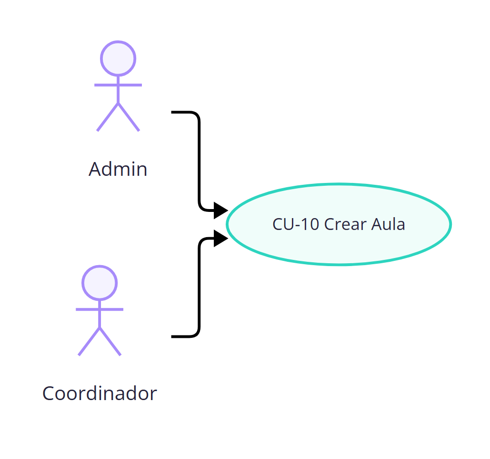
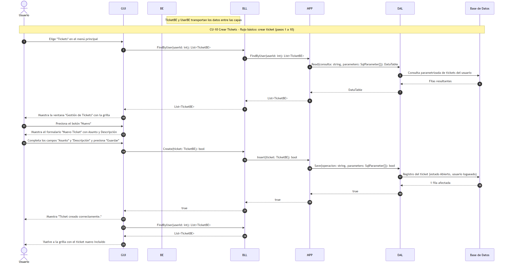
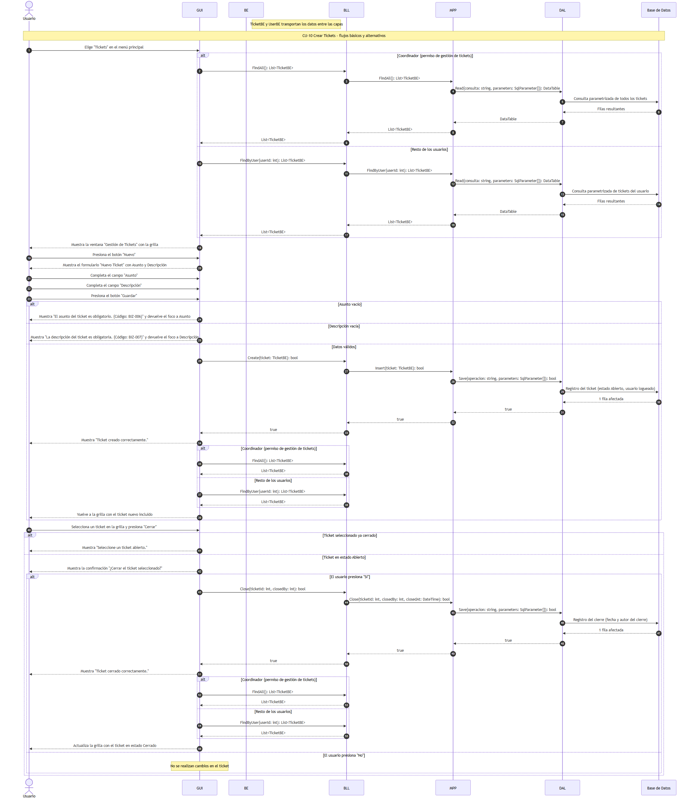
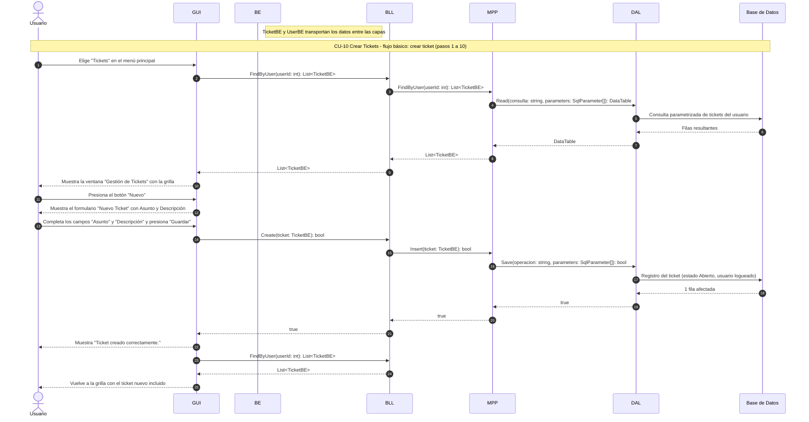
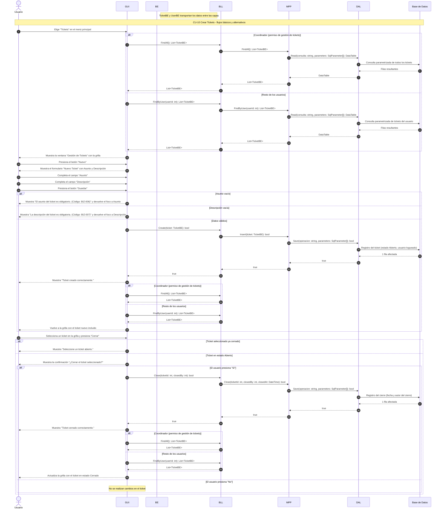

#### 4.10. Especificación de Casos de Uso: CU-10 Crear Tickets

#### 4.10.0. Diagramas de Caso de Uso

#### 4.10.1. Carátula

| Campo                   | Valor                                                                                                                                                                                                             |
| :---------------------- | :---------------------------------------------------------------------------------------------------------------------------------------------------------------------------------------------------------------- |
| **ID y Nombre**         | CU-10 Crear Tickets                                                                                                                                                                                               |
| **Estado**              | En Revisión                                                                                                                                                                                                       |
| **Descripción**         | Permite a los usuarios reportar un problema o solicitud (ticket: asunto + descripción) con trazabilidad de quién lo reportó y cuándo. El Coordinador además lista los tickets de todos los usuarios y los cierra. |
| **Actor Principal**     | Coordinador, Profesor                                                                                                                                                                                             |
| **Actores Secundarios** | Ninguno                                                                                                                                                                                                           |
| **Precondiciones**      | El usuario debe haber iniciado sesión en el sistema.                                                                                                                                                              |
| **Punto de extensión**  | No aplica                                                                                                                                                                                                         |
| **Condición**           | El asunto y la descripción del ticket son obligatorios; el ticket nace en estado *Abierto* y solo el Coordinador puede cerrarlo.                                                                                  |

#### 4.10.2. Historial de Revisiones

| Versión | Fecha      | Descripción                                                                                                                                                 | Autor         |
| :------ | :--------- | :---------------------------------------------------------------------------------------------------------------------------------------------------------- | :------------ |
| 1.0     | 19/10/2026 | Creación inicial de la especificación del Caso de Uso                                                                                                       | Darío Zubaray |
| 1.1     | 20/10/2026 | Ajuste de actores: crean Coordinador y Profesor, cierra solo Coordinador, Admin oculto                                                                      | Darío Zubaray |
| 1.2     | 20/10/2026 | Separación del cierre de tickets en un caso de uso aparte (pendiente de documentar); el CU queda centrado en la creación                                    | Darío Zubaray |
| 1.3     | 29/10/2026 | Ajuste de actores al modelo final con 4 roles.                                                                                                              | Darío Zubaray |

#### 4.10.3. Objetivo

Registrar el reporte de un problema o solicitud (ticket) de un usuario, dejando trazabilidad de quién lo reportó y cuándo. Para el Coordinador, permitir además listar y cerrar los tickets de todos los usuarios.

#### 4.10.4. Precondiciones

- El usuario ha iniciado sesión en el sistema.

#### 4.10.5. Puntos de Extensión y Condiciones

- **Punto de Extensión:** No aplica.
- **Condición:** El ticket nace en estado *Abierto*; su cierre pertenece a este mismo caso de uso (solo Coordinador).

#### 4.10.6. Descripción analítica del Caso de Uso

**Campos que completa el usuario:**

| Campo | Tipo | Obligatorio | Validación |
| :--- | :--- | :--- | :--- |
| Asunto | Texto | Sí | No puede quedar vacío. |
| Descripción | Texto largo | Sí | No puede quedar vacío. |

Flujo Básico 1 - Crear ticket (Profesor; también el Coordinador):
1. El usuario elige **Tickets** en el menú principal.
2. El sistema muestra la ventana "Gestión de Tickets" con la grilla de tickets: los demás usuarios ven solo sus propios tickets; el Coordinador ve todos.
3. El usuario presiona el botón **Nuevo**.
4. El sistema muestra el formulario "Nuevo Ticket" con los campos *Asunto* y *Descripción*.
5. El usuario completa el campo "Asunto".
6. El usuario completa el campo "Descripción".
7. El usuario presiona el botón **Guardar**.
8. El sistema valida los campos, registra el ticket en estado *Abierto* asociado a su usuario y muestra el mensaje "Ticket creado correctamente.".
9. El sistema vuelve a la grilla con el ticket nuevo incluido.
10. Fin del Caso de Uso.

Flujo Básico 2 - Cerrar ticket (Coordinador):
1. El usuario selecciona un ticket de la grilla.
2. El usuario presiona el botón **Cerrar**.
3. El sistema muestra la confirmación "¿Cerrar el ticket seleccionado?".
4. El usuario presiona "Sí".
5. El sistema cierra el ticket registrando la fecha y el autor del cierre, muestra el mensaje "Ticket cerrado correctamente." y actualiza la grilla.
6. Fin del Caso de Uso.

Flujos Alternativos:
- **7.a Asunto vacío:**
  1. El sistema muestra el mensaje "El asunto del ticket es obligatorio. (Código: BIZ-006)" y devuelve el foco al campo Asunto.
  2. El usuario completa el asunto y vuelve a presionar "Guardar".
- **7.b Descripción vacía:**
  1. El sistema muestra el mensaje "La descripción del ticket es obligatoria. (Código: BIZ-007)" y devuelve el foco al campo Descripción.
  2. El usuario completa la descripción y vuelve a presionar "Guardar".
- **2.a El ticket seleccionado ya está cerrado:**
  1. El sistema muestra el mensaje "Seleccione un ticket abierto."
- **4.a El usuario presiona "No" en la confirmación:**
  1. El sistema no realiza ningún cambio y mantiene la grilla sin modificar.

#### 4.10.7. Modelo de Dominio

Participan las siguientes entidades:
- Ticket (asunto, descripción, estado Abierto/Cerrado, fecha de creación, fecha y autor de cierre)
- Usuario (autor del ticket; el Coordinador es quien puede cerrarlo)

#### 4.10.8. Diagramas de Secuencia

DSS (simple): 

DSD (detallado): 

