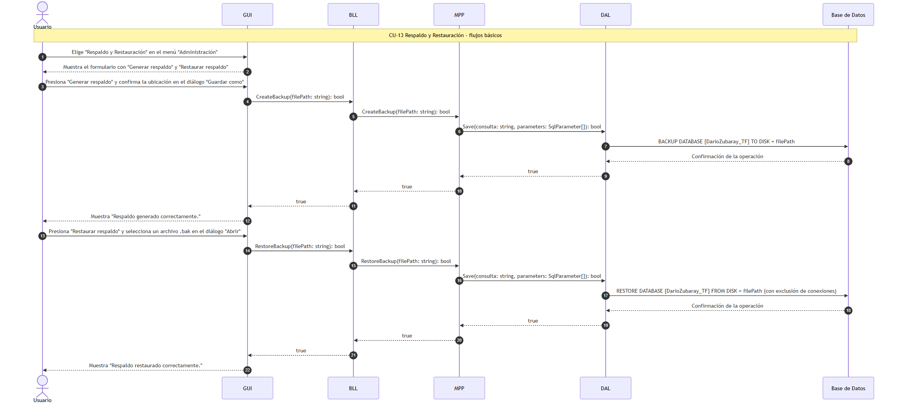
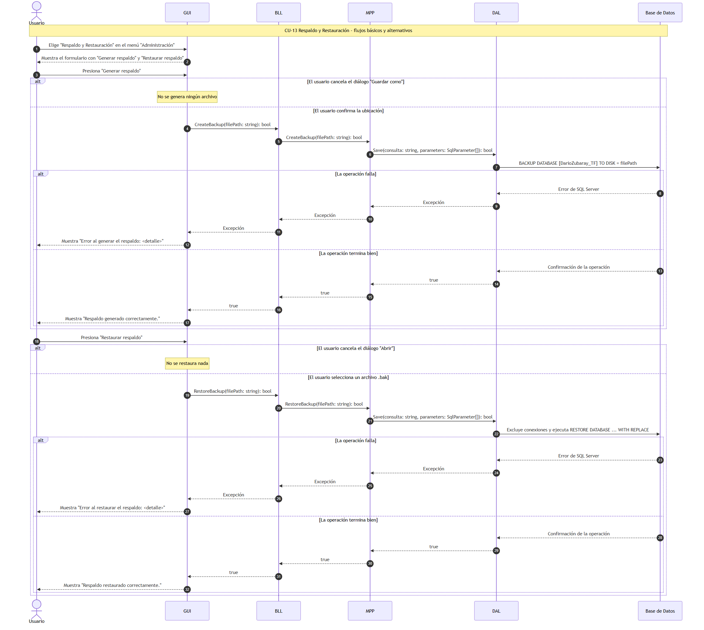
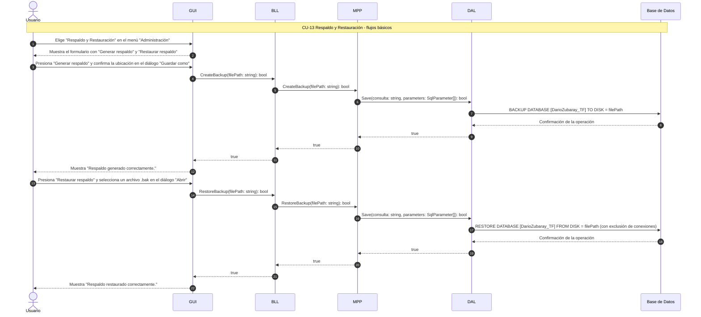
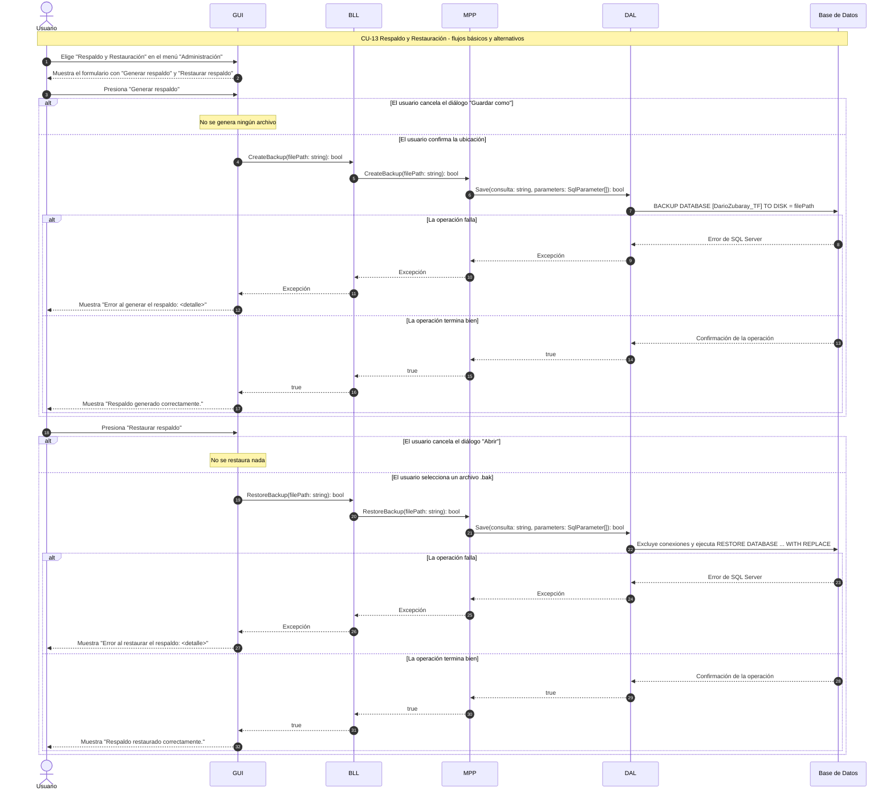

#### 4.12. Especificación de Casos de Uso: CU-13 Respaldo y Restauración de la Base de Datos

> Convención de estructura y estilo: [`convenciones-cu-y-secuencia.md`](convenciones-cu-y-secuencia.md).

#### 4.12.1. Carátula

| Campo | Valor |
| :--- | :--- |
| **ID y Nombre** | CU-13 Respaldo y Restauración de la Base de Datos |
| **Estado** | En Revisión |
| **Descripción** | Permite al Administrador generar un archivo de respaldo (.bak) de la base de datos del sistema o restaurarla desde un archivo de respaldo seleccionado. |
| **Actor Principal** | Administrador |
| **Actores Secundarios** | Ninguno |
| **Precondiciones** | El usuario debe haber iniciado sesión con el permiso de respaldo (`FORM_BACKUP_MGMT`). Para restaurar, debe existir un archivo de respaldo válido generado por el sistema. |
| **Punto de extensión** | No aplica |
| **Condición** | El respaldo queda generado como archivo .bak en la ubicación elegida por el usuario, o la base de datos queda restaurada con el contenido del archivo seleccionado. |

#### 4.12.2. Historial de Revisiones

| Versión | Fecha | Descripción | Autor |
| :--- | :--- | :--- | :--- |
| 1.0 | 31/10/2026 | Creación inicial de la especificación del Caso de Uso y módulo implementado (SQL v1.3.0, `BackupBLL`/`BackupMPP`, `BackupForm`) | Darío Zubaray |

#### 4.12.3. Objetivo

Permitir al Administrador proteger la información del sistema mediante respaldos periódicos y recuperarla ante una eventual pérdida, desde la aplicación y sin intervención manual en SQL Server.

#### 4.12.4. Precondiciones

- El usuario debe haber iniciado sesión con el permiso `FORM_BACKUP_MGMT`.
- Para restaurar: debe existir un archivo de respaldo válido de la base de datos del sistema.

#### 4.12.5. Puntos de Extensión y Condiciones

- **Punto de Extensión:** No aplica.
- **Condición:** Se elige un destino (respaldo) o un archivo de origen (restauración) y la operación de SQL Server se completa sin errores.

#### 4.12.6. Descripción analítica del Caso de Uso

**Campos que completa el usuario:**

| Campo | Tipo | Obligatorio | Validación |
| :--- | :--- | :--- | :--- |
| Archivo de respaldo (destino o origen) | Diálogo "Guardar como" / "Abrir" (.bak) | Sí | El usuario confirma o cancela el diálogo; no se ingresa la ruta a mano. |

Flujo Básico 1 - Generar respaldo:
1. El usuario elige **Respaldo y Restauración** en el menú "Administración".
2. El sistema muestra el formulario "Respaldo y Restauración" con los botones "Generar respaldo" y "Restaurar respaldo".
3. El usuario presiona el botón "Generar respaldo".
4. El sistema muestra el diálogo "Guardar como" en formato .bak.
5. El usuario confirma el nombre y la ubicación del archivo.
6. El sistema ejecuta el respaldo de la base de datos y muestra "Respaldo generado correctamente."
7. Fin del Caso de Uso.

Flujo Básico 2 - Restaurar respaldo:
1. El usuario presiona el botón "Restaurar respaldo".
2. El sistema muestra el diálogo "Abrir" en formato .bak.
3. El usuario selecciona el archivo de respaldo y confirma.
4. El sistema restaura la base de datos con el contenido del archivo, excluyendo las demás conexiones.
5. El sistema muestra "Respaldo restaurado correctamente."
6. Fin del Caso de Uso.

Flujos Alternativos:
- **4.a (Flujo 1) El usuario cancela el diálogo "Guardar como":**
  1. El sistema no genera ningún archivo y mantiene el formulario.
- **6.a (Flujo 1) Error al generar el respaldo:**
  1. El sistema muestra el mensaje "Error al generar el respaldo: \<detalle\>".
  2. El usuario puede reintentar o cerrar el formulario.
- **3.a (Flujo 2) El usuario cancela el diálogo "Abrir":**
  1. El sistema no restaura nada y mantiene el formulario.
- **4.a (Flujo 2) Error al restaurar el respaldo:**
  1. El sistema muestra el mensaje "Error al restaurar el respaldo: \<detalle\>".
  2. El usuario puede seleccionar otro archivo o cerrar el formulario.

#### 4.12.7. Modelo de Dominio

Participan las siguientes entidades:
- Base de datos del sistema (objeto del respaldo y de la restauración)
- Archivo de respaldo .bak (artifacto generado/seleccionado por el usuario)

#### 4.12.8. Diagramas de Secuencia

DSS (simple): 

DSD (detallado): 

#### 4.12.9. Notas de implementación

- Nuevas clases (a crear en la implementación):
  - `BackupBLL.CreateBackup(string filePath): bool` y `BackupBLL.RestoreBackup(string filePath): bool` (delegan en MPP; sin reglas de negocio)
  - `BackupMPP.CreateBackup`: `BACKUP DATABASE` con parámetro de ruta, ejecutado sobre la base del sistema
  - `BackupMPP.RestoreBackup`: conexión a `master` para excluir las conexiones (`SET SINGLE_USER WITH ROLLBACK IMMEDIATE`), `RESTORE DATABASE ... WITH REPLACE` y restauración de `MULTI_USER`
  - `ServiceLocatorBLL.GetBackupMPP` / `CreateBackupBLL`
- Permiso `FORM_BACKUP_MGMT` (SQL v1.3.0, otorgado solo al rol Admin; el patrón "Admin: todos los permisos" lo propaga).
- Menú "Administración" → "Respaldo y Restauración" en `MainForm` (visibilidad por permiso `FORM_BACKUP_MGMT`).
- Recursos nuevos en `Resources.resx` (`BackupForm_*`, `Main_MenuBackup`).
- La restauración desconecta a los demás usuarios de la base de datos durante la operación; es una operación exclusiva del Administrador.
