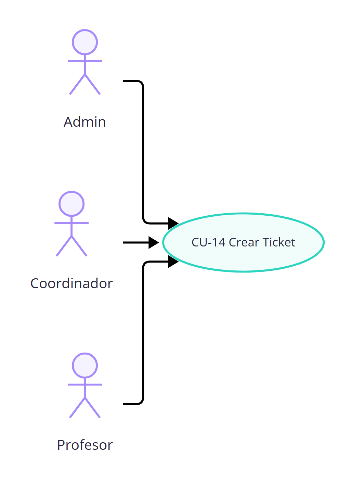
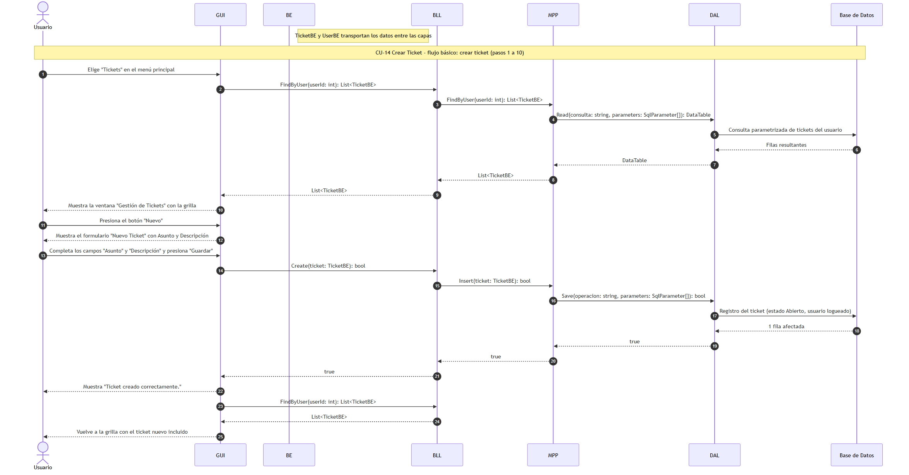
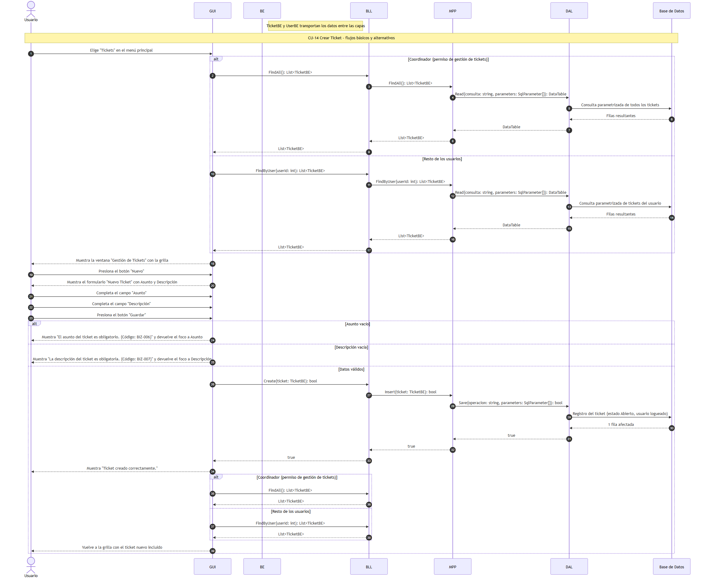
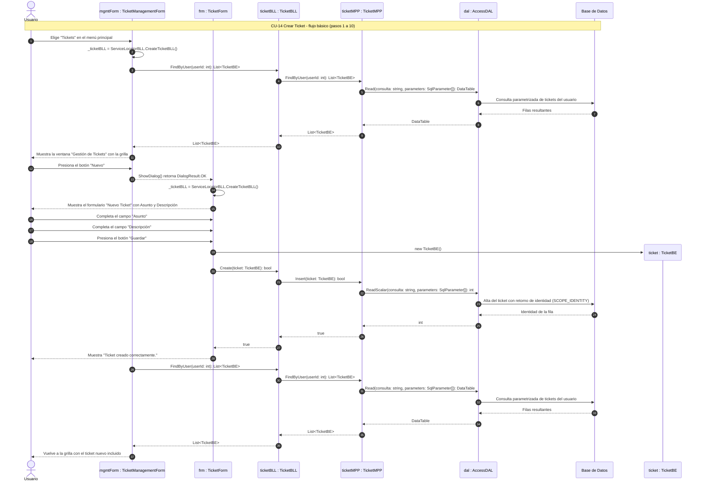
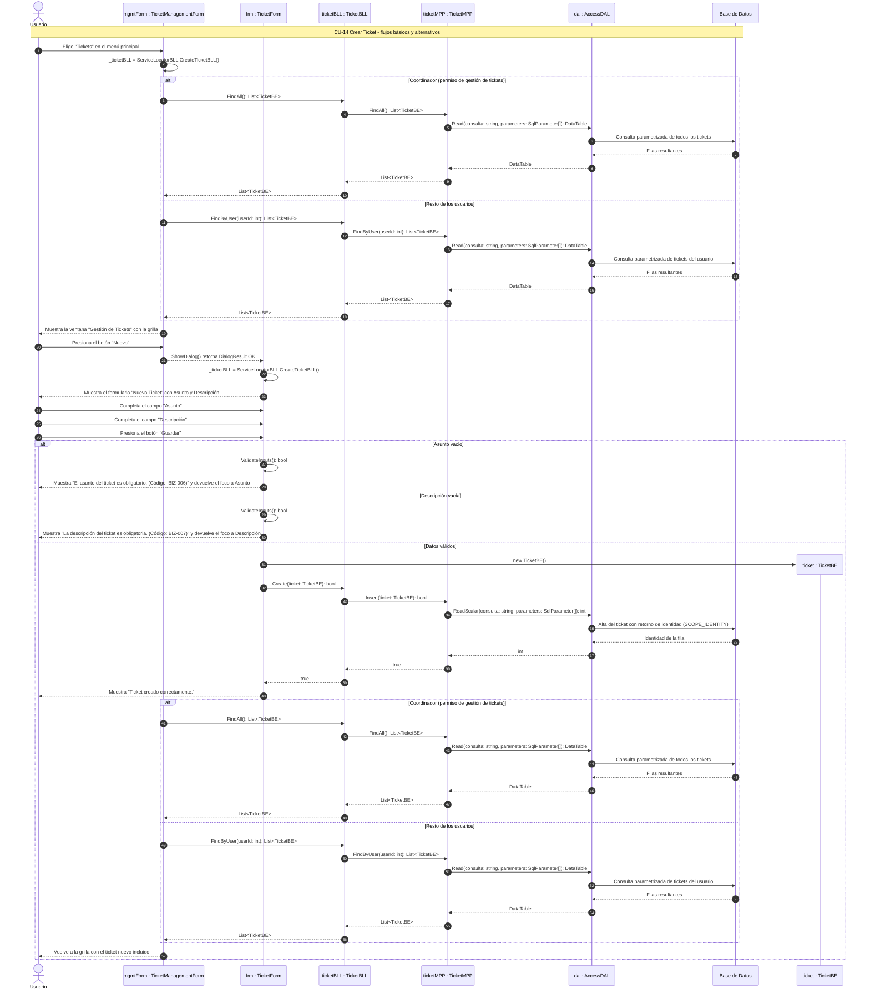

#### 4.14. Especificación de Casos de Uso: CU-14 Crear Ticket

#### 4.14.0. Diagramas de Caso de Uso

#### 4.14.1. Carátula

| Campo                   | Valor                                                                                                                                                                                                     |
| :---------------------- | :-------------------------------------------------------------------------------------------------------------------------------------------------------------------------------------------------------- |
| **ID y Nombre**         | CU-14 Crear Ticket                                                                                                                                                                                        |
| **Estado**              | En Revisión                                                                                                                                                                                               |
| **Descripción**         | Permite a los usuarios reportar un problema o solicitud (ticket: asunto + descripción) con trazabilidad de quién lo reportó y cuándo.                                                                     |
| **Actor Principal**     | Administrador, Coordinador, Profesor                                                                                                                                                                      |
| **Actores Secundarios** | Ninguno                                                                                                                                                                                                   |
| **Precondiciones**      | El usuario debe haber iniciado sesión en el sistema.                                                                                                                                                      |
| **Punto de extensión**  | No aplica                                                                                                                                                                                                 |
| **Condición**           | El asunto y la descripción del ticket son obligatorios; el ticket nace en estado *Abierto*.                                                                                                                |

#### 4.14.2. Historial de Revisiones

| Versión | Fecha      | Descripción                                                                                                                              | Autor         |
| :------ | :--------- | :--------------------------------------------------------------------------------------------------------------------------------------- | :------------ |
| 1.0     | 19/10/2026 | Creación inicial de la especificación del Caso de Uso                                                                                    | Darío Zubaray |
| 1.1     | 16/11/2026 | Separación en CU atómico: este documento queda como caso de uso individual de creación de tickets (origen: CU-10 Crear Tickets)           | Darío Zubaray |

#### 4.14.3. Objetivo

Registrar el reporte de un problema o solicitud (ticket) de un usuario, dejando trazabilidad de quién lo reportó y cuándo.

#### 4.14.4. Precondiciones

- El usuario ha iniciado sesión en el sistema.

#### 4.14.5. Puntos de Extensión y Condiciones

- **Punto de Extensión:** No aplica.
- **Condición:** El ticket nace en estado *Abierto*; el asunto y la descripción son obligatorios.

#### 4.14.6. Descripción analítica del Caso de Uso

**Campos que completa el usuario:**

| Campo       | Tipo        | Obligatorio | Validación             |
| :---------- | :---------- | :---------- | :--------------------- |
| Asunto      | Texto       | Sí          | No puede quedar vacío. |
| Descripción | Texto largo | Sí          | No puede quedar vacío. |

Flujo Básico:
1. El usuario elige **Tickets** en el menú principal.
2. El sistema muestra la ventana "Gestión de Tickets" con la grilla de tickets: los demás usuarios ven solo sus propios tickets; el Coordinador ve todos.
3. El usuario presiona el botón **Nuevo**.
4. El sistema muestra el formulario "Nuevo Ticket" con los campos *Asunto* y *Descripción*.
5. El usuario completa el campo "Asunto".
6. El usuario completa el campo "Descripción".
7. El usuario presiona el botón **Guardar**.
8. El sistema muestra el mensaje "Ticket creado correctamente."
9. El sistema vuelve a la grilla con el ticket nuevo incluido, en estado *Abierto*.
10. Fin del Caso de Uso.

Flujos Alternativos:
- **7.a Asunto vacío:**
  1. El sistema muestra el mensaje "El asunto del ticket es obligatorio. (Código: BIZ-006)" y devuelve el foco al campo Asunto.
  2. El usuario completa el asunto y vuelve a presionar "Guardar".
- **7.b Descripción vacía:**
  1. El sistema muestra el mensaje "La descripción del ticket es obligatoria. (Código: BIZ-007)" y devuelve el foco al campo Descripción.
  2. El usuario completa la descripción y vuelve a presionar "Guardar".

#### 4.14.7. Modelo de Dominio

Participan las siguientes entidades:
- Ticket (asunto, descripción, estado Abierto/Cerrado, fecha de creación, fecha y autor de cierre)
- Usuario (autor del ticket)

#### 4.14.8. Diagramas de Secuencia

DSS (simple): 

DSD (detallado): 

