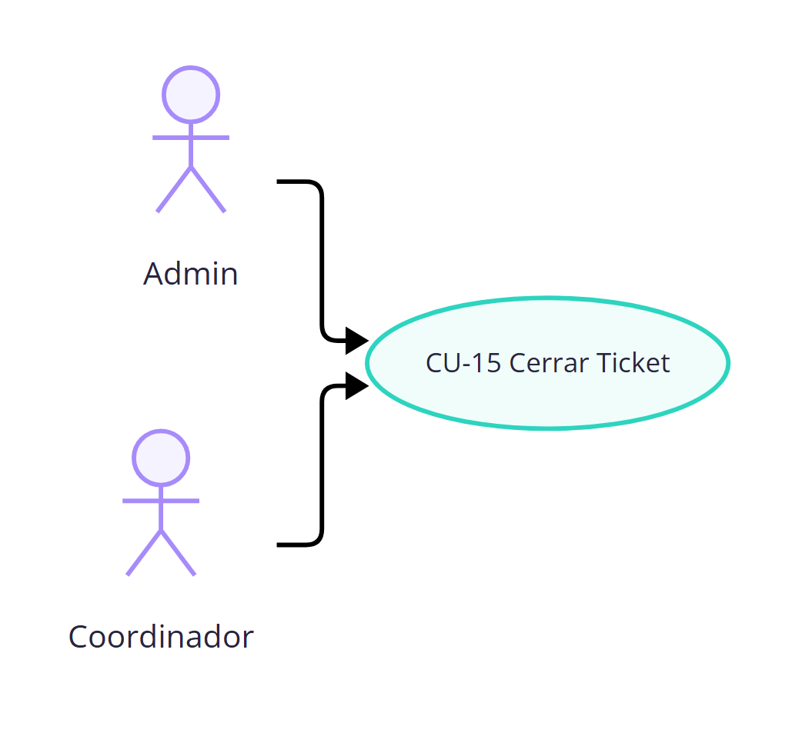
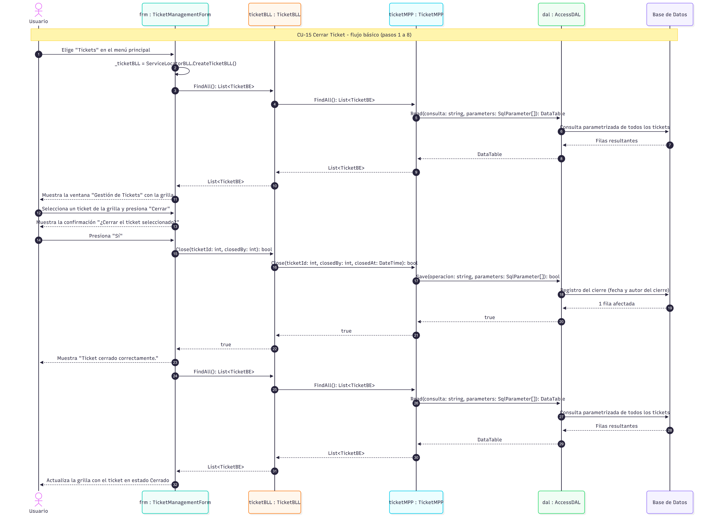
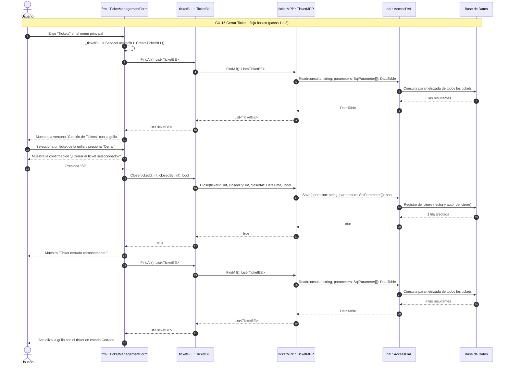
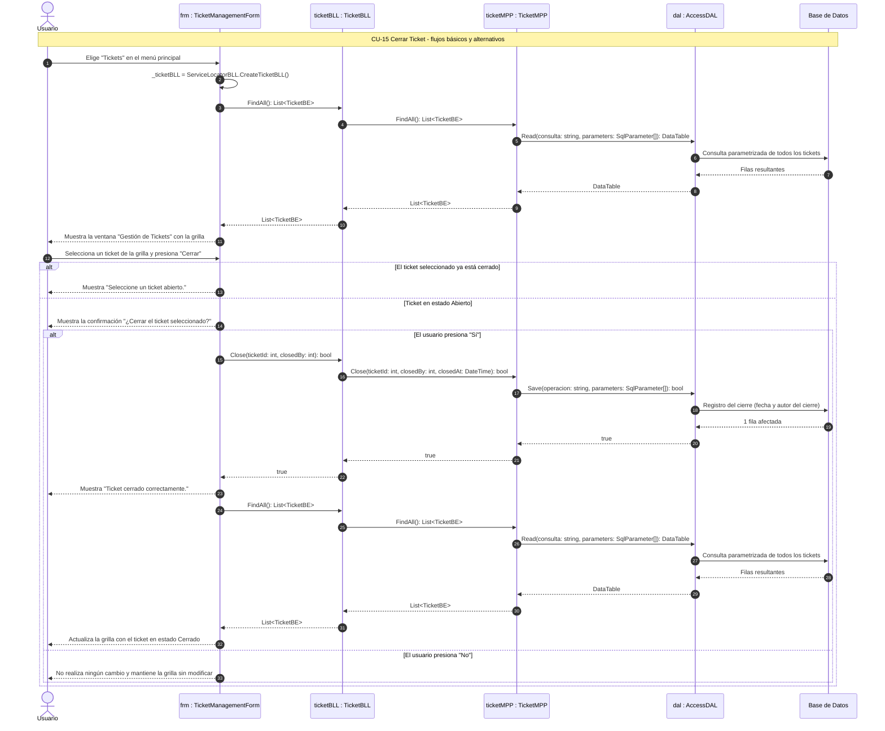

#### 4.15. Especificación de Casos de Uso: CU-15 Cerrar Ticket

#### 4.15.0. Diagramas de Caso de Uso

#### 4.15.1. Carátula

| Campo                   | Valor                                                                                                                                                                                             |
| :---------------------- | :------------------------------------------------------------------------------------------------------------------------------------------------------------------------------------------------ |
| **ID y Nombre**         | CU-15 Cerrar Ticket                                                                                                                                                                               |
| **Estado**              | En Revisión                                                                                                                                                                                       |
| **Descripción**         | Permite al Administrador y al Coordinador cerrar los tickets reportados por los usuarios, dejando constancia de la fecha y el autor del cierre.                                                  |
| **Actor Principal**     | Administrador, Coordinador                                                                                                                                                                        |
| **Actores Secundarios** | Ninguno                                                                                                                                                                                           |
| **Precondiciones**      | El usuario debe haber iniciado sesión con permiso de gestión de tickets y debe existir al menos un ticket registrado.                                                                             |
| **Punto de extensión**  | No aplica                                                                                                                                                                                         |
| **Condición**           | El ticket seleccionado está en estado *Abierto*; al confirmar, el ticket queda en estado *Cerrado*, con la fecha y el autor del cierre registrados.                                                 |

#### 4.15.2. Historial de Revisiones

| Versión | Fecha      | Descripción                                                                                                                          | Autor         |
| :------ | :--------- | :----------------------------------------------------------------------------------------------------------------------------------- | :------------ |
| 1.0     | 19/10/2026 | Creación inicial de la especificación del Caso de Uso                                                                                | Darío Zubaray |
| 1.1     | 16/11/2026 | Separación en CU atómico: este documento queda como caso de uso individual de cierre de tickets (origen: CU-10 Crear Tickets)         | Darío Zubaray |

#### 4.15.3. Objetivo

Permitir al Administrador y al Coordinador cerrar los tickets reportados por los usuarios, dejando registrada la fecha y el autor del cierre.

#### 4.15.4. Precondiciones

- El usuario ha iniciado sesión en el sistema con permiso de gestión de tickets.
- Debe existir al menos un ticket registrado en el sistema.

#### 4.15.5. Puntos de Extensión y Condiciones

- **Punto de Extensión:** No aplica.
- **Condición:** El ticket seleccionado está en estado *Abierto* y el usuario confirma el cierre.

#### 4.15.6. Descripción analítica del Caso de Uso

**Campos que completa el usuario:**

| Campo  | Tipo                  | Obligatorio | Validación                                     |
| :----- | :-------------------- | :---------- | :--------------------------------------------- |
| Ticket | Selección en la grilla | Sí          | Debe tratarse de un ticket en estado *Abierto*. |

Flujo Básico:
1. El usuario elige **Tickets** en el menú principal.
2. El sistema muestra la ventana "Gestión de Tickets" con la grilla de todos los tickets.
3. El usuario selecciona un ticket de la grilla.
4. El usuario presiona el botón **Cerrar**.
5. El sistema muestra la confirmación "¿Cerrar el ticket seleccionado?".
6. El usuario presiona "Sí".
7. El sistema muestra el mensaje "Ticket cerrado correctamente." y vuelve a la grilla con el ticket en estado *Cerrado*, con la fecha y el autor del cierre registrados.
8. Fin del Caso de Uso.

Flujos Alternativos:
- **4.a El ticket seleccionado ya está cerrado:**
  1. El sistema muestra el mensaje "Seleccione un ticket abierto."
  2. El usuario selecciona otro ticket de la grilla y vuelve a presionar "Cerrar".
- **6.a El usuario presiona "No" en la confirmación:**
  1. El sistema no realiza ningún cambio y mantiene la grilla sin modificar.
  2. El usuario puede seleccionar otro ticket o cerrar el formulario.

#### 4.15.7. Modelo de Dominio

Participan las siguientes entidades:
- Ticket (asunto, descripción, estado Abierto/Cerrado, fecha de creación, fecha y autor de cierre)
- Usuario (autor del ticket; el cierre queda asociado a quien lo cierra)

#### 4.15.8. Diagramas de Secuencia

DSS (simple): 

DSD (detallado): 

