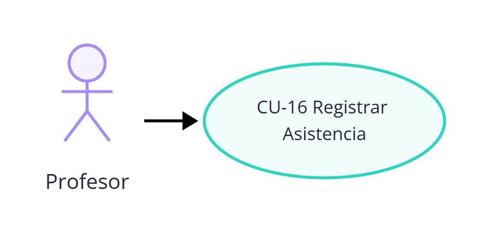
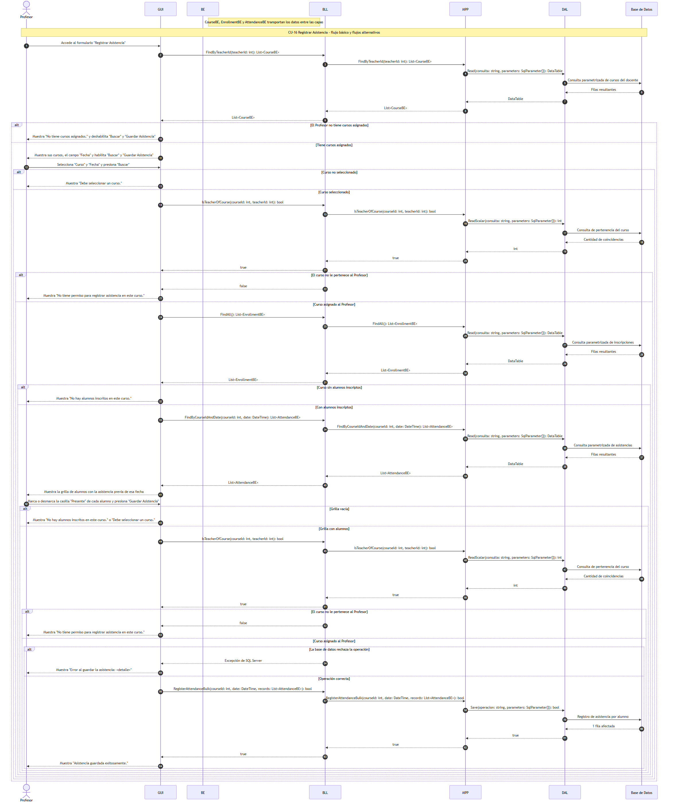
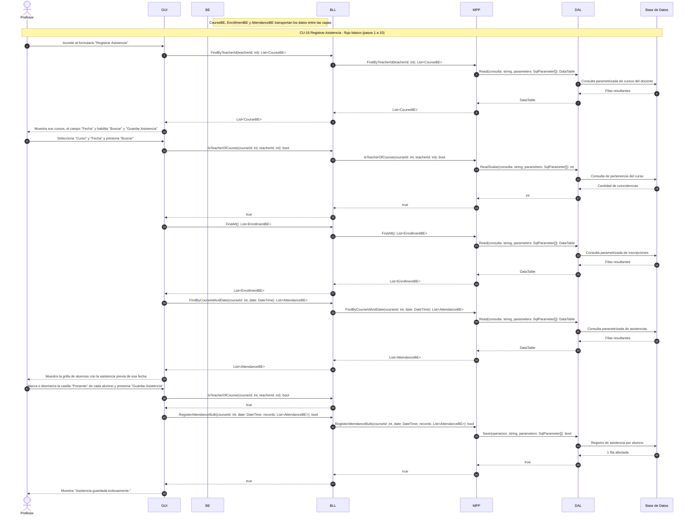
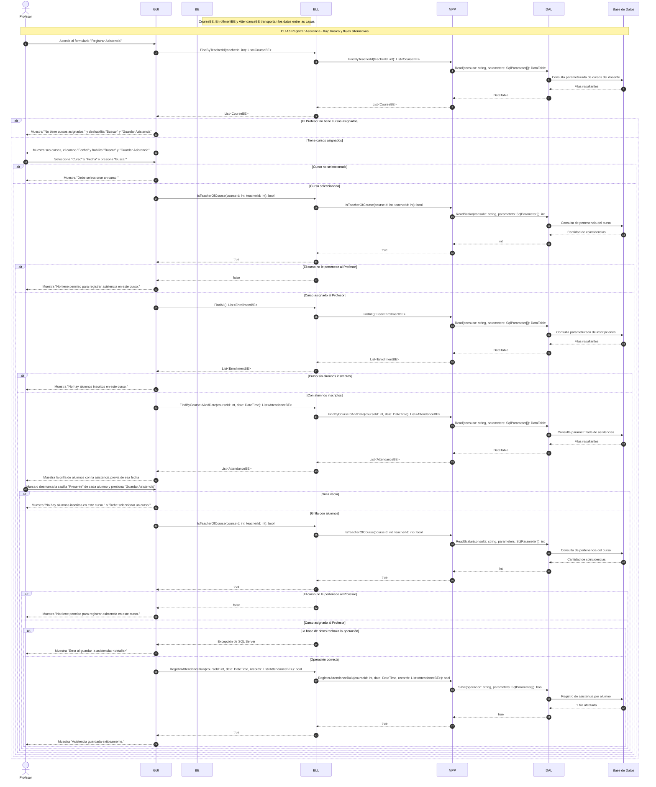

#### 4.16. Especificación de Casos de Uso: CU-16 Registrar Asistencia

#### 4.16.0. Diagramas de Caso de Uso

#### 4.16.1. Carátula

| Campo                   | Valor                                                                                                                                           |
| :---------------------- | :---------------------------------------------------------------------------------------------------------------------------------------------- |
| **ID y Nombre**         | CU-16 Registrar Asistencia                                                                                                                      |
| **Estado**              | En Revisión                                                                                                                                     |
| **Descripción**         | Permite al Profesor registrar la asistencia de los alumnos inscriptos en una clase de uno de sus cursos, marcando quiénes estuvieron presentes. |
| **Actor Principal**     | Profesor                                                                                                                                        |
| **Actores Secundarios** | Ninguno                                                                                                                                         |
| **Precondiciones**      | El Profesor debe tener al menos un curso asignado.                                                                                              |
| **Punto de extensión**  | No aplica                                                                                                                                       |
| **Condición**           | Seleccionó curso y fecha, el curso le pertenece y la planilla fue registrada.                                                                   |

#### 4.16.2. Historial de Revisiones

| Versión | Fecha      | Descripción                                                                                                                                                                                                                       | Autor         |
| :------ | :--------- | :-------------------------------------------------------------------------------------------------------------------------------------------------------------------------------------------------------------------------------- | :------------ |
| 1.0     | 13/09/2026 | Creación inicial de la especificación del Caso de Uso                                                                                                                                                                             | Darío Zubaray |
| 1.1     | 28/10/2026 | Flujo en ping-pong paso por paso con la tabla de campos, alineación con el código (estados "Presente/Ausente" según la casilla de la grilla; control de pertenencia del curso) y regeneración de los diagramas por capa (DSS/DSD) | Darío Zubaray |
| 1.2     | 16/11/2026 | Reenumeración a CU-16 (CUs atómicos) | Darío Zubaray |

#### 4.16.3. Objetivo

Asentar la asistencia por clase de los estudiantes inscriptos en un curso a cargo del docente.

#### 4.16.4. Precondiciones

- El Profesor debe haber iniciado sesión en la aplicación.
- El Profesor debe tener asignado al menos un curso.

#### 4.16.5. Puntos de Extensión y Condiciones

- **Punto de Extensión:** No aplica.
- **Condición:** El Profesor confirma la planilla de asistencia con el botón "Guardar Asistencia".

#### 4.16.6. Descripción analítica del Caso de Uso

**Campos que completa el usuario:**

| Campo | Tipo | Obligatorio | Validación |
| :--- | :--- | :--- | :--- |
| Curso | Lista desplegable | Sí | Debe seleccionarse un curso y el curso debe estar asignado al Profesor. |
| Fecha | Fecha | Sí | Sin validación adicional. |
| Presente (por alumno) | Casilla en la grilla | Sí (una por alumno) | Casilla marcada = Presente; casilla sin marcar = Ausente. |

Flujo Básico:
1. El Profesor accede al formulario "Registrar Asistencia" del menú "Académico".
2. El sistema muestra la lista de sus cursos, el campo "Fecha" y habilita los botones "Buscar" y "Guardar Asistencia".
3. El Profesor selecciona el campo "Curso".
4. El Profesor selecciona el campo "Fecha".
5. El Profesor presiona el botón "Buscar".
6. El sistema muestra la grilla con los alumnos inscriptos en el curso y la asistencia previamente cargada para esa fecha, si la hubiera.
7. El Profesor marca o desmarca la casilla "Presente" de cada alumno.
8. El Profesor presiona el botón "Guardar Asistencia".
9. El sistema muestra el mensaje "Asistencia guardada exitosamente."
10. Fin del Caso de Uso.

Flujos Alternativos:
- **1.a El Profesor no tiene cursos asignados:**
  1. El sistema muestra el mensaje "No tiene cursos asignados." y deja los botones "Buscar" y "Guardar Asistencia" deshabilitados.
  2. Fin del Caso de Uso.
- **5.a Curso no seleccionado:**
  1. El sistema muestra el mensaje "Debe seleccionar un curso."
  2. El Profesor selecciona el campo "Curso" y vuelve a presionar "Buscar".
- **5.b Curso que no le pertenece al Profesor:**
  1. El sistema muestra el mensaje "No tiene permiso para registrar asistencia en este curso."
  2. El Profesor selecciona otro curso de la lista y vuelve a presionar "Buscar".
- **5.c Curso sin alumnos inscriptos:**
  1. El sistema muestra el mensaje "No hay alumnos inscritos en este curso."
  2. El Profesor selecciona otro curso o cierra el formulario.
- **8.a Guardar sin curso seleccionado o con la grilla vacía:**
  1. El sistema muestra el mensaje "Debe seleccionar un curso." o "No hay alumnos inscritos en este curso." (en ese orden de validación).
  2. El Profesor selecciona el curso y fecha, presiona "Buscar" y vuelve a presionar "Guardar Asistencia".
- **8.b Curso que no le pertenece al Profesor:**
  1. El sistema muestra el mensaje "No tiene permiso para registrar asistencia en este curso."
  2. El Profesor selecciona otro curso y vuelve a presionar "Guardar Asistencia".
- **8.c Fecha fuera del período del curso:**
  1. El sistema muestra el mensaje "La fecha de la asistencia debe estar dentro del período del curso. (Código: BIZ-017)".
  2. El Profesor selecciona una fecha dentro del período del curso, vuelve a presionar "Buscar" y luego "Guardar Asistencia".

#### 4.16.7. Modelo de Dominio

Participan las siguientes entidades:
- Curso
- Usuario (alumno inscripto y Profesor)
- Inscripción
- Asistencia

#### 4.16.8. Diagramas de Secuencia

DSS (simple): 

DSD (detallado): 

