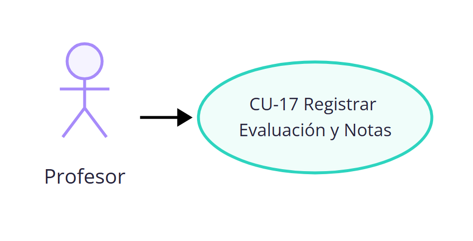
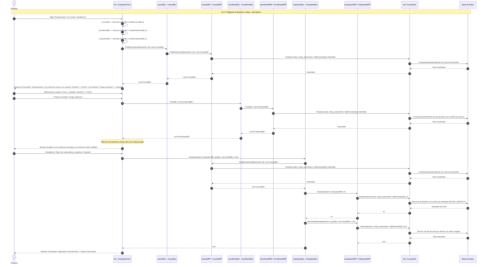
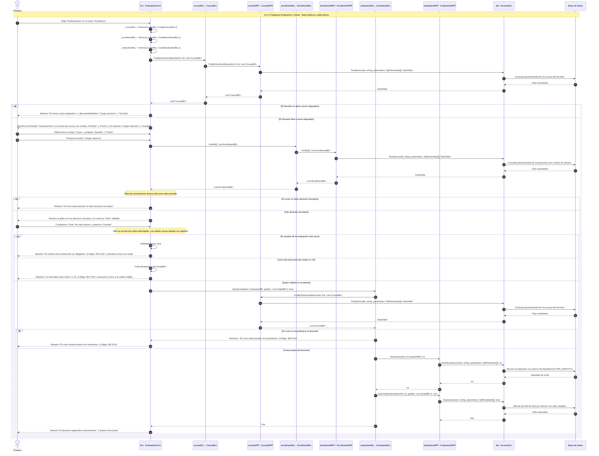

#### 4.17. Especificación de Casos de Uso: CU-17 Registrar Evaluación y Notas

#### 4.17.0. Diagramas de Caso de Uso

#### 4.17.1. Carátula

| Campo                   | Valor                                                                                                                                                                              |
| :---------------------- | :--------------------------------------------------------------------------------------------------------------------------------------------------------------------------------- |
| **ID y Nombre**         | CU-17 Registrar Evaluación y Notas                                                                                                                                                 |
| **Estado**              | En Revisión                                                                                                                                                                        |
| **Descripción**         | Permite al Profesor registrar una evaluación para uno de sus cursos (nombre y fecha) y cargar la nota de cada alumno inscripto. El profesor solo puede evaluar sus propios cursos. |
| **Actor Principal**     | Profesor                                                                                                                                                                           |
| **Actores Secundarios** | Ninguno                                                                                                                                                                            |
| **Precondiciones**      | El usuario debe haber iniciado sesión como Profesor y tener al menos un curso asignado.                                                                                            |
| **Punto de extensión**  | No aplica                                                                                                                                                                          |
| **Condición**           | La evaluación queda registrada con las notas de los alumnos del curso en la base de datos.                                                                                         |

#### 4.17.2. Historial de Revisiones

| Versión | Fecha | Descripción | Autor |
| :--- | :--- | :--- | :--- |
| 1.0 | 29/10/2026 | Creación inicial de la especificación del Caso de Uso (diseño del módulo de evaluaciones) | Darío Zubaray |
| 1.1 | 31/10/2026 | Módulo implementado en la 3ra entrega: SQL v1.3.0 (`evaluations`/`grades`, permiso `FORM_EVAL_MGMT`), `EvaluationBLL`/`EvaluationMPP` y `EvaluationForm` (menú Académico → Evaluaciones) | Darío Zubaray |
| 1.2 | 16/11/2026 | Reenumeración a CU-17 (CUs atómicos) | Darío Zubaray |

#### 4.17.3. Objetivo

Permitir al Profesor evaluar a los alumnos de sus cursos cargando las notas de forma asociada a una evaluación con nombre y fecha.

#### 4.17.4. Precondiciones

- El usuario debe haber iniciado sesión como Profesor.
- El docente debe tener al menos un curso asignado.

#### 4.17.5. Puntos de Extensión y Condiciones

- **Punto de Extensión:** No aplica.
- **Condición:** El curso seleccionado pertenece al docente, el nombre de la evaluación está informado y todas las notas cargadas están en el rango 0 a 10.

#### 4.17.6. Descripción analítica del Caso de Uso

**Campos que completa el usuario:**

| Campo | Tipo | Obligatorio | Validación |
| :--- | :--- | :--- | :--- |
| Curso | Lista desplegable | Sí | Solo se listan los cursos asignados al docente. |
| Nombre | Texto | Sí | No puede estar vacío. |
| Fecha | Fecha | Sí | Debe informarse una fecha. |
| Nota (por alumno) | Grilla (número) | No | Cada nota debe estar entre 0 y 10. El valor vacío indica alumno sin nota en la evaluación. |

Flujo Básico:
1. El usuario elige **Evaluaciones** en el menú "Académico".
2. El sistema muestra el formulario "Evaluaciones" con la lista de sus cursos, los campos "Nombre" y "Fecha" y los botones "Cargar alumnos" y "Guardar".
3. El usuario selecciona el campo "Curso".
4. El usuario completa el campo "Nombre".
5. El usuario completa el campo "Fecha".
6. El usuario presiona el botón "Cargar alumnos".
7. El sistema muestra en la grilla los alumnos inscriptos en el curso con la columna "Nota" editable.
8. El usuario completa la "Nota" de cada alumno.
9. El usuario presiona el botón "Guardar".
10. El sistema registra la evaluación con las notas, muestra el mensaje "Evaluación registrada correctamente." y limpia el formulario.
11. Fin del Caso de Uso.

Flujos Alternativos:
- **2.a El docente no tiene cursos asignados:**
  1. El sistema muestra el mensaje "No tiene cursos asignados." y deja deshabilitados los botones "Cargar alumnos" y "Guardar".
  2. Fin del Caso de Uso.
- **6.a El curso no tiene alumnos inscriptos:**
  1. El sistema muestra el mensaje "El curso seleccionado no tiene alumnos inscriptos." y no carga la grilla.
  2. El usuario selecciona otro curso o cierra el formulario.
- **9.a Nombre de la evaluación vacío:**
  1. El sistema muestra el mensaje "El nombre de la evaluación es obligatorio. (Código: BIZ-013)" y devuelve el foco al campo.
  2. El usuario completa el nombre y vuelve a presionar "Guardar".
- **9.b Nota fuera de rango:**
  1. El sistema muestra el mensaje "La nota debe estar entre 0 y 10. (Código: BIZ-015)" y devuelve el foco a la celda inválida.
  2. El usuario corrige la nota y vuelve a presionar "Guardar".
- **9.c El curso no pertenece al docente (regla de negocio):**
  1. El sistema muestra el mensaje "El curso seleccionado no le pertenece. (Código: BIZ-014)".
  2. El usuario selecciona otro curso o cierra el formulario.

#### 4.17.7. Modelo de Dominio

Participan las siguientes entidades:
- Curso (asignado al docente; restringe qué se puede evaluar)
- Alumno (inscripto al curso; recibe la nota)
- Evaluación (nombre, fecha, curso y docente que la creó)
- Nota (valor entre 0 y 10 de un alumno en una evaluación)

#### 4.17.8. Diagramas de Secuencia

DSS (simple): 

DSD (detallado): 

#### 4.17.9. Notas de implementación

- Tablas nuevas (SQL v1.3.0):
  - `evaluations` (`id`, `course_id` FK → `courses`, `name`, `date`, `created_by` FK → `users`, `created_at`, `last_update`)
  - `grades` (`id`, `evaluation_id` FK → `evaluations`, `student_id` FK → `students`, `grade` decimal, UNIQUE (`evaluation_id`, `student_id`))
- Nuevas entidades y clases (implementadas en la 3ra entrega):
  - `EvaluationBE`, `GradeBE` (BE)
  - `EvaluationMPP` con `Save(evaluation: EvaluationBE): int`, `SaveGrades(evaluationId: int, grades: List<GradeBE>): void`, `FindByCourseId(courseId: int): List<EvaluationBE>`, `FindGradesByEvaluationId(evaluationId: int): List<GradeBE>`
  - `EvaluationBLL` con `Save(evaluation: EvaluationBE, grades: List<GradeBE>): bool`
  - `ServiceLocatorBLL.GetEvaluationMPP` / `CreateEvaluationBLL`
- Códigos de error nuevos: `BIZ-013` (nombre de evaluación obligatorio), `BIZ-014` (curso ajeno al docente), `BIZ-015` (nota fuera de rango) — ya agregados en `ErrorCodesBLL`.
- Recursos nuevos en `Resources.resx` (`EvaluationForm_*`).
- Permiso nuevo tipo `FORM_EVAL_MGMT` para el menú "Académico" → "Evaluaciones", otorgado al rol Profesor (y, por herencia de permisos totales, al Administrador).
