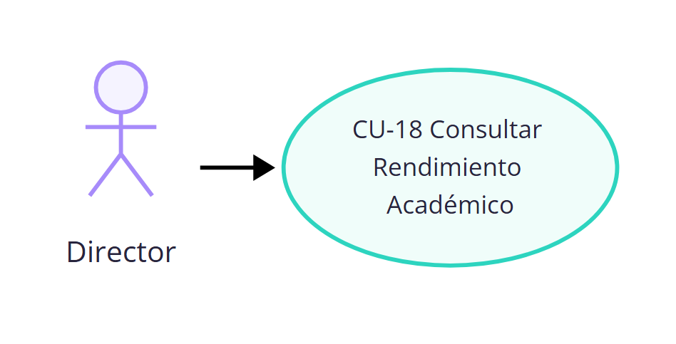
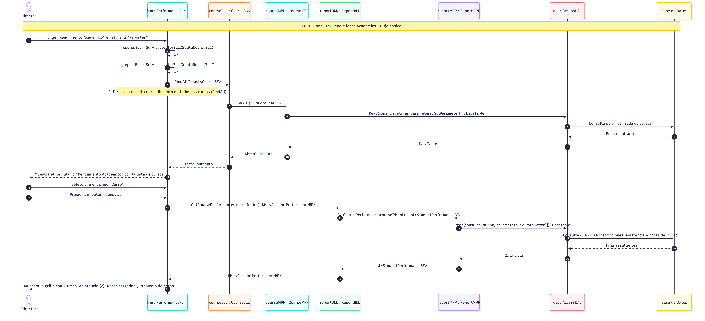
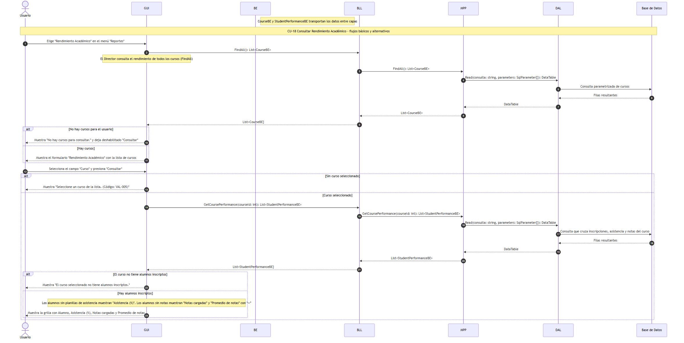
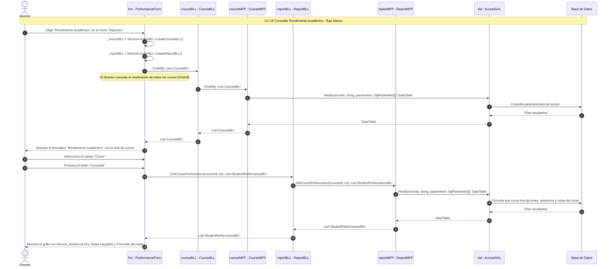
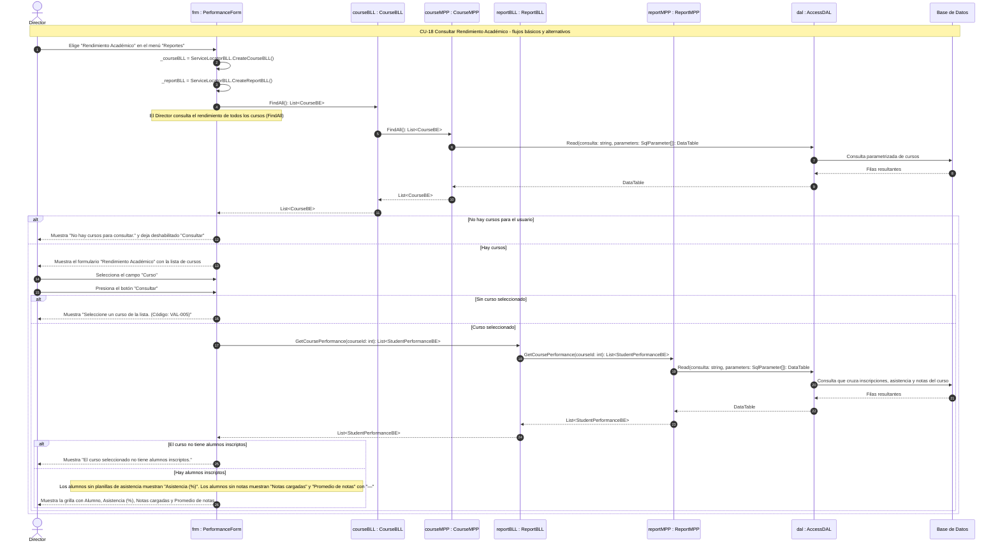

#### 4.18. Especificación de Casos de Uso: CU-18 Consultar Rendimiento Académico

#### 4.18.0. Diagramas de Caso de Uso

#### 4.18.1. Carátula

| Campo                   | Valor                                                                                                                                                                       |
| :---------------------- | :-------------------------------------------------------------------------------------------------------------------------------------------------------------------------- |
| **ID y Nombre**         | CU-18 Consultar Rendimiento Académico                                                                                                                                       |
| **Estado**              | En Revisión                                                                                                                                                                 |
| **Descripción**         | Permite consultar, para un curso seleccionado, el rendimiento académico de cada alumno inscripto: porcentaje de asistencia, cantidad de notas cargadas y promedio de notas. |
| **Actor Principal**     | Director                                                                                                                                                                    |
| **Actores Secundarios** | Ninguno                                                                                                                                                                     |
| **Precondiciones**      | El usuario debe haber iniciado sesión con el permiso de reportes (`FORM_REPORTS`) y debe existir al menos un curso.                                                         |
| **Punto de extensión**  | No aplica                                                                                                                                                                   |
| **Condición**           | El sistema muestra en pantalla la grilla de rendimiento del curso seleccionado.                                                                                             |

#### 4.18.2. Historial de Revisiones

| Versión | Fecha | Descripción | Autor |
| :--- | :--- | :--- | :--- |
| 1.0 | 29/10/2026 | Creación inicial de la especificación del Caso de Uso (diseño del módulo de rendimiento) | Darío Zubaray |
| 1.1 | 31/10/2026 | Módulo implementado en la 3ra entrega: SQL v1.3.0 (permisos `FORM_REPORTS`), `ReportMPP`/`ReportBLL` y `PerformanceForm` (menú Reportes → Rendimiento Académico) | Darío Zubaray |
| 1.2 | 04/11/2026 | Alineación con el modelo de actores: CU-18 solo Director; se revoca `FORM_REPORTS` de los roles Profesor y Coordinador (SQL v1.3.0) | Darío Zubaray |
| 1.3 | 16/11/2026 | Reenumeración a CU-18 (CUs atómicos) | Darío Zubaray |

#### 4.18.3. Objetivo

Brindar a los roles con permiso de reportes una vista consolidada del rendimiento de los alumnos de un curso, combinando asistencia y notas.

#### 4.18.4. Precondiciones

- El usuario debe haber iniciado sesión con el permiso `FORM_REPORTS`.
- Debe existir al menos un curso en el sistema.

#### 4.18.5. Puntos de Extensión y Condiciones

- **Punto de Extensión:** No aplica.
- **Condición:** Se selecciona un curso y el curso tiene al menos un alumno inscripto.

#### 4.18.6. Descripción analítica del Caso de Uso

**Campos que completa el usuario:**

| Campo | Tipo | Obligatorio | Validación |
| :--- | :--- | :--- | :--- |
| Curso | Lista desplegable | Sí | Debe seleccionarse un curso. Los demás roles ven todos los cursos. |

**Indicadores que muestra el sistema (calculados por curso):**

| Indicador | Definición | Sin datos |
| :--- | :--- | :--- |
| Asistencia (%) | (planillas de asistencia con estado presente / total de planillas de asistencia del curso) × 100, redondeado a entero. | "—" si el curso no tiene planillas cargadas. |
| Notas cargadas | Cantidad de notas registradas del alumno en las evaluaciones del curso. | "—" si el alumno no tiene notas. |
| Promedio de notas | Promedio aritmético de las notas cargadas del alumno, con dos decimales. | "—" si el alumno no tiene notas. |

Flujo Básico:
1. El usuario elige **Rendimiento Académico** en el menú "Reportes".
2. El sistema muestra el formulario "Rendimiento Académico" con la lista de cursos y el botón "Consultar".
3. El usuario selecciona el campo "Curso".
4. El usuario presiona el botón "Consultar".
5. El sistema muestra la grilla con una fila por alumno inscripto y las columnas "Alumno", "Asistencia (%)", "Notas cargadas" y "Promedio de notas".
6. Fin del Caso de Uso.

Flujos Alternativos:
- **2.a No hay cursos para el usuario:**
  1. El sistema muestra el mensaje "No hay cursos para consultar." y deja deshabilitado el botón "Consultar".
  2. Fin del Caso de Uso.
- **4.a Sin curso seleccionado:**
  1. El sistema muestra el mensaje "Seleccione un curso de la lista. (Código: VAL-005)".
  2. El usuario selecciona el campo "Curso" y vuelve a presionar "Consultar".
- **4.b El curso no tiene alumnos inscriptos:**
  1. El sistema muestra el mensaje "El curso seleccionado no tiene alumnos inscriptos." y no carga la grilla.
  2. El usuario selecciona otro curso o cierra el formulario.
- **4.c El curso no tiene planillas de asistencia cargadas:**
  1. El sistema muestra la columna "Asistencia (%)" con el valor "—" para todos los alumnos.
  2. Fin del Caso de Uso.
- **4.d Un alumno no tiene notas cargadas:**
  1. El sistema muestra "—" en las columnas "Notas cargadas" y "Promedio de notas" de ese alumno.
  2. Fin del Caso de Uso.

#### 4.18.7. Modelo de Dominio

Participan las siguientes entidades:
- Curso (seleccionado para la consulta)
- Alumno (inscripto al curso)
- Asistencia (planillas de asistencia del curso, para el porcentaje)
- Evaluación y Nota (para el promedio y la cantidad de notas cargadas)

#### 4.18.8. Diagramas de Secuencia

DSS (simple): 

DSD (detallado): 

#### 4.18.9. Notas de implementación

- Nueva entidad y clases (implementadas en la 3ra entrega):
  - `StudentPerformanceBE` (`StudentId`, `StudentName`, `AttendancePercent` nullable, `GradesCount`, `Average` nullable)
  - `ReportMPP.GetCoursePerformance(courseId: int): List<StudentPerformanceBE>` (una consulta con `JOIN` a `students`, `course_students`, `attendance` y `grades`)
  - `ReportBLL.GetCoursePerformance(courseId: int): List<StudentPerformanceBE>`
  - `ServiceLocatorBLL.GetReportMPP` / `CreateReportBLL`
- Recursos nuevos en `Resources.resx` (`PerformanceForm_*`).
- Menú nuevo "Reportes" en `MainForm` (visibilidad por permiso `FORM_REPORTS`), con el ítem "Rendimiento Académico".
- Permiso `FORM_REPORTS` (SQL v1.3.0, otorgado a los roles Admin y Director).
- Las columnas con "—" se implementan con valores nulos en `StudentPerformanceBE` y formato de celda personalizado.
