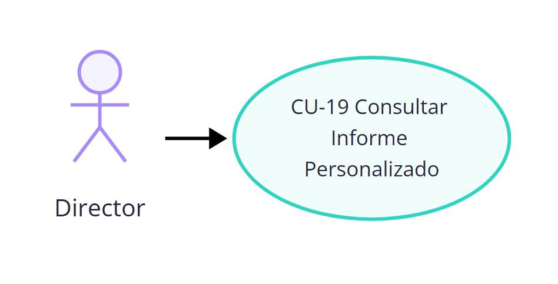
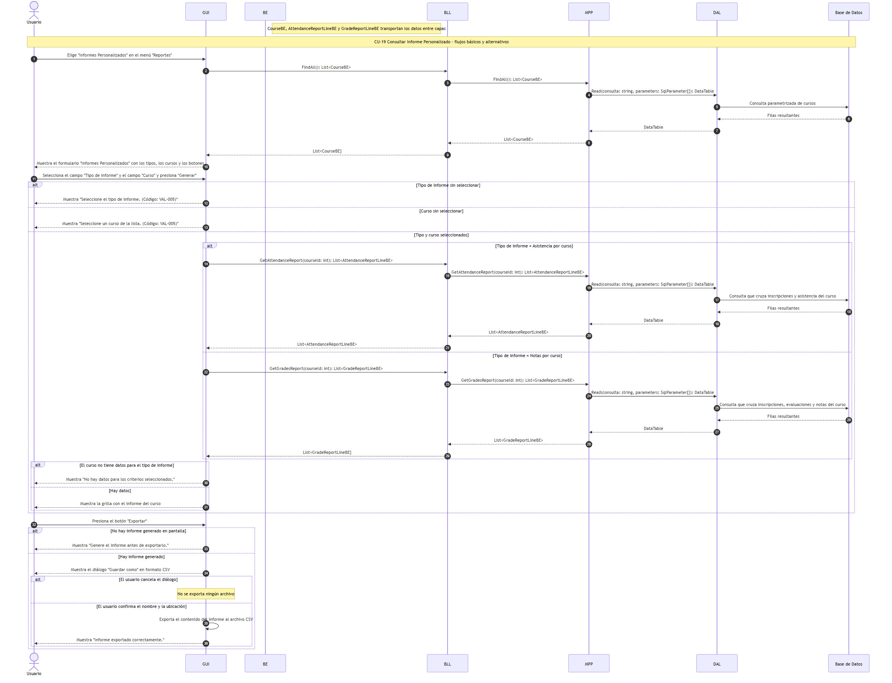
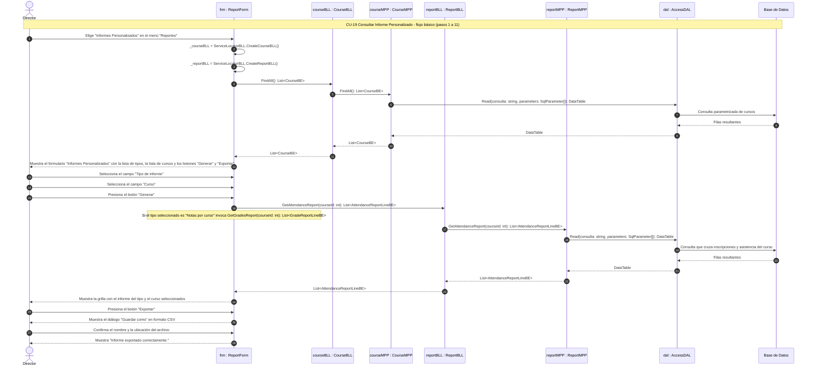
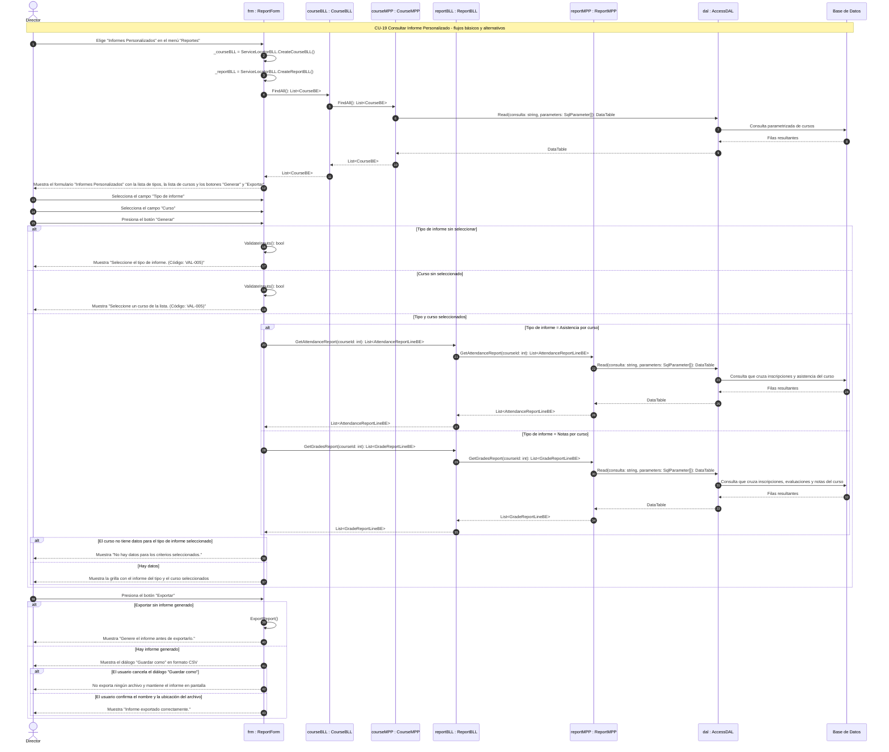

#### 4.19. Especificación de Casos de Uso: CU-19 Consultar Informe Personalizado

#### 4.19.0. Diagramas de Caso de Uso

#### 4.19.1. Carátula

| Campo                   | Valor                                                                                                                                                                      |
| :---------------------- | :------------------------------------------------------------------------------------------------------------------------------------------------------------------------- |
| **ID y Nombre**         | CU-19 Consultar Informe Personalizado                                                                                                                                     |
| **Estado**              | En Revisión                                                                                                                                                                |
| **Descripción**         | Permite generar en pantalla un informe académico de un curso (asistencia o notas) según el tipo seleccionado, y exportarlo a un archivo CSV para su impresión.              |
| **Actor Principal**     | Director                                                                                                                                                                   |
| **Actores Secundarios** | Ninguno                                                                                                                                                                    |
| **Precondiciones**      | El usuario debe haber iniciado sesión con el permiso de informes personalizados (`FORM_REPORT_DETAIL`, otorgado a los roles Admin y Director) y debe existir al menos un curso. |
| **Punto de extensión**  | No aplica                                                                                                                                                                  |
| **Condición**           | El informe queda mostrado en pantalla y, si se exporta, generado como archivo CSV en la ubicación elegida por el usuario.                                                  |

#### 4.19.2. Historial de Revisiones

| Versión | Fecha      | Descripción                                                                                                                                             | Autor         |
| :------ | :--------- | :------------------------------------------------------------------------------------------------------------------------------------------------------ | :------------ |
| 1.0     | 29/10/2026 | Creación inicial de la especificación del Caso de Uso (diseño del módulo de informes)                                                                    | Darío Zubaray |
| 1.1     | 16/11/2026 | Renumeración de CU-14 a CU-19 y unificación de los flujos de generar y exportar en un solo Flujo Básico                                                  | Darío Zubaray |

#### 4.19.3. Objetivo

Brindar a los roles con permiso de reportes la posibilidad de generar informes académicos por curso (asistencia o notas) y exportarlos para su impresión o distribución.

#### 4.19.4. Precondiciones

- El usuario debe haber iniciado sesión con el permiso `FORM_REPORT_DETAIL`.
- Debe existir al menos un curso en el sistema.

#### 4.19.5. Puntos de Extensión y Condiciones

- **Punto de Extensión:** No aplica.
- **Condición:** Se seleccionan el tipo de informe y el curso, y el curso tiene datos que mostrar para el tipo elegido.

#### 4.19.6. Descripción analítica del Caso de Uso

**Campos que completa el usuario:**

| Campo           | Tipo               | Obligatorio | Validación                                                       |
| :-------------- | :----------------- | :---------- | :--------------------------------------------------------------- |
| Tipo de informe | Lista desplegable  | Sí          | Debe seleccionarse un tipo: "Asistencia por curso" o "Notas por curso". |
| Curso           | Lista desplegable  | Sí          | Debe seleccionarse un curso.                                     |

**Contenido de cada tipo de informe:**

| Tipo de informe      | Columnas del informe                                    |
| :------------------- | :------------------------------------------------------ |
| Asistencia por curso | Alumno, Planillas, Presentes, Asistencia (%)           |
| Notas por curso      | Alumno, Evaluaciones, Notas cargadas, Promedio de notas |

Flujo Básico:
1. El usuario elige **Informes Personalizados** en el menú "Reportes".
2. El sistema muestra el formulario "Informes Personalizados" con la lista de tipos de informe, la lista de cursos y los botones "Generar" y "Exportar".
3. El usuario selecciona el campo "Tipo de informe".
4. El usuario selecciona el campo "Curso".
5. El usuario presiona el botón "Generar".
6. El sistema muestra la grilla con el informe del tipo y el curso seleccionados.
7. El usuario presiona el botón "Exportar".
8. El sistema muestra el diálogo "Guardar como" en formato CSV.
9. El usuario confirma el nombre y la ubicación del archivo.
10. El sistema muestra el mensaje "Informe exportado correctamente."
11. Fin del Caso de Uso.

Flujos Alternativos:
- **5.a Tipo de informe sin seleccionar:**
  1. El sistema muestra el mensaje "Seleccione el tipo de informe. (Código: VAL-005)".
  2. El usuario selecciona el tipo de informe y vuelve a presionar "Generar".
- **5.b Curso sin seleccionado:**
  1. El sistema muestra el mensaje "Seleccione un curso de la lista. (Código: VAL-005)".
  2. El usuario selecciona el curso y vuelve a presionar "Generar".
- **5.c El curso no tiene datos para el tipo de informe seleccionado:**
  1. El sistema muestra el mensaje "No hay datos para los criterios seleccionados." y no carga la grilla.
  2. El usuario selecciona otro curso o cierra el formulario.
- **7.a Exportar sin informe generado:**
  1. El sistema muestra el mensaje "Genere el informe antes de exportarlo."
  2. El usuario genera el informe y vuelve a presionar "Exportar".
- **9.a El usuario cancela el diálogo "Guardar como":**
  1. El sistema no exporta ningún archivo y mantiene el informe en pantalla.
  2. El usuario puede volver a presionar "Exportar" o cerrar el formulario.

#### 4.19.7. Modelo de Dominio

Participan las siguientes entidades:
- Curso (seleccionado para el informe)
- Alumno (inscripto al curso)
- Asistencia (planillas del curso, para el informe de asistencia)
- Evaluación y Nota (para el informe de notas)

#### 4.19.8. Diagramas de Secuencia

DSS (simple): 

DSD (detallado): 

#### 4.19.9. Notas de implementación

- Nuevas entidades y clases (implementadas en la 3ra entrega):
  - `AttendanceReportLineBE` (`StudentId`, `StudentName`, `TotalPlans`, `PresentPlans`, `AttendancePercent`)
  - `GradeReportLineBE` (`StudentId`, `StudentName`, `EvaluationsCount`, `GradesCount`, `Average` nullable)
  - `ReportMPP.GetAttendanceReport(courseId: int): List<AttendanceReportLineBE>` y
    `ReportMPP.GetGradesReport(courseId: int): List<GradeReportLineBE>`
  - `ReportBLL.GetAttendanceReport(courseId: int): List<AttendanceReportLineBE>` y
    `ReportBLL.GetGradesReport(courseId: int): List<GradeReportLineBE>`
  - Se reutiliza `ServiceLocatorBLL.GetReportMPP` / `CreateReportBLL` (compartidos con CU-18)
- La exportación a CSV se resuelve en la capa GUI (sin pasar por BLL) usando el diálogo `SaveFileDialog` y
  escritura del archivo con separador punto y coma (compatible con Excel en español).
- Recursos nuevos en `Resources.resx` (`ReportForm_*`).
- Menú "Reportes" en `MainForm`: el ítem "Informes Personalizados" es visible con el permiso `FORM_REPORT_DETAIL`
  (SQL v1.3.0, roles Admin y Director).
