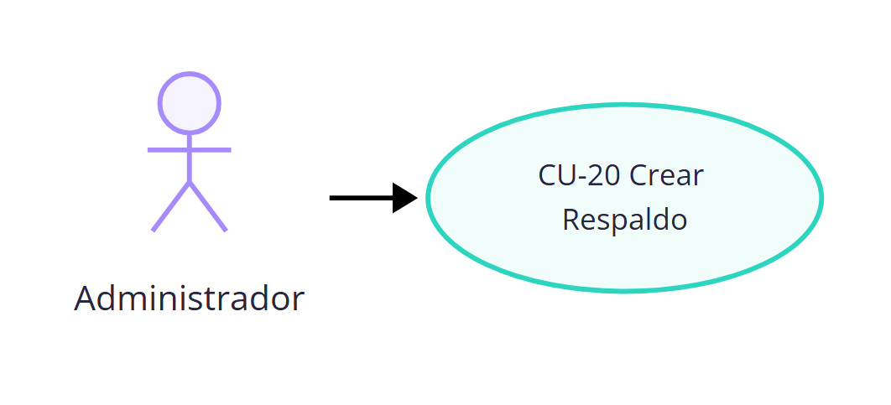
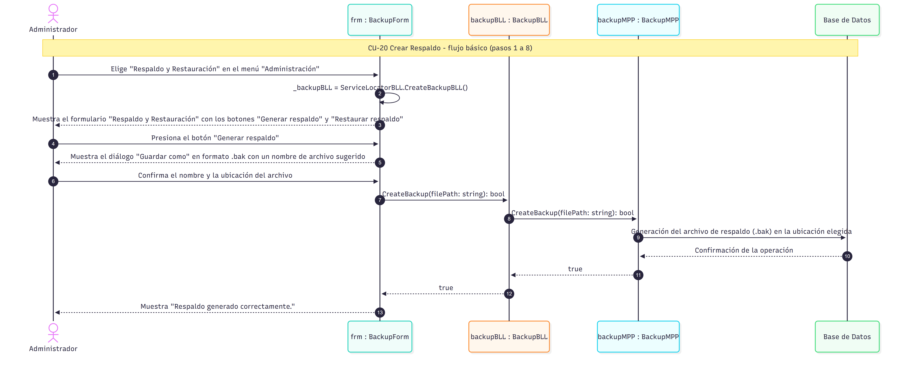
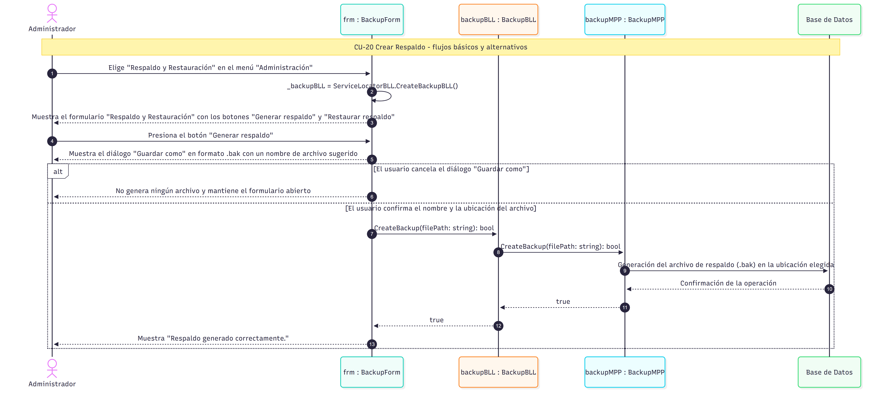
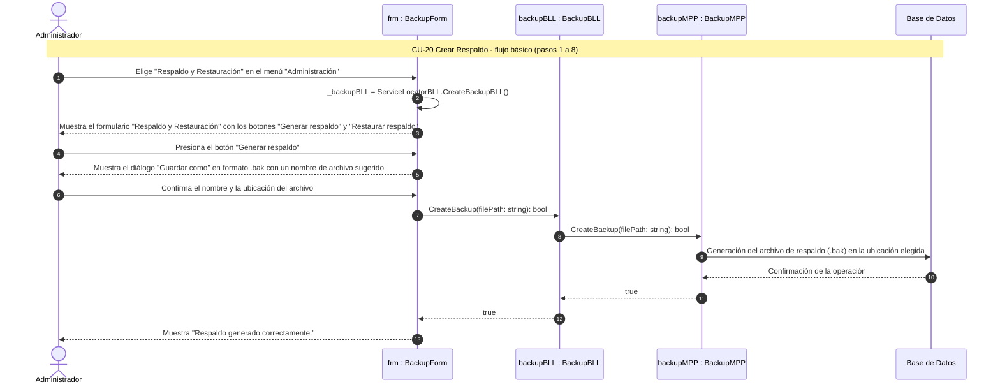
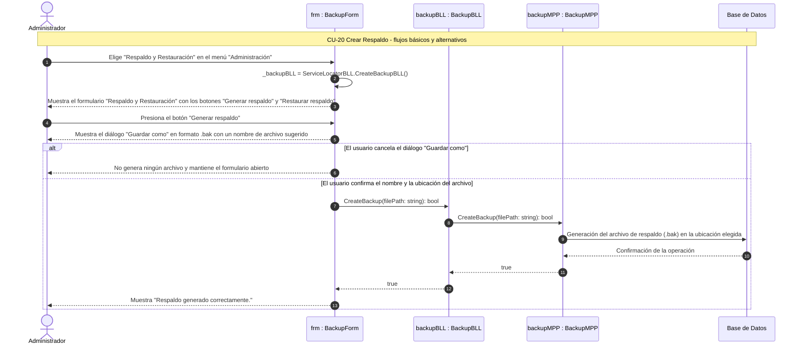

#### 4.20. Especificación de Casos de Uso: CU-20 Crear Respaldo

#### 4.20.0. Diagramas de Caso de Uso

#### 4.20.1. Carátula

| Campo                   | Valor                                                                                                                                                                |
| :---------------------- | :------------------------------------------------------------------------------------------------------------------------------------------------------------------- |
| **ID y Nombre**         | CU-20 Crear Respaldo                                                                                                                                                 |
| **Estado**              | En Revisión                                                                                                                                                          |
| **Descripción**         | Permite al Administrador generar un archivo de respaldo (.bak) de la base de datos del sistema en la ubicación que elige, desde la aplicación.                        |
| **Actor Principal**     | Administrador                                                                                                                                                        |
| **Actores Secundarios** | Ninguno                                                                                                                                                              |
| **Precondiciones**      | El usuario debe haber iniciado sesión con el permiso de respaldo (`FORM_BACKUP_MGMT`).                                                                               |
| **Punto de extensión**  | No aplica                                                                                                                                                            |
| **Condición**           | El respaldo queda generado como archivo .bak en la ubicación elegida por el usuario.                                                                                 |

#### 4.20.2. Historial de Revisiones

| Versión | Fecha     | Descripción                                                                                                                                    | Autor         |
| :------ | :-------- | :--------------------------------------------------------------------------------------------------------------------------------------------- | :------------ |
| 1.0     | 31/10/2026 | Creación inicial de la especificación del Caso de Uso y módulo implementado (SQL v1.3.0, `BackupBLL`/`BackupMPP`, `BackupForm`)                | Darío Zubaray |
| 1.1     | 16/11/2026 | Reestructuración en CU atómico: este documento queda como caso de uso individual de generación de respaldo                                       | Darío Zubaray |

#### 4.20.3. Objetivo

Permitir al Administrador proteger la información del sistema mediante un respaldo de la base de datos, desde la aplicación y sin intervención manual en SQL Server.

#### 4.20.4. Precondiciones

- El usuario debe haber iniciado sesión con el permiso `FORM_BACKUP_MGMT`.

#### 4.20.5. Puntos de Extensión y Condiciones

- **Punto de Extensión:** No aplica.
- **Condición:** Se elige un destino para el archivo y el respaldo se genera en la ubicación elegida.

#### 4.20.6. Descripción analítica del Caso de Uso

**Campos que completa el usuario:**

| Campo                     | Tipo                                  | Obligatorio | Validación                                                          |
| :------------------------ | :------------------------------------ | :---------- | :------------------------------------------------------------------ |
| Archivo de respaldo (destino) | Diálogo "Guardar como" (.bak)     | Sí          | El usuario confirma o cancela el diálogo; no se ingresa la ruta a mano. |

Flujo Básico:
1. El usuario elige **Respaldo y Restauración** en el menú "Administración".
2. El sistema muestra el formulario "Respaldo y Restauración" con los botones "Generar respaldo" y "Restaurar respaldo".
3. El usuario presiona el botón "Generar respaldo".
4. El sistema muestra el diálogo "Guardar como" en formato .bak con un nombre de archivo sugerido.
5. El usuario confirma el nombre y la ubicación del archivo.
6. El sistema genera el archivo de respaldo de la base de datos en la ubicación elegida.
7. El sistema muestra el mensaje "Respaldo generado correctamente." confirmando el archivo en la ubicación elegida.
8. Fin del Caso de Uso.

Flujos Alternativos:
- **5.a El usuario cancela el diálogo "Guardar como":**
  1. El sistema no genera ningún archivo y mantiene el formulario abierto.
  2. El usuario vuelve a presionar "Generar respaldo" o cierra el formulario.

#### 4.20.7. Modelo de Dominio

Participan las siguientes entidades:
- Base de datos del sistema (objeto del respaldo)
- Archivo de respaldo .bak (artefacto generado por el usuario)

#### 4.20.8. Diagramas de Secuencia

DSS (simple): 

DSD (detallado): 

#### 4.20.9. Notas de implementación

- Nuevas clases (implementadas en la 3ra entrega):
  - `BackupBLL.CreateBackup(string filePath): bool` (delega en MPP; sin reglas de negocio)
  - `BackupMPP.CreateBackup`: `BACKUP DATABASE` con parámetro de ruta, ejecutado sobre la base del sistema
  - `ServiceLocatorBLL.GetBackupMPP` / `CreateBackupBLL`
- Permiso `FORM_BACKUP_MGMT` (SQL v1.3.0, otorgado solo al rol Admin; el patrón "Admin: todos los permisos" lo propaga).
- Menú "Administración" → "Respaldo y Restauración" en `MainForm` (visibilidad por permiso `FORM_BACKUP_MGMT`).
- Recursos nuevos en `Resources.resx` (`BackupForm_*`, `Main_MenuBackup`).
