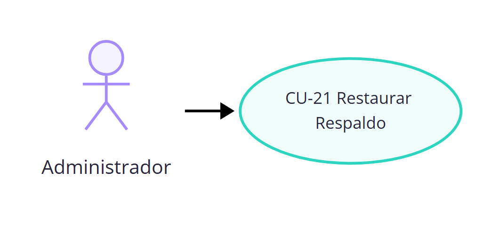
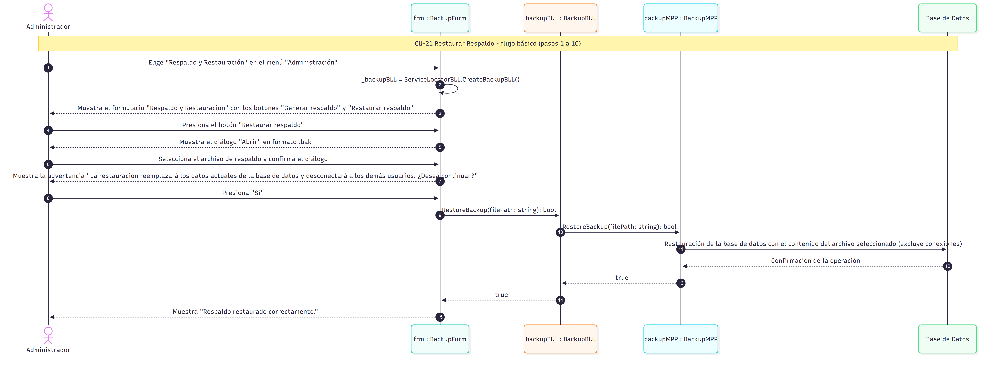
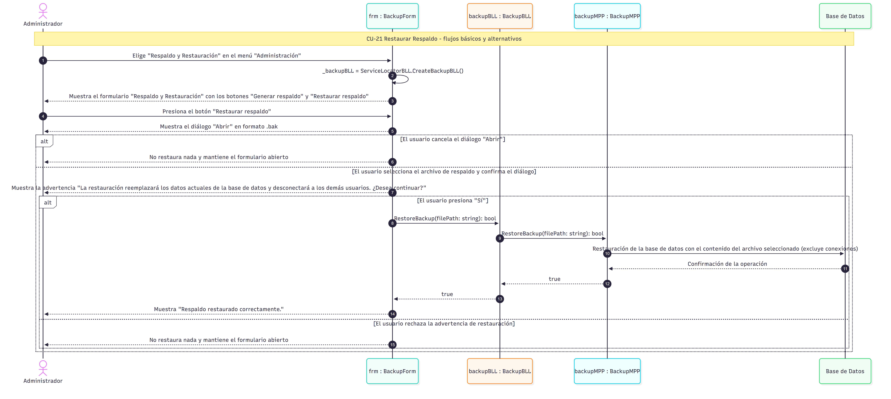
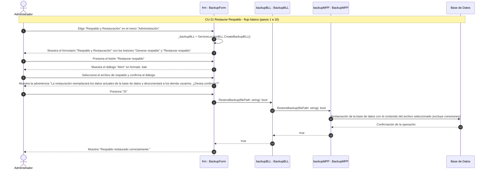
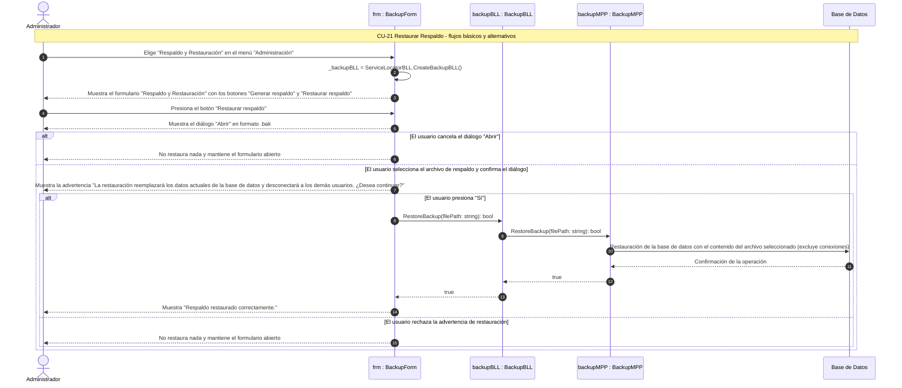

#### 4.21. Especificación de Casos de Uso: CU-21 Restaurar Respaldo

#### 4.21.0. Diagramas de Caso de Uso

#### 4.21.1. Carátula

| Campo                   | Valor                                                                                                                                                                     |
| :---------------------- | :------------------------------------------------------------------------------------------------------------------------------------------------------------------------ |
| **ID y Nombre**         | CU-21 Restaurar Respaldo                                                                                                                                                  |
| **Estado**              | En Revisión                                                                                                                                                               |
| **Descripción**         | Permite al Administrador restaurar la base de datos del sistema desde un archivo de respaldo (.bak) seleccionado, reemplazando los datos actuales.                         |
| **Actor Principal**     | Administrador                                                                                                                                                             |
| **Actores Secundarios** | Ninguno                                                                                                                                                                   |
| **Precondiciones**      | El usuario debe haber iniciado sesión con el permiso de respaldo (`FORM_BACKUP_MGMT`) y debe existir un archivo de respaldo válido generado por el sistema.                |
| **Punto de extensión**  | No aplica                                                                                                                                                                 |
| **Condición**           | La base de datos queda restaurada con el contenido del archivo seleccionado; los datos actuales quedan reemplazados.                                                      |

#### 4.21.2. Historial de Revisiones

| Versión | Fecha     | Descripción                                                                                                                                      | Autor         |
| :------ | :-------- | :----------------------------------------------------------------------------------------------------------------------------------------------- | :------------ |
| 1.0     | 31/10/2026 | Creación inicial de la especificación del Caso de Uso y módulo implementado (SQL v1.3.0, `BackupBLL`/`BackupMPP`, `BackupForm`)                  | Darío Zubaray |
| 1.1     | 16/11/2026 | Reestructuración en CU atómico: este documento queda como caso de uso individual de restauración de respaldo                                       | Darío Zubaray |

#### 4.21.3. Objetivo

Permitir al Administrador recuperar la información del sistema ante una eventual pérdida, restaurando la base de datos desde un archivo de respaldo, desde la aplicación y sin intervención manual en SQL Server.

#### 4.21.4. Precondiciones

- El usuario debe haber iniciado sesión con el permiso `FORM_BACKUP_MGMT`.
- Debe existir un archivo de respaldo válido de la base de datos del sistema.

#### 4.21.5. Puntos de Extensión y Condiciones

- **Punto de Extensión:** No aplica.
- **Condición:** Se selecciona un archivo de respaldo de origen y la restauración se completa con el contenido del archivo.

#### 4.21.6. Descripción analítica del Caso de Uso

**Campos que completa el usuario:**

| Campo                      | Tipo                        | Obligatorio | Validación                                                          |
| :------------------------- | :-------------------------- | :---------- | :------------------------------------------------------------------ |
| Archivo de respaldo (origen) | Diálogo "Abrir" (.bak)    | Sí          | El usuario selecciona un archivo .bak y confirma el diálogo; no se ingresa la ruta a mano. |

Flujo Básico:
1. El usuario elige **Respaldo y Restauración** en el menú "Administración".
2. El sistema muestra el formulario "Respaldo y Restauración" con los botones "Generar respaldo" y "Restaurar respaldo".
3. El usuario presiona el botón "Restaurar respaldo".
4. El sistema muestra el diálogo "Abrir" en formato .bak.
5. El usuario selecciona el archivo de respaldo y confirma el diálogo.
6. El sistema muestra la advertencia "La restauración reemplazará los datos actuales de la base de datos y desconectará a los demás usuarios. ¿Desea continuar?"
7. El usuario presiona "Sí".
8. El sistema restaura la base de datos con el contenido del archivo seleccionado.
9. El sistema muestra el mensaje "Respaldo restaurado correctamente." y la base de datos queda con el contenido del archivo seleccionado (los datos actuales quedan reemplazados).
10. Fin del Caso de Uso.

Flujos Alternativos:
- **5.a El usuario cancela el diálogo "Abrir":**
  1. El sistema no restaura nada y mantiene el formulario abierto.
  2. El usuario selecciona otro archivo o cierra el formulario.
- **7.a El usuario rechaza la advertencia de restauración:**
  1. El usuario presiona "No" y el sistema no restaura nada, manteniendo el formulario abierto.
  2. El usuario vuelve a presionar "Restaurar respaldo" o cierra el formulario.

#### 4.21.7. Modelo de Dominio

Participan las siguientes entidades:
- Base de datos del sistema (objeto de la restauración)
- Archivo de respaldo .bak (artefacto seleccionado por el usuario)

#### 4.21.8. Diagramas de Secuencia

DSS (simple): 

DSD (detallado): 

#### 4.21.9. Notas de implementación

- `BackupBLL.RestoreBackup(string filePath): bool` y `BackupMPP.RestoreBackup` (delegan en MPP; sin reglas de negocio):
  conexión a `master` para excluir las conexiones (`SET SINGLE_USER WITH ROLLBACK IMMEDIATE`),
  `RESTORE DATABASE ... WITH REPLACE` y restauración de `MULTI_USER`.
- La restauración desconecta a los demás usuarios de la base de datos durante la operación; es una
  operación exclusiva del Administrador (permiso `FORM_BACKUP_MGMT`, SQL v1.3.0).
- Comparte formulario y permiso con el CU-20 Crear Respaldo (`MainForm` → "Administración" → "Respaldo y Restauración").
