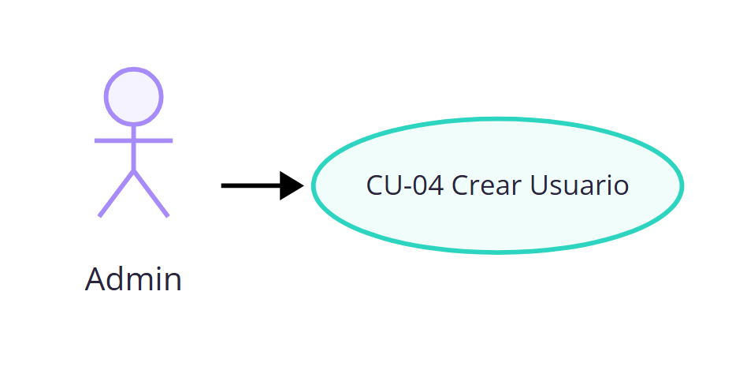
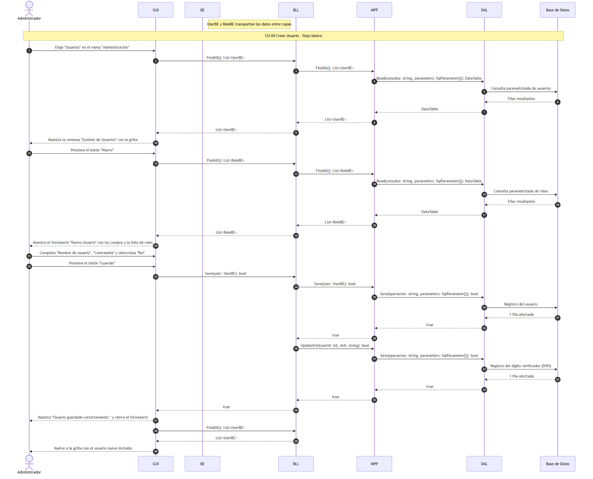
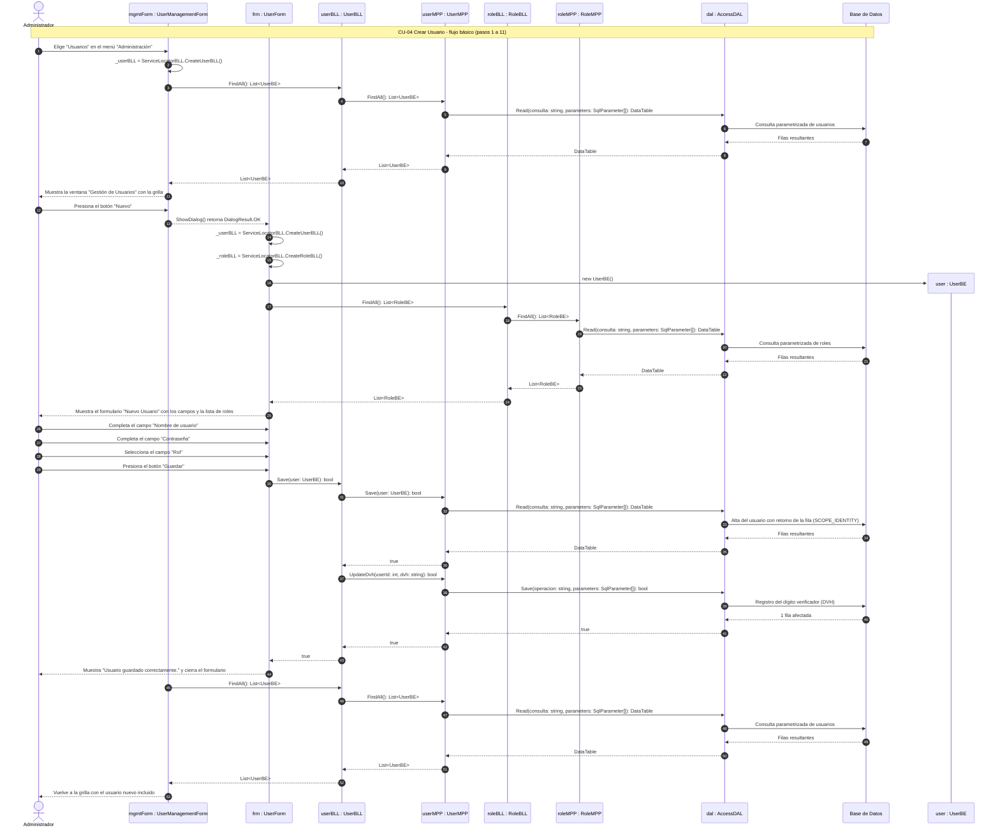
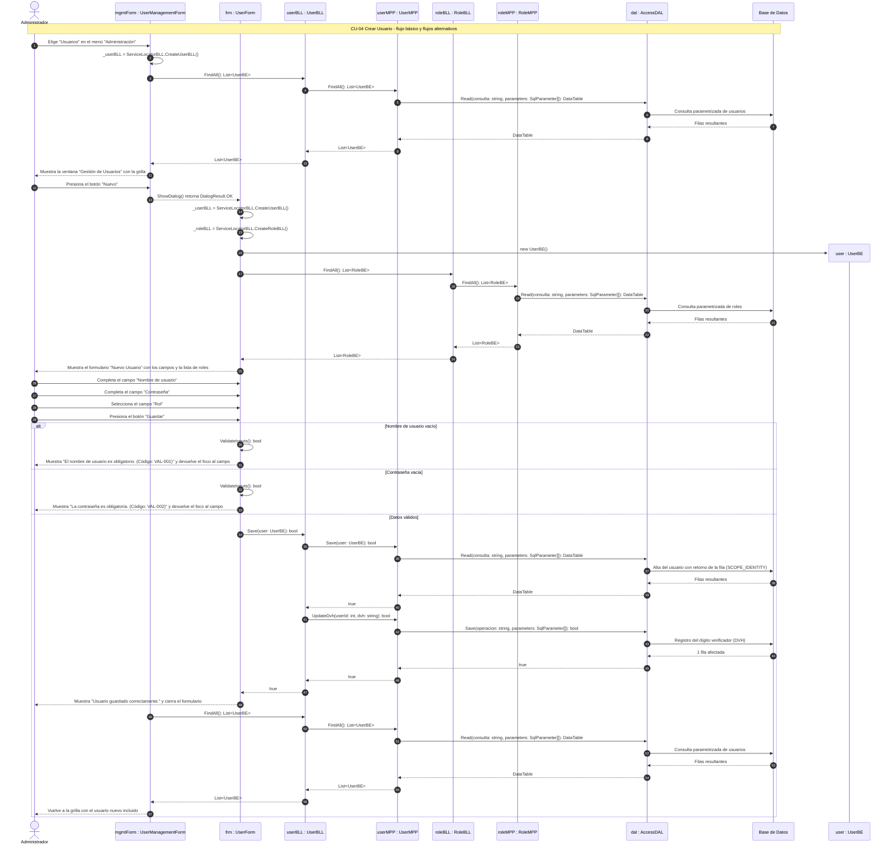

#### 4.4. Especificación de Casos de Uso: CU-04 Crear Usuario

#### 4.4.0. Diagramas de Caso de Uso

#### 4.4.1. Carátula

| Campo                   | Valor                                                                                                                                                                                                                                       |
| :---------------------- | :------------------------------------------------------------------------------------------------------------------------------------------------------------------------------------------------------------------------------------------ |
| **ID y Nombre**         | CU-04 Crear Usuario                                                                                                                                                                                                                         |
| **Estado**              | En Revisión                                                                                                                                                                                                                                 |
| **Descripción**         | Permite al Administrador crear una cuenta de acceso del sistema con el rol que le corresponde, para que el personal de la academia pueda iniciar sesión.                                                                                      |
| **Actor Principal**     | Administrador                                                                                                                                                                                                                               |
| **Actores Secundarios** | Ninguno                                                                                                                                                                                                                                     |
| **Precondiciones**      | El usuario debe haber iniciado sesión como Administrador y debe existir al menos un rol registrado.                                                                                                                                         |
| **Punto de extensión**  | No aplica                                                                                                                                                                                                                                   |
| **Condición**           | El usuario queda creado en la base de datos, con su dígito verificador (DVH) regenerado.                                                                                                                                                   |

#### 4.4.2. Historial de Revisiones

| Versión | Fecha     | Descripción                                                                                                          | Autor           |
| :------ | :-------- | :------------------------------------------------------------------------------------------------------------------- | :-------------- |
| 1.0     | 29/10/2026 | Creación inicial de la especificación (origen: flujo de alta del antiguo CU-04 Gestionar Usuarios)                   | Darío Zubaray   |
| 1.1     | 16/11/2026 | Reestructuración en CU atómico: este documento queda como caso de uso individual de alta de usuarios                 | Darío Zubaray   |

#### 4.4.3. Objetivo

Permitir al Administrador registrar una nueva cuenta de usuario con el rol que le corresponde, de modo que su personal pueda acceder al sistema.

#### 4.4.4. Precondiciones

- El usuario debe haber iniciado sesión como Administrador.
- Debe existir al menos un rol registrado en el sistema.

#### 4.4.5. Puntos de Extensión y Condiciones

- **Punto de Extensión:** No aplica.
- **Condición:** Los datos ingresados cumplen las reglas de validación del formulario (nombre de usuario y contraseña obligatorios).

#### 4.4.6. Descripción analítica del Caso de Uso

**Campos que completa el usuario:**

| Campo            | Tipo               | Obligatorio | Validación                                            |
| :--------------- | :----------------- | :---------- | :---------------------------------------------------- |
| Nombre de usuario | Texto             | Sí          | No puede estar vacío.                                 |
| Contraseña       | Texto (oculta)     | Sí          | No puede estar vacía.                                 |
| Activo           | Casilla            | No          | Sin validación.                                        |
| Rol              | Lista desplegable  | Sí          | Debe seleccionarse un rol.                             |

Flujo Básico:
1. El usuario elige **Usuarios** en el menú "Administración".
2. El sistema muestra la ventana "Gestión de Usuarios" con la grilla de usuarios.
3. El usuario presiona el botón **Nuevo**.
4. El sistema muestra el formulario "Nuevo Usuario" con los campos y la lista de roles.
5. El usuario completa el campo "Nombre de usuario".
6. El usuario completa el campo "Contraseña".
7. El usuario selecciona el campo "Rol".
8. El usuario presiona el botón **Guardar**.
9. El sistema muestra el mensaje "Usuario guardado correctamente." y cierra el formulario.
10. El sistema vuelve a la grilla con el usuario nuevo incluido.
11. Fin del Caso de Uso.

Flujos Alternativos:
- **8.a Nombre de usuario vacío:**
  1. El sistema muestra el mensaje "El nombre de usuario es obligatorio. (Código: VAL-001)" y devuelve el foco al campo.
  2. El usuario completa el nombre y vuelve a presionar "Guardar".
- **8.b Contraseña vacía:**
  1. El sistema muestra el mensaje "La contraseña es obligatoria. (Código: VAL-002)" y devuelve el foco al campo.
  2. El usuario completa la contraseña y vuelve a presionar "Guardar".

#### 4.4.7. Modelo de Dominio

Participan las siguientes entidades:
- Usuario (con sus datos de acceso, estado, rol y DVH)
- Rol (para asignar al usuario)

#### 4.4.8. Diagramas de Secuencia

DSS (simple): 

DSD (detallado): 

