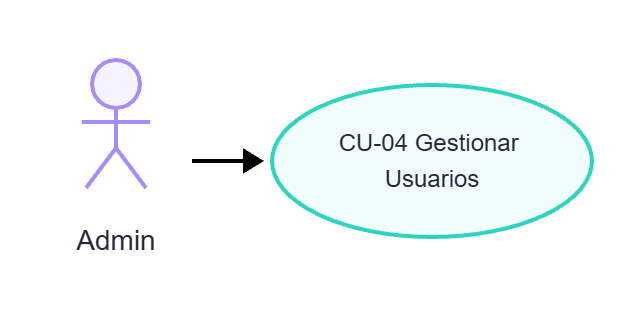
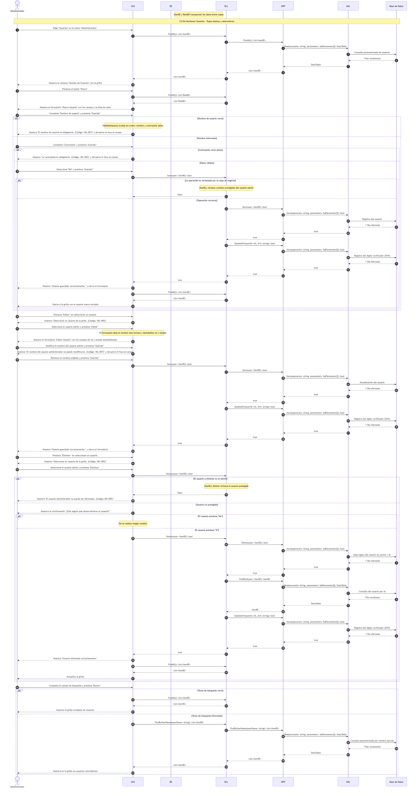
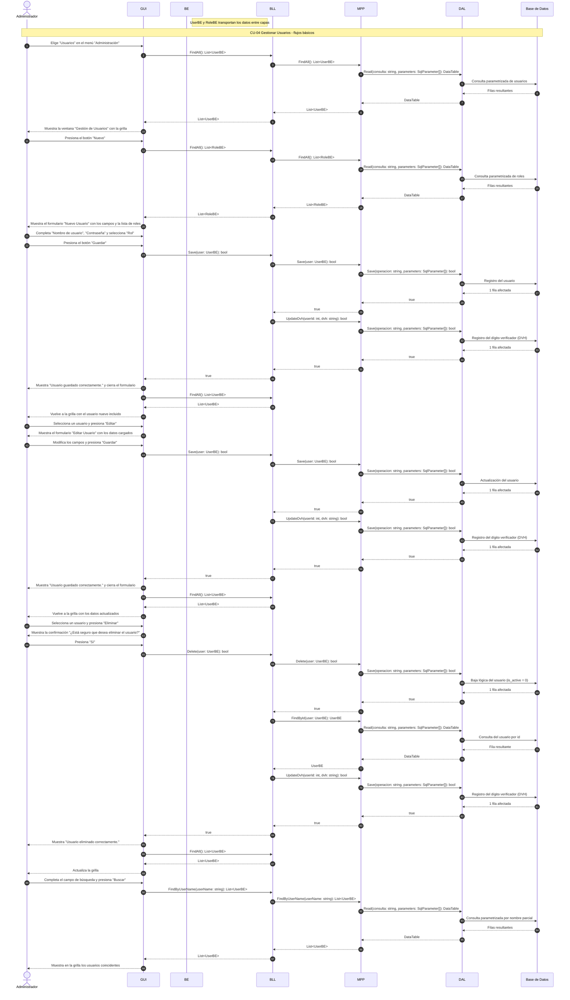

#### 4.4. Especificación de Casos de Uso: CU-04 Gestionar Usuarios

#### 4.4.0. Diagramas de Caso de Uso

#### 4.4.1. Carátula

| Campo                   | Valor                                                                                                                                                                                                                                       |
| :---------------------- | :------------------------------------------------------------------------------------------------------------------------------------------------------------------------------------------------------------------------------------------ |
| **ID y Nombre**         | CU-04 Gestionar Usuarios                                                                                                                                                                                                                    |
| **Estado**              | En Revisión                                                                                                                                                                                                                                 |
| **Descripción**         | Permite al Administrador administrar las cuentas de acceso del sistema: crear usuarios con su rol, editar sus datos, buscarlos por nombre y darlos de baja (lógica). El usuario `admin` está protegido: no puede eliminarse ni renombrarse. |
| **Actor Principal**     | Administrador                                                                                                                                                                                                                               |
| **Actores Secundarios** | Ninguno                                                                                                                                                                                                                                     |
| **Precondiciones**      | El usuario debe haber iniciado sesión como Administrador y debe existir al menos un rol registrado.                                                                                                                                         |
| **Punto de extensión**  | No aplica                                                                                                                                                                                                                                   |
| **Condición**           | El usuario queda creado, modificado o dado de baja (lógico) en la base de datos, con su dígito verificador (DVH) regenerado.                                                                                                                |

#### 4.4.2. Historial de Revisiones

| Versión | Fecha | Descripción | Autor |
| :--- | :--- | :--- | :--- |
| 1.0 | 29/10/2026 | Creación inicial de la especificación del Caso de Uso (alineada con `UserManagementForm` y `UserForm`) | Darío Zubaray |

#### 4.4.3. Objetivo

Permitir al Administrador mantener las cuentas de usuario del sistema (altas, edición y bajas lógicas) para que el personal de la academia pueda acceder con el rol que le corresponde.

#### 4.4.4. Precondiciones

- El usuario debe haber iniciado sesión como Administrador.
- Debe existir al menos un rol registrado en el sistema.

#### 4.4.5. Puntos de Extensión y Condiciones

- **Punto de Extensión:** No aplica.
- **Condición:** Los datos ingresados cumplen las reglas de validación del formulario y, en la eliminación, el usuario seleccionado no es el usuario `admin`.

#### 4.4.6. Descripción analítica del Caso de Uso

**Campos que completa el usuario:**

| Campo | Tipo | Obligatorio | Validación |
| :--- | :--- | :--- | :--- |
| Nombre de usuario | Texto | Sí | No puede estar vacío. El nombre `admin` no puede modificarse (queda solo lectura al editarlo). |
| Contraseña | Texto (oculta) | Sí, solo en alta | No puede estar vacía. En edición no se muestra. |
| Activo | Casilla | No | Sin validación. Para el usuario `admin` la casilla queda deshabilitada. |
| Rol | Lista desplegable | Sí | Debe seleccionarse un rol. Para el usuario `admin` la lista queda deshabilitada. |

Flujo Básico 1 - Crear usuario:
1. El usuario elige **Usuarios** en el menú "Administración".
2. El sistema muestra la ventana "Gestión de Usuarios" con la grilla de usuarios.
3. El usuario presiona el botón **Nuevo**.
4. El sistema muestra el formulario "Nuevo Usuario" con los campos y la lista de roles.
5. El usuario completa el campo "Nombre de usuario".
6. El usuario completa el campo "Contraseña".
7. El usuario selecciona el campo "Rol".
8. El usuario presiona el botón **Guardar**.
9. El sistema muestra el mensaje "Usuario guardado correctamente." y cierra el formulario.
10. El sistema vuelve a la grilla con el usuario nuevo incluido.
11. Fin del Caso de Uso.

Flujo Básico 2 - Editar usuario:
1. El usuario selecciona un usuario de la grilla y presiona el botón **Editar**.
2. El sistema muestra el formulario "Editar Usuario" con los datos del usuario y la lista de roles (sin campo de contraseña).
3. El usuario modifica los campos que correspondan.
4. El usuario presiona el botón **Guardar**.
5. El sistema muestra el mensaje "Usuario guardado correctamente." y cierra el formulario.
6. El sistema vuelve a la grilla con los datos actualizados.
7. Fin del Caso de Uso.

Flujo Básico 3 - Eliminar usuario (baja lógica):
1. El usuario selecciona un usuario de la grilla y presiona el botón **Eliminar**.
2. El sistema muestra la confirmación "¿Está seguro que desea eliminar el usuario '\<nombre\>'?".
3. El usuario presiona "Sí".
4. El sistema desactiva el usuario, muestra el mensaje "Usuario eliminado correctamente." y actualiza la grilla.
5. Fin del Caso de Uso.

Flujo Básico 4 - Buscar usuarios:
1. El usuario completa el campo de búsqueda "Nombre de usuario:".
2. El usuario presiona el botón **Buscar**.
3. El sistema muestra en la grilla los usuarios cuyo nombre coincide con lo buscado.
4. Fin del Caso de Uso.

Flujos Alternativos:
- **8.a Nombre de usuario vacío (alta):**
  1. El sistema muestra el mensaje "El nombre de usuario es obligatorio. (Código: VAL-001)" y devuelve el foco al campo.
  2. El usuario completa el nombre y vuelve a presionar "Guardar".
- **8.b Contraseña vacía (alta):**
  1. El sistema muestra el mensaje "La contraseña es obligatoria. (Código: VAL-002)" y devuelve el foco al campo.
  2. El usuario completa la contraseña y vuelve a presionar "Guardar".
- **1.a Sin usuario seleccionado (editar o eliminar):**
  1. El sistema muestra el mensaje "Seleccione un usuario de la grilla. (Código: VAL-005)".
  2. El usuario selecciona un usuario de la grilla y reintenta.
- **4.a Intento de renombrar al usuario admin (edición):**
  1. El sistema muestra el mensaje "El nombre del usuario administrador no puede modificarse. (Código: VAL-007)" y devuelve el foco al campo.
  2. El usuario restaura el nombre original o cancela la operación.
- **3.b Intento de eliminar al usuario admin:**
  1. El sistema muestra el mensaje "El usuario administrador no puede ser eliminado. (Código: BIZ-005)".
- **3.c El usuario presiona "No" en la confirmación:**
  1. El sistema no realiza ningún cambio y mantiene la grilla sin modificar.
- **2.a Campo de búsqueda vacío:**
  1. El sistema muestra la grilla completa de usuarios.

> Nota: al editar al usuario `admin`, el formulario deja el nombre solo lectura y deshabilita el rol y la casilla "Activo" (el estado y el rol del sysadmin los fuerza la capa de negocio).

#### 4.4.7. Modelo de Dominio

Participan las siguientes entidades:
- Usuario (con sus datos de acceso, estado, rol y DVH)
- Rol (para asignar al usuario)

#### 4.4.8. Diagramas de Secuencia

```mermaid
sequenceDiagram
    autonumber
    actor Administrador
    participant GUI as GUI
    participant BE as BE
    participant BLL as BLL
    participant MPP as MPP
    participant DAL as DAL
    participant BD as Base de Datos

    Note right of BE: UserBE y RoleBE transportan los datos entre capas
    Note over Administrador,BD: CU-04 Gestionar Usuarios - flujos básicos y alternativos

    Administrador->>GUI: Elige "Usuarios" en el menú "Administración"
    GUI->>BLL: FindAll(): List<UserBE>
    BLL->>MPP: FindAll(): List<UserBE>
    MPP->>DAL: Read(consulta: string, parameters: SqlParameter[]): DataTable
    DAL->>BD: Consulta parametrizada de usuarios
    BD-->>DAL: Filas resultantes
    DAL-->>MPP: DataTable
    MPP-->>BLL: List<UserBE>
    BLL-->>GUI: List<UserBE>
    GUI-->>Administrador: Muestra la ventana "Gestión de Usuarios" con la grilla

    Administrador->>GUI: Presiona el botón "Nuevo"
    GUI->>BLL: FindAll(): List<RoleBE>
    BLL-->>GUI: List<RoleBE>
    GUI-->>Administrador: Muestra el formulario "Nuevo Usuario" con los campos y la lista de roles

    Administrador->>GUI: Completa "Nombre de usuario" y presiona "Guardar"
    alt Nombre de usuario vacío
        Note over GUI: ValidateInputs() evalúa en orden: nombre y contraseña (alta)
        GUI-->>Administrador: Muestra "El nombre de usuario es obligatorio. (Código: VAL-001)" y devuelve el foco al campo
    else Nombre informado
        Administrador->>GUI: Completa "Contraseña" y presiona "Guardar"
        alt Contraseña vacía (alta)
            GUI-->>Administrador: Muestra "La contraseña es obligatoria. (Código: VAL-002)" y devuelve el foco al campo
        else Datos válidos
            Administrador->>GUI: Selecciona "Rol" y presiona "Guardar"
            GUI->>BLL: Save(user: UserBE): bool
            alt La operación es rechazada por la capa de negocio
                Note over BLL: UserBLL rechaza cambios protegidos del usuario admin
                BLL-->>GUI: false
            else Operación correcta
                BLL->>MPP: Save(user: UserBE): bool
                MPP->>DAL: Save(operacion: string, parameters: SqlParameter[]): bool
                DAL->>BD: Registro del usuario
                BD-->>DAL: 1 fila afectada
                DAL-->>MPP: true
                MPP-->>BLL: true
                BLL->>MPP: UpdateDvh(userId: int, dvh: string): bool
                MPP->>DAL: Save(operacion: string, parameters: SqlParameter[]): bool
                DAL->>BD: Registro del dígito verificador (DVH)
                BD-->>DAL: 1 fila afectada
                DAL-->>MPP: true
                MPP-->>BLL: true
                BLL-->>GUI: true
                GUI-->>Administrador: Muestra "Usuario guardado correctamente." y cierra el formulario
                GUI->>BLL: FindAll(): List<UserBE>
                BLL-->>GUI: List<UserBE>
                GUI-->>Administrador: Vuelve a la grilla con el usuario nuevo incluido
            end
        end
    end

    Administrador->>GUI: Presiona "Editar" sin seleccionar un usuario
    GUI-->>Administrador: Muestra "Seleccione un usuario de la grilla. (Código: VAL-005)"

    Administrador->>GUI: Selecciona el usuario admin y presiona "Editar"
    Note over GUI: El formulario deja el nombre solo lectura y deshabilita rol y estado
    GUI-->>Administrador: Muestra el formulario "Editar Usuario" con los campos de rol y estado deshabilitados
    Administrador->>GUI: Modifica el nombre del usuario admin y presiona "Guardar"
    GUI-->>Administrador: Muestra "El nombre del usuario administrador no puede modificarse. (Código: VAL-007)" y devuelve el foco al campo
    Administrador->>GUI: Restaura el nombre original y presiona "Guardar"
    GUI->>BLL: Save(user: UserBE): bool
    BLL->>MPP: Save(user: UserBE): bool
    MPP->>DAL: Save(operacion: string, parameters: SqlParameter[]): bool
    DAL->>BD: Actualización del usuario
    BD-->>DAL: 1 fila afectada
    DAL-->>MPP: true
    MPP-->>BLL: true
    BLL->>MPP: UpdateDvh(userId: int, dvh: string): bool
    MPP->>DAL: Save(operacion: string, parameters: SqlParameter[]): bool
    DAL->>BD: Registro del dígito verificador (DVH)
    BD-->>DAL: 1 fila afectada
    DAL-->>MPP: true
    MPP-->>BLL: true
    BLL-->>GUI: true
    GUI-->>Administrador: Muestra "Usuario guardado correctamente." y cierra el formulario

    Administrador->>GUI: Presiona "Eliminar" sin seleccionar un usuario
    GUI-->>Administrador: Muestra "Seleccione un usuario de la grilla. (Código: VAL-005)"

    Administrador->>GUI: Selecciona el usuario admin y presiona "Eliminar"
    GUI->>BLL: Delete(user: UserBE): bool
    alt El usuario a eliminar es el admin
        Note over BLL: UserBLL.Delete rechaza el usuario protegido
        BLL-->>GUI: false
        GUI-->>Administrador: Muestra "El usuario administrador no puede ser eliminado. (Código: BIZ-005)"
    else Usuario no protegido
        GUI-->>Administrador: Muestra la confirmación "¿Está seguro que desea eliminar el usuario?"
        alt El usuario presiona "No"
            Note over GUI: No se realiza ningún cambio
        else El usuario presiona "Sí"
            GUI->>BLL: Delete(user: UserBE): bool
            BLL->>MPP: Delete(user: UserBE): bool
            MPP->>DAL: Save(operacion: string, parameters: SqlParameter[]): bool
            DAL->>BD: Baja lógica del usuario (is_active = 0)
            BD-->>DAL: 1 fila afectada
            DAL-->>MPP: true
            MPP-->>BLL: true
            BLL->>MPP: FindById(user: UserBE): UserBE
            MPP->>DAL: Read(consulta: string, parameters: SqlParameter[]): DataTable
            DAL->>BD: Consulta del usuario por id
            BD-->>DAL: Fila resultante
            DAL-->>MPP: DataTable
            MPP-->>BLL: UserBE
            BLL->>MPP: UpdateDvh(userId: int, dvh: string): bool
            MPP->>DAL: Save(operacion: string, parameters: SqlParameter[]): bool
            DAL->>BD: Registro del dígito verificador (DVH)
            BD-->>DAL: 1 fila afectada
            DAL-->>MPP: true
            MPP-->>BLL: true
            BLL-->>GUI: true
            GUI-->>Administrador: Muestra "Usuario eliminado correctamente."
            GUI->>BLL: FindAll(): List<UserBE>
            BLL-->>GUI: List<UserBE>
            GUI-->>Administrador: Actualiza la grilla
        end
    end

    Administrador->>GUI: Completa el campo de búsqueda y presiona "Buscar"
    alt Texto de búsqueda vacío
        GUI->>BLL: FindAll(): List<UserBE>
        BLL-->>GUI: List<UserBE>
        GUI-->>Administrador: Muestra la grilla completa de usuarios
    else Texto de búsqueda informado
        GUI->>BLL: FindByUserName(userName: string): List<UserBE>
        BLL->>MPP: FindByUserName(userName: string): List<UserBE>
        MPP->>DAL: Read(consulta: string, parameters: SqlParameter[]): DataTable
        DAL->>BD: Consulta parametrizada por nombre parcial
        BD-->>DAL: Filas resultantes
        DAL-->>MPP: DataTable
        MPP-->>BLL: List<UserBE>
        BLL-->>GUI: List<UserBE>
        GUI-->>Administrador: Muestra en la grilla los usuarios coincidentes
    end
```

DSS (simple): 

DSD (detallado): 

