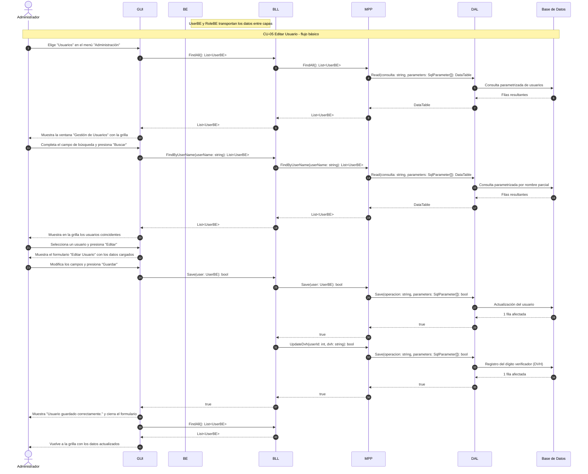
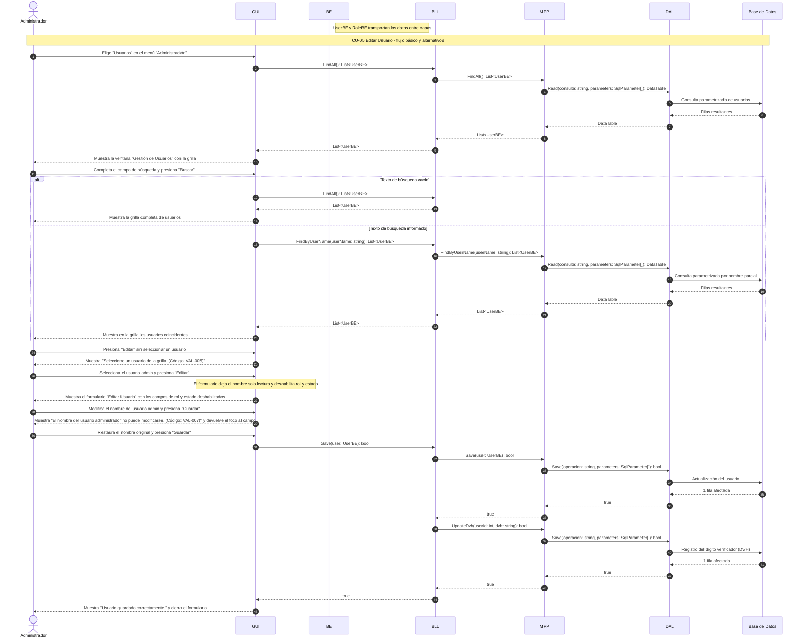

#### 4.5. Especificación de Casos de Uso: CU-05 Editar Usuario

#### 4.5.0. Diagramas de Caso de Uso

#### 4.5.1. Carátula

| Campo                   | Valor                                                                                                                                                                                                                                       |
| :---------------------- | :------------------------------------------------------------------------------------------------------------------------------------------------------------------------------------------------------------------------------------------ |
| **ID y Nombre**         | CU-05 Editar Usuario                                                                                                                                                                                                                         |
| **Estado**              | En Revisión                                                                                                                                                                                                                                 |
| **Descripción**         | Permite al Administrador modificar los datos de una cuenta de usuario existente (nombre de usuario, estado y rol). El usuario `admin` está protegido: su nombre no puede modificarse.                                                        |
| **Actor Principal**     | Administrador                                                                                                                                                                                                                               |
| **Actores Secundarios** | Ninguno                                                                                                                                                                                                                                     |
| **Precondiciones**      | El usuario debe haber iniciado sesión como Administrador y debe existir al menos un rol registrado.                                                                                                                                         |
| **Punto de extensión**  | No aplica                                                                                                                                                                                                                                   |
| **Condición**           | El usuario queda modificado en la base de datos, con su dígito verificador (DVH) regenerado.                                                                                                                                                 |

#### 4.5.2. Historial de Revisiones

| Versión | Fecha     | Descripción                                                                                                          | Autor           |
| :------ | :-------- | :------------------------------------------------------------------------------------------------------------------- | :-------------- |
| 1.0     | 29/10/2026 | Creación inicial de la especificación del Caso de Uso (alineada con `UserManagementForm` y `UserForm`)              | Darío Zubaray   |
| 1.1     | 16/11/2026 | Reestructuración en CU atómico: este documento queda como caso de uso individual de edición de usuarios            | Darío Zubaray   |

#### 4.5.3. Objetivo

Permitir al Administrador actualizar los datos de una cuenta de usuario existente (nombre de usuario, estado y rol) para que el personal de la academia siga accediendo al sistema con la información que le corresponde.

#### 4.5.4. Precondiciones

- El usuario debe haber iniciado sesión como Administrador.
- Debe existir al menos un rol registrado en el sistema.

#### 4.5.5. Puntos de Extensión y Condiciones

- **Punto de Extensión:** No aplica.
- **Condición:** Los datos ingresados cumplen las reglas de validación del formulario y, si el usuario editado es `admin`, su nombre no se modifica.

#### 4.5.6. Descripción analítica del Caso de Uso

**Campos que completa el usuario:**

| Campo            | Tipo               | Obligatorio | Validación                                                                       |
| :--------------- | :----------------- | :---------- | :------------------------------------------------------------------------------- |
| Nombre de usuario | Texto             | Sí          | No puede estar vacío. El nombre `admin` no puede modificarse (queda solo lectura al editarlo). |
| Contraseña       | Texto (oculta)     | No          | No se muestra en edición: la contraseña existente se conserva.                   |
| Activo           | Casilla            | No          | Sin validación. Para el usuario `admin` la casilla queda deshabilitada.          |
| Rol              | Lista desplegable  | Sí          | Debe seleccionarse un rol. Para el usuario `admin` la lista queda deshabilitada. |

Flujo Básico:
1. El usuario elige **Usuarios** en el menú "Administración".
2. El sistema muestra la ventana "Gestión de Usuarios" con la grilla de usuarios.
3. El usuario completa el campo de búsqueda "Nombre de usuario:" o lo deja vacío para ver todos los usuarios.
4. El usuario presiona el botón **Buscar**.
5. El sistema muestra en la grilla los usuarios que coinciden con lo buscado; si el campo está vacío, muestra la grilla completa.
6. El usuario selecciona un usuario de la grilla.
7. El usuario presiona el botón **Editar**.
8. El sistema muestra el formulario "Editar Usuario" con los datos del usuario y la lista de roles (sin campo de contraseña).
9. El usuario modifica los campos que correspondan.
10. El usuario presiona el botón **Guardar**.
11. El sistema muestra el mensaje "Usuario guardado correctamente." y cierra el formulario.
12. El sistema vuelve a la grilla con los datos actualizados.
13. Fin del Caso de Uso.

Flujos Alternativos:
- **7.a Ningún usuario seleccionado:**
  1. El sistema muestra el mensaje "Seleccione un usuario de la grilla. (Código: VAL-005)".
  2. El usuario selecciona un usuario de la grilla y vuelve a presionar "Editar".
- **10.a Nombre de usuario vacío:**
  1. El sistema muestra el mensaje "El nombre de usuario es obligatorio. (Código: VAL-001)" y devuelve el foco al campo.
  2. El usuario completa el nombre y vuelve a presionar "Guardar".
- **10.b Intento de renombrar al usuario admin:**
  1. El sistema muestra el mensaje "El nombre del usuario administrador no puede modificarse. (Código: VAL-007)" y devuelve el foco al campo.
  2. El usuario restaura el nombre original o cancela la operación.
- **10.c Nombre de usuario ya utilizado:**
  1. El sistema muestra el mensaje "El nombre de usuario no se encuentra disponible (Código: VAL-008)" y devuelve el foco al campo.
  2. El usuario informa un nombre distinto o cancela la operación.

> Nota: al editar al usuario `admin`, el formulario deja el nombre solo lectura y deshabilita el rol y la casilla "Activo".

#### 4.5.7. Modelo de Dominio

Participan las siguientes entidades:
- Usuario (con sus datos de acceso, estado, rol y DVH)
- Rol (para asignar al usuario)

#### 4.5.8. Diagramas de Secuencia

DSS (simple): 

DSD (detallado): 

