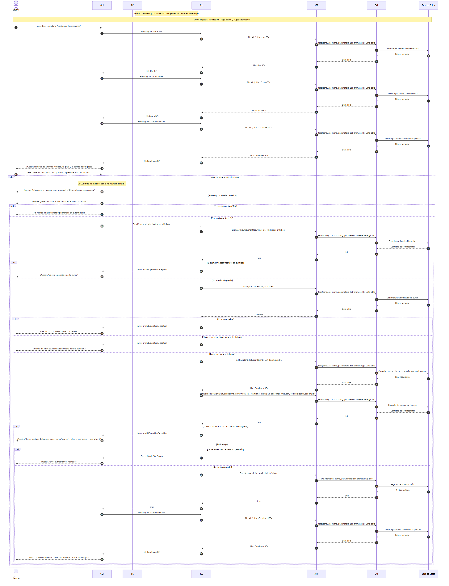
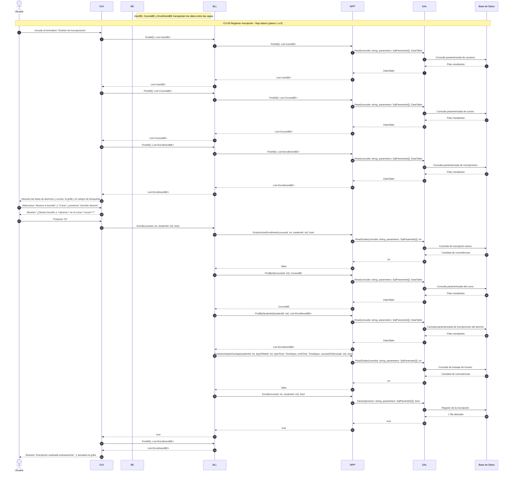
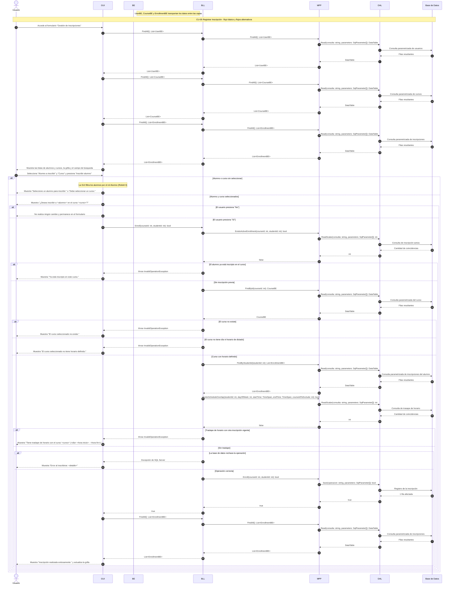

#### 4.5. Especificación de Casos de Uso: CU-05 Registrar Inscripción

> Convención de estructura y estilo: [`convenciones-cu-y-secuencia.md`](convenciones-cu-y-secuencia.md).

#### 4.5.1. Carátula

| Campo | Valor |
| :--- | :--- |
| **ID y Nombre** | CU-05 Registrar Inscripción |
| **Estado** | En Revisión |
| **Descripción** | Permite al Coordinador inscribir a un alumno en un curso activo, validando que el alumno no esté ya inscripto y que no tenga trasape de horario con sus inscripciones vigentes. |
| **Actor Principal** | Coordinador |
| **Actores Secundarios** | Ninguno |
| **Precondiciones** | El usuario debe haber iniciado sesión con el rol correspondiente; debe existir al menos un alumno y un curso activo con horario definido. |
| **Punto de extensión** | No aplica |
| **Condición** | El alumno queda inscripto en el curso seleccionado, sin duplicados ni trasape de horario. |

#### 4.5.2. Historial de Revisiones

| Versión | Fecha | Descripción | Autor |
| :--- | :--- | :--- | :--- |
| 1.0 | 13/09/2026 | Creación inicial de la especificación del Caso de Uso | Darío Zubaray |
| 1.1 | 24/09/2026 | Cambio de actor: la inscripción es registrada por el Coordinador | Darío Zubaray |
| 1.2 | 28/10/2026 | Flujo en ping-pong paso por paso con la tabla de campos, incorporación de Bedelía como actor y regeneración de los diagramas por capa (DSS/DSD); el alta se implementó en `EnrollmentManagementForm` para que el código responda al rol del personal de la academia | Darío Zubaray |
| 1.3 | 29/10/2026 | Ajuste de actores al modelo final de 4 roles: se elimina Bedelía (ya no es un rol del sistema); la inscripción es exclusiva del Coordinador | Darío Zubaray |

#### 4.5.3. Objetivo

Registrar la inscripción de un alumno a un curso, dejándolo matriculado oficialmente en la oferta académica vigente.

#### 4.5.4. Precondiciones

- El usuario ha iniciado sesión como Coordinador.
- Existen alumnos registrados en el sistema.
- Existen cursos activos con horario definido (día y hora de inicio y fin).

#### 4.5.5. Puntos de Extensión y Condiciones

- **Punto de Extensión:** No aplica.
- **Condición:** El alumno no se encuentra inscripto en el curso y no tiene trasape de horario con otra inscripción vigente.

#### 4.5.6. Descripción analítica del Caso de Uso

**Campos que completa el usuario:**

| Campo | Tipo | Obligatorio | Validación |
| :--- | :--- | :--- | :--- |
| Alumno a inscribir | Lista desplegable | Sí | Debe seleccionarse un alumno. |
| Curso | Lista desplegable | Sí | Debe seleccionarse un curso; el curso debe existir, estar activo y tener horario definido. |

Flujo Básico:
1. El usuario accede al formulario "Gestión de Inscripciones" del menú "Académico".
2. El sistema muestra las listas de alumnos y de cursos activos, la grilla de inscripciones vigentes y el campo de búsqueda.
3. El usuario selecciona el campo "Alumno a inscribir".
4. El usuario selecciona el campo "Curso".
5. El usuario presiona el botón "Inscribir alumno".
6. El sistema muestra la confirmación "¿Desea inscribir a '\<alumno\>' en el curso '\<curso\>'?"
7. El usuario presiona "Sí".
8. El sistema muestra el mensaje "Inscripción realizada exitosamente." y actualiza la grilla con la nueva inscripción.
9. Fin del Caso de Uso.

Flujos Alternativos:
- **5.a Alumno no seleccionado:**
  1. El sistema muestra el mensaje "Seleccione un alumno para inscribir."
  2. El usuario selecciona el campo "Alumno a inscribir" y vuelve a presionar "Inscribir alumno".
- **5.b Curso no seleccionado:**
  1. El sistema muestra el mensaje "Debe seleccionar un curso."
  2. El usuario selecciona el campo "Curso" y vuelve a presionar "Inscribir alumno".
- **7.a El usuario cancela la confirmación:**
  1. El usuario presiona "No".
  2. El sistema no realiza ningún cambio y permanece en el formulario (fin del intento).
- **7.b Alumno ya inscripto en el curso:**
  1. El sistema muestra el mensaje "Ya está inscripto en este curso."
  2. El usuario selecciona otro curso o cancela la operación.
- **7.c Curso inexistente o inactivo:**
  1. El sistema muestra el mensaje "El curso seleccionado no existe."
  2. El usuario selecciona otro curso y vuelve a inscribir.
- **7.d Curso sin horario definido:**
  1. El sistema muestra el mensaje "El curso seleccionado no tiene horario definido."
  2. El usuario selecciona otro curso y vuelve a inscribir.
- **7.e Traslape de horario con otra inscripción vigente:**
  1. El sistema muestra el mensaje "Tiene traslape de horario con el curso '\<curso\>' (\<día\> \<hora inicio\> - \<hora fin\>)."
  2. El usuario selecciona otro curso sin trasape o cancela la operación.
- **7.f Error de base de datos al inscribir:**
  1. El sistema muestra el mensaje "Error al inscribirse: \<detalle\>".
  2. El usuario reintenta o cierra el formulario.

#### 4.5.7. Modelo de Dominio

Participan las siguientes entidades:
- Usuario (alumno y personal de la academia)
- Curso
- Inscripción

#### 4.5.8. Diagramas de Secuencia

DSS (simple): 

DSD (detallado): 

