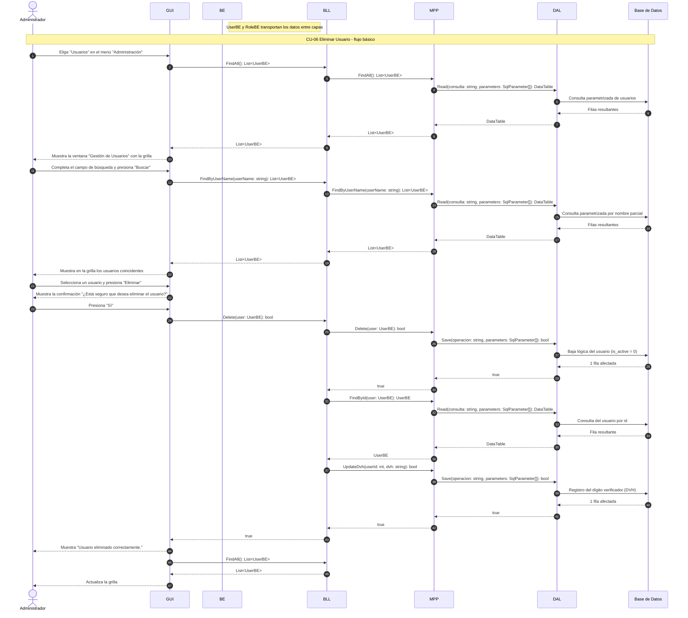
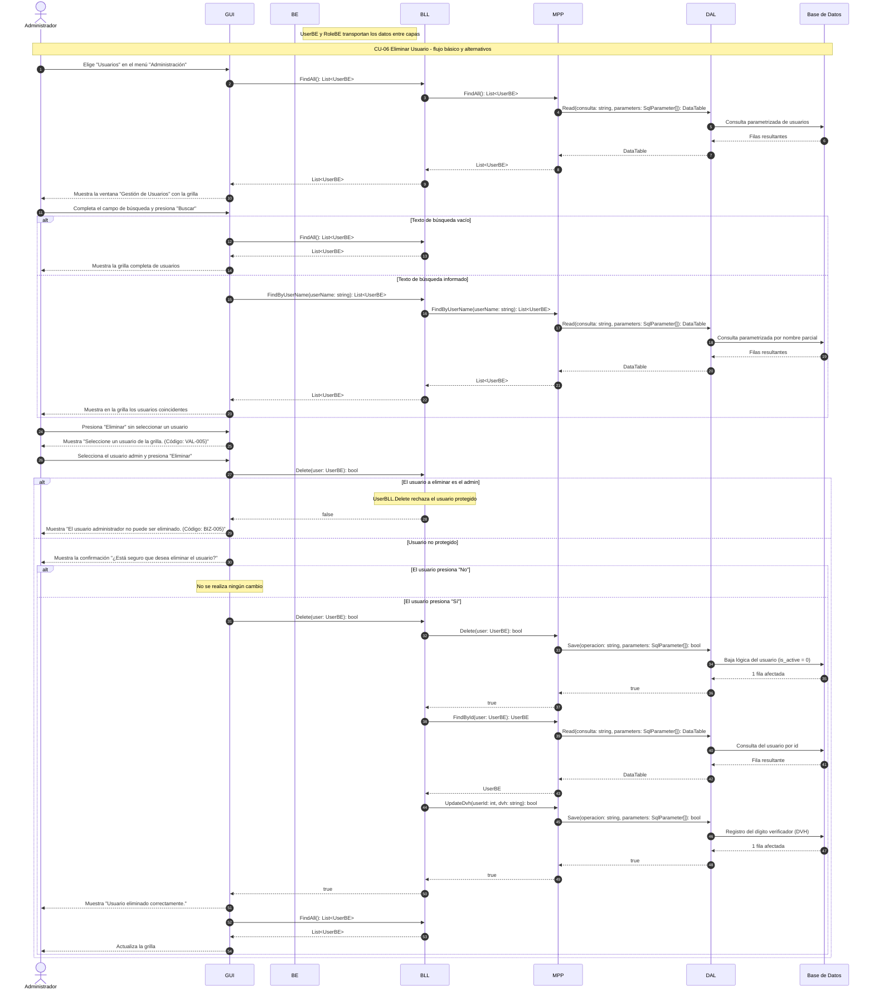

#### 4.6. Especificación de Casos de Uso: CU-06 Eliminar Usuario

#### 4.6.0. Diagramas de Caso de Uso

#### 4.6.1. Carátula

| Campo                   | Valor                                                                                                                                                                                                                                       |
| :---------------------- | :------------------------------------------------------------------------------------------------------------------------------------------------------------------------------------------------------------------------------------------ |
| **ID y Nombre**         | CU-06 Eliminar Usuario                                                                                                                                                                                                                      |
| **Estado**              | En Revisión                                                                                                                                                                                                                                 |
| **Descripción**         | Permite al Administrador dar de baja (lógica) una cuenta de usuario de la grilla después de confirmar la operación. El usuario `admin` está protegido: no puede eliminarse.                                                                 |
| **Actor Principal**     | Administrador                                                                                                                                                                                                                               |
| **Actores Secundarios** | Ninguno                                                                                                                                                                                                                                     |
| **Precondiciones**      | El usuario debe haber iniciado sesión como Administrador y debe existir al menos un usuario registrado en el sistema.                                                                                                                       |
| **Punto de extensión**  | No aplica                                                                                                                                                                                                                                   |
| **Condición**           | El usuario queda dado de baja (lógico) en la base de datos, con su dígito verificador (DVH) regenerado.                                                                                                                                     |

#### 4.6.2. Historial de Revisiones

| Versión | Fecha     | Descripción                                                                                                          | Autor           |
| :------ | :-------- | :------------------------------------------------------------------------------------------------------------------- | :-------------- |
| 1.0     | 29/10/2026 | Creación inicial de la especificación del Caso de Uso (alineada con `UserManagementForm` y `UserForm`)              | Darío Zubaray   |
| 1.1     | 16/11/2026 | Reestructuración en CU atómico: este documento queda como caso de uso individual de eliminación de usuarios         | Darío Zubaray   |

#### 4.6.3. Objetivo

Permitir al Administrador dar de baja las cuentas de usuario que ya no deben acceder al sistema, sin eliminar sus datos.

#### 4.6.4. Precondiciones

- El usuario debe haber iniciado sesión como Administrador.
- Debe existir al menos un usuario registrado en el sistema.

#### 4.6.5. Puntos de Extensión y Condiciones

- **Punto de Extensión:** No aplica.
- **Condición:** El usuario seleccionado no es el usuario `admin` y la eliminación se confirma en el diálogo de confirmación.

#### 4.6.6. Descripción analítica del Caso de Uso

**Campos que completa el usuario:**

| Campo                      | Tipo | Obligatorio | Validación                                     |
| :------------------------- | :--- | :---------- | :--------------------------------------------- |
| Nombre de usuario (búsqueda) | Texto | No          | Si está vacío, se muestra la grilla completa.  |

Flujo Básico:
1. El usuario elige **Usuarios** en el menú "Administración".
2. El sistema muestra la ventana "Gestión de Usuarios" con la grilla de usuarios.
3. El usuario completa el campo de búsqueda "Nombre de usuario:" o lo deja vacío para ver todos los usuarios.
4. El usuario presiona el botón **Buscar**.
5. El sistema muestra en la grilla los usuarios que coinciden con lo buscado; si el campo está vacío, muestra la grilla completa.
6. El usuario selecciona un usuario de la grilla.
7. El usuario presiona el botón **Eliminar**.
8. El sistema muestra la confirmación "¿Está seguro que desea eliminar el usuario '\<nombre\>'?".
9. El usuario presiona "Sí".
10. El sistema muestra el mensaje "Usuario eliminado correctamente." y actualiza la grilla con el usuario dado de baja.
11. Fin del Caso de Uso.

Flujos Alternativos:
- **7.a Ningún usuario seleccionado:**
  1. El sistema muestra el mensaje "Seleccione un usuario de la grilla. (Código: VAL-005)".
  2. El usuario selecciona un usuario de la grilla y vuelve a presionar "Eliminar".
- **7.b El usuario seleccionado es el usuario admin:**
  1. El sistema muestra el mensaje "El usuario administrador no puede ser eliminado. (Código: BIZ-005)".
  2. El usuario selecciona otro usuario de la grilla o cancela la operación.
- **9.a El usuario presiona "No" en la confirmación:**
  1. El sistema no realiza ningún cambio y mantiene la grilla sin modificar.
  2. El usuario vuelve a la grilla y reintenta la operación o la cancela.

#### 4.6.7. Modelo de Dominio

Participan las siguientes entidades:
- Usuario (con sus datos de acceso, estado, rol y DVH)

#### 4.6.8. Diagramas de Secuencia

DSS (simple): 

DSD (detallado): 

