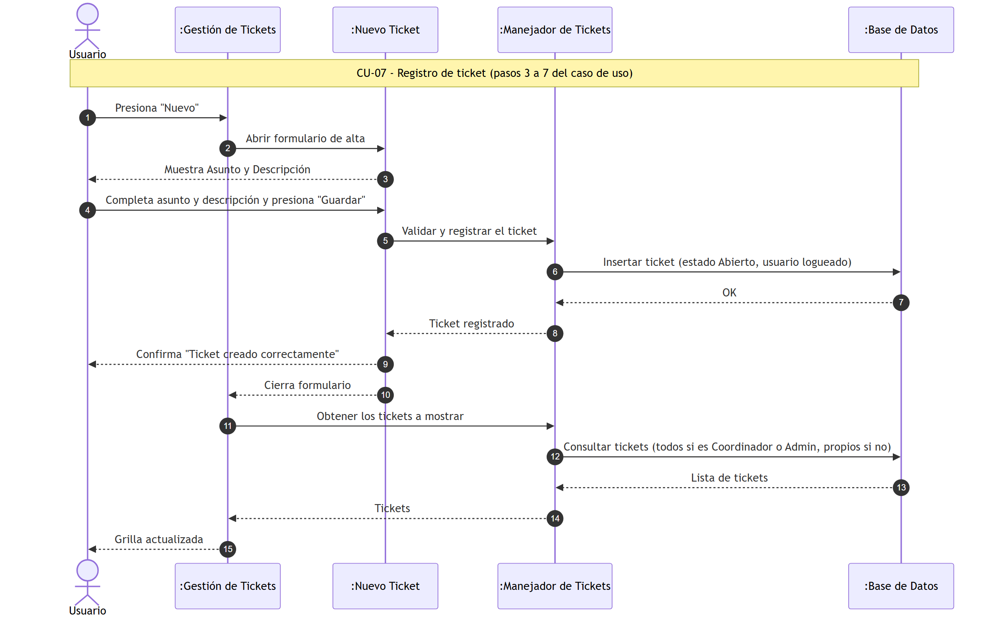
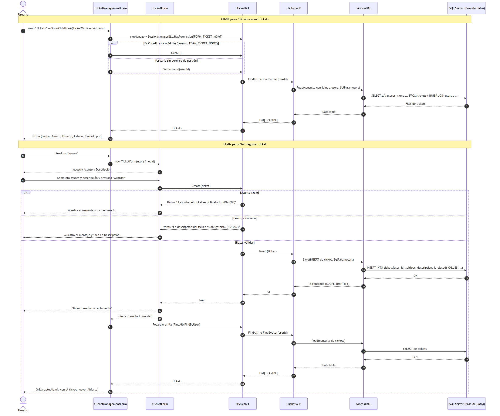
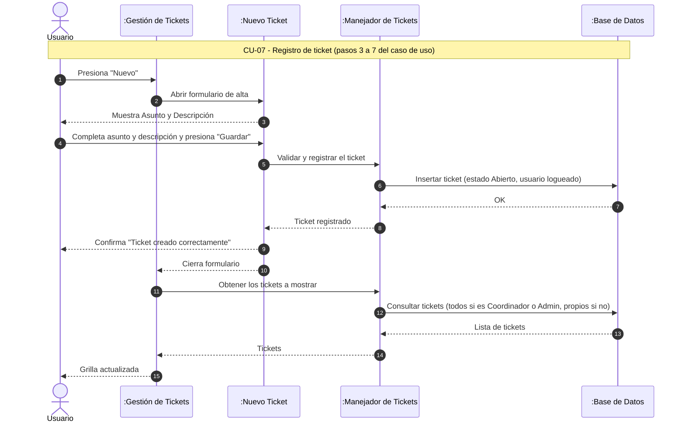

#### 4.6. Especificación de Casos de Uso: CU-07 Registrar Ticket / Reclamo

#### 4.6.1. Carátula

| Campo                   | Valor                                                                                                                                                                                                   |
| :---------------------- | :------------------------------------------------------------------------------------------------------------------------------------------------------------------------------------------------------ |
| **ID y Nombre**         | CU-07 Crear Ticket                                                                                                                                                                                      |
| **Estado**              | En Revisión                                                                                                                                                                                             |
| **Descripción**         | Permite a los roles Coordinador y Profesor registrar un ticket (asunto + descripción) para reportar un problema o solicitud, con trazabilidad de quién lo reportó y cuándo. |
| **Actor Principal**     | Coordinador y Profesor (crean tickets)                                                                                                                                                                  |
| **Actores Secundarios** | Admin (actor oculto: puede crear tickets como caso especial del sistema)                                                                                                                               |
| **Precondiciones**      | El usuario debe haber iniciado sesión en el sistema.                                                                                                                                                    |
| **Punto de extensión**  | No aplica                                                                                                                                                                                               |
| **Condición**           | El asunto y la descripción del ticket son obligatorios; el ticket nace en estado *Abierto*                                                                                                              |

#### 4.6.2. Historial de Revisiones

| Versión | Fecha      | Descripción                                                                            | Autor         |
| :------ | :--------- | :------------------------------------------------------------------------------------- | :------------ |
| 1.0     | 19/10/2026 | Creación inicial de la especificación del Caso de Uso                                  | Darío Zubaray |
| 1.1     | 20/10/2026 | Ajuste de actores: crean Coordinador y Profesor, cierra solo Coordinador, Admin oculto | Darío Zubaray |
| 1.2     | 20/10/2026 | Separación del cierre de tickets en un caso de uso aparte (pendiente de documentar); el CU queda centrado en la creación | Darío Zubaray |

#### 4.6.3. Objetivo

Registrar el reporte de un problema o solicitud (ticket) de un usuario, dejando trazabilidad de quién lo reportó y cuándo.

> **Nota:** el listado global de tickets y el cierre de tickets se documentan en un caso de uso aparte (pendiente).

#### 4.6.4. Precondiciones

- El usuario ha iniciado sesión en el sistema (roles Coordinador o Profesor).

#### 4.6.5. Puntos de Extensión y Condiciones

- **Punto de Extensión:** No aplica.
- **Condición:** El ticket nace en estado *Abierto*; su cierre pertenece a otro caso de uso (pendiente de documentar).

#### 4.6.6. Descripción analítica del Caso de Uso

Flujo básico (registro — Coordinador o Profesor):
1. El Usuario elige **Tickets** en el menú principal.
2. El sistema muestra la ventana "Gestión de Tickets" con la grilla de tickets: los Coordinadores (y el Admin oculto) ven todos los tickets (de todos los usuarios); los demás usuarios ven solo los suyos.
3. El Usuario presiona el botón **Nuevo**.
4. El sistema muestra el formulario "Nuevo Ticket" con los campos *Asunto* y *Descripción*.
5. El Usuario completa el asunto y la descripción y presiona **Guardar**.
6. El sistema valida que ambos campos tengan contenido, persiste el ticket en estado *Abierto* asociado al usuario logueado y muestra la confirmación "Ticket creado correctamente".
7. El sistema vuelve a la grilla de tickets con el ticket nuevo incluido.

Flujo alternativo:
- **5.a Asunto vacío:**
  1. El sistema muestra "El asunto del ticket es obligatorio. (Código: BIZ-006)" y el foco vuelve al asunto.
- **5.b Descripción vacía:**
  1. El sistema muestra "La descripción del ticket es obligatoria. (Código: BIZ-007)" y el foco vuelve a la descripción.

#### 4.6.7. Modelo de Dominio

Participan las siguientes entidades:
- Ticket (asunto, descripción, estado Abierto/Cerrado, fecha de creación, fecha y autor de cierre)
- Usuario (autor del ticket: Coordinador o Profesor)

#### 4.6.8. Diagramas de Secuencia

Diagrama simple: 

Diagrama detallado: 

