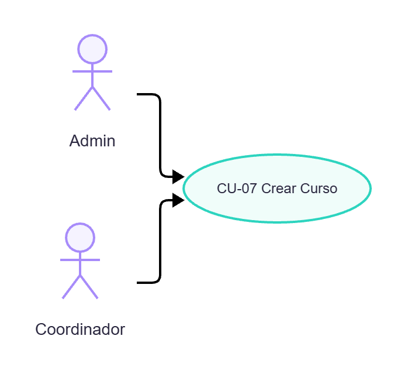
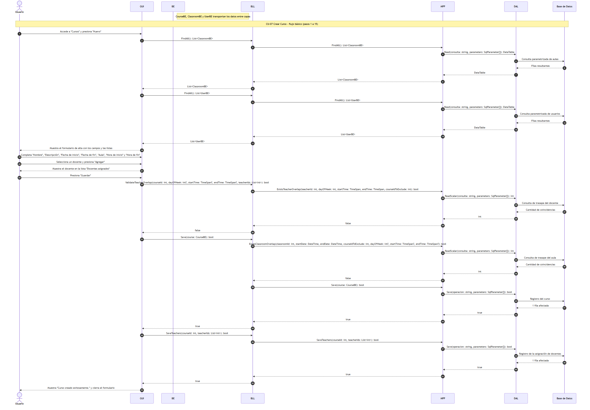
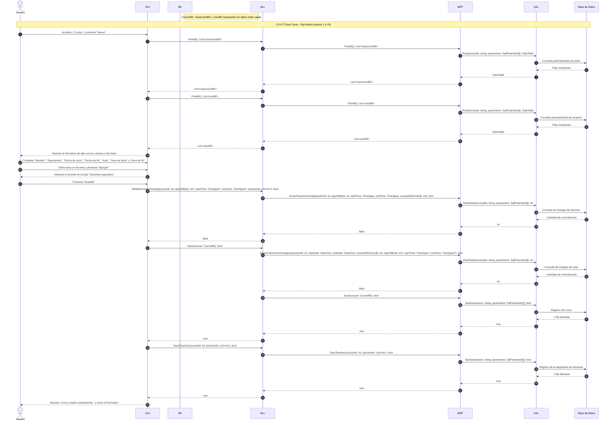
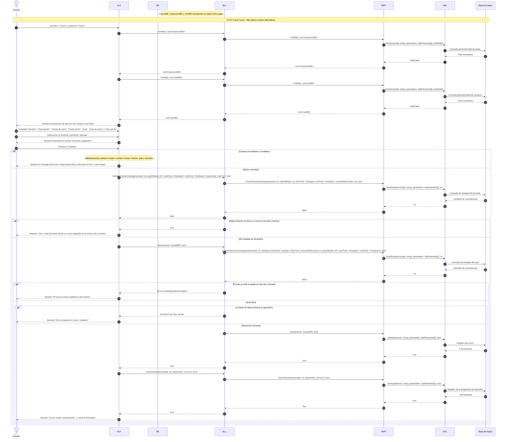

#### 4.7. Especificación de Casos de Uso: CU-07 Crear Curso

#### 4.7.0. Diagramas de Caso de Uso

#### 4.7.1. Carátula

| Campo                   | Valor                                                                                                                                                                    |
| :---------------------- | :----------------------------------------------------------------------------------------------------------------------------------------------------------------------- |
| **ID y Nombre**         | CU-07 Crear Curso                                                                                                                                                        |
| **Estado**              | En Revisión                                                                                                                                                              |
| **Descripción**         | Permite al Coordinador registrar un nuevo curso dentro del sistema, asignándole nombre, descripción, fecha de inicio y fin, aula, horario de dictado y docentes a cargo. |
| **Actor Principal**     | Coordinador                                                                                                                                                              |
| **Actores Secundarios** | Ninguno                                                                                                                                                                  |
| **Precondiciones**      | El usuario debe haber iniciado sesión con el rol correspondiente y el sistema debe contar con aulas y docentes registrados.                                              |
| **Punto de extensión**  | No aplica                                                                                                                                                                |
| **Condición**           | Los datos obligatorios son válidos, el aula y los docentes no tienen solapamiento de horario y el curso queda registrado activo.                                         |

#### 4.7.2. Historial de Revisiones

| Versión | Fecha      | Descripción                                                                                                                                                     | Autor         |
| :------ | :--------- | :-------------------------------------------------------------------------------------------------------------------------------------------------------------- | :------------ |
| 1.0     | 13/09/2026 | Creación inicial de la especificación del Caso de Uso                                                                                                           | Darío Zubaray |
| 1.1     | 28/10/2026 | Flujo en ping-pong paso por paso con la tabla de campos, alineación de los flujos alternativos con el código y regeneración de los diagramas por capa (DSS/DSD) | Darío Zubaray |

#### 4.7.3. Objetivo

Permitir el alta de un nuevo curso en el sistema para que quede disponible en la oferta académica y en las inscripciones.

#### 4.7.4. Precondiciones

- El usuario debe estar autenticado como Coordinador o Profesor.
- El sistema debe contar con aulas y docentes registrados para asociar al curso.

#### 4.7.5. Puntos de Extensión y Condiciones

- **Punto de Extensión:** No aplica.
- **Condición:** Los datos ingresados cumplen las reglas de validación del formulario y el aula y los docentes no tienen solapamiento de horario.

#### 4.7.6. Descripción analítica del Caso de Uso

**Campos que completa el usuario:**

| Campo | Tipo | Obligatorio | Validación |
| :--- | :--- | :--- | :--- |
| Nombre | Texto | Sí | No puede estar vacío. |
| Descripción | Texto largo | No | Sin validación. |
| Fecha de inicio | Fecha | Sí | Debe ser anterior a la fecha de fin. |
| Fecha de fin | Fecha | Sí | Se valida contra la fecha de inicio. |
| Aula | Lista desplegable | Sí | Debe seleccionarse un aula. |
| Hora de inicio | Texto (máscara hh:mm) | Sí | Debe estar completa, con formato hh:mm, horas entre 00 y 23, minutos en 00/15/30/45 y anterior a la hora de fin. |
| Hora de fin | Texto (máscara hh:mm) | Sí | Igual que la hora de inicio. |
| Docentes a cargo | Lista (mínimo uno) | Sí | Debe agregar al menos un docente; ninguno puede tener un curso el mismo día y horario. |

Nota: el **día de dictado no es un campo del formulario**: el sistema lo deduce de la fecha de inicio del curso.

Flujo Básico:
1. El usuario accede al formulario "Cursos" del menú "Administración" y presiona "Nuevo".
2. El sistema muestra el formulario de alta de curso con sus campos y las listas de aulas y docentes disponibles.
3. El usuario completa el campo "Nombre".
4. El usuario completa el campo "Descripción".
5. El usuario completa el campo "Fecha de inicio".
6. El usuario completa el campo "Fecha de fin".
7. El usuario selecciona el campo "Aula".
8. El usuario completa el campo "Hora de inicio".
9. El usuario completa el campo "Hora de fin".
10. El usuario selecciona un docente de la lista "Docentes disponibles" y presiona el botón "Agregar".
11. El sistema muestra el docente en la lista "Docentes asignados".
12. El usuario repite los pasos 10 y 11 por cada docente a asignar.
13. El usuario presiona el botón "Guardar".
14. El sistema muestra el mensaje "Curso creado exitosamente.", cierra el formulario y el curso aparece en el listado.
15. Fin del Caso de Uso.

Flujos Alternativos:
- **13.a Campos obligatorios incompletos o inválidos:**
  1. El sistema muestra el mensaje del primer campo observado ("El nombre es obligatorio.", "La fecha de inicio debe ser anterior a la fecha de fin.", "Debe completar el horario.", "Formato de horario inválido.", "Las horas deben estar entre 00 y 23.", "Los minutos deben ser 00, 15, 30 o 45.", "La hora de inicio debe ser anterior a la hora de fin.", "Debe seleccionar un aula." o "Debe asignar al menos un docente.") y devuelve el foco a ese campo.
  2. El usuario corrige los datos señalados y vuelve a presionar "Guardar".
- **13.b Ningún docente asignado:**
  1. El sistema muestra el mensaje "Debe asignar al menos un docente."
  2. El usuario agrega un docente (pasos 10 y 11) y vuelve a presionar "Guardar".
- **13.c Docente con curso en el mismo día y horario:**
  1. El sistema muestra el mensaje "Uno o más docentes tienen un curso asignado en el mismo día y horario."
  2. El usuario selecciona otro docente u otro horario y vuelve a presionar "Guardar".
- **13.d Aula ocupada en el día y horario:**
  1. El sistema muestra el mensaje "El aula ya está ocupada en ese horario."
  2. El usuario cambia el aula, el horario o las fechas y vuelve a presionar "Guardar".
- **13.e Error de base de datos al guardar:**
  1. El sistema muestra el mensaje "Error al guardar el curso: \<detalle\>".
  2. El usuario corrige la situación (o reintenta) y vuelve a presionar "Guardar", o presiona "Cancelar" para abandonar el alta.

#### 4.7.7. Modelo de Dominio

Participan las siguientes entidades:
- Curso
- Aula
- Usuario

#### 4.7.8. Diagramas de Secuencia

DSS (simple): 

DSD (detallado): 

