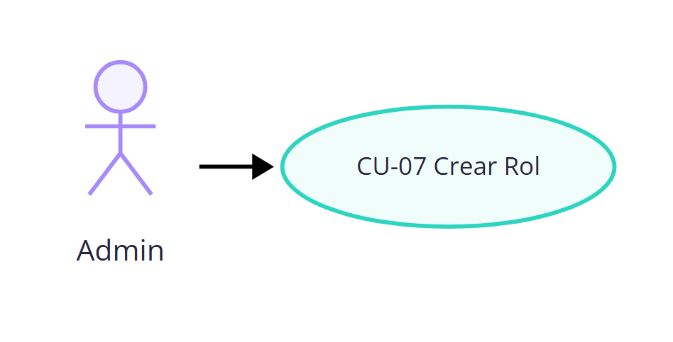
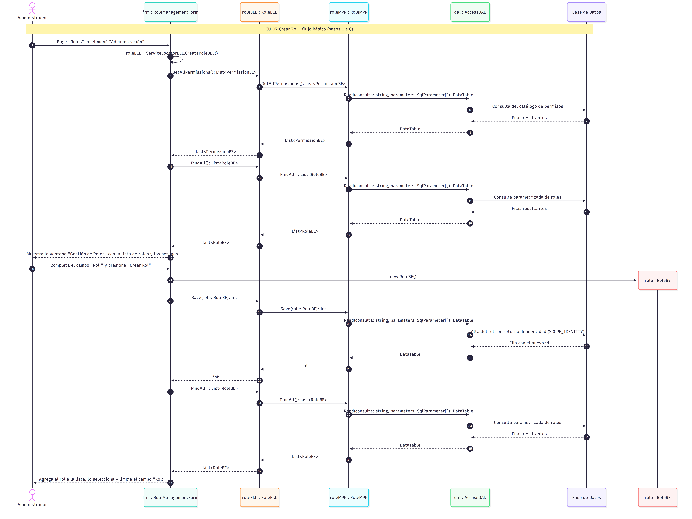
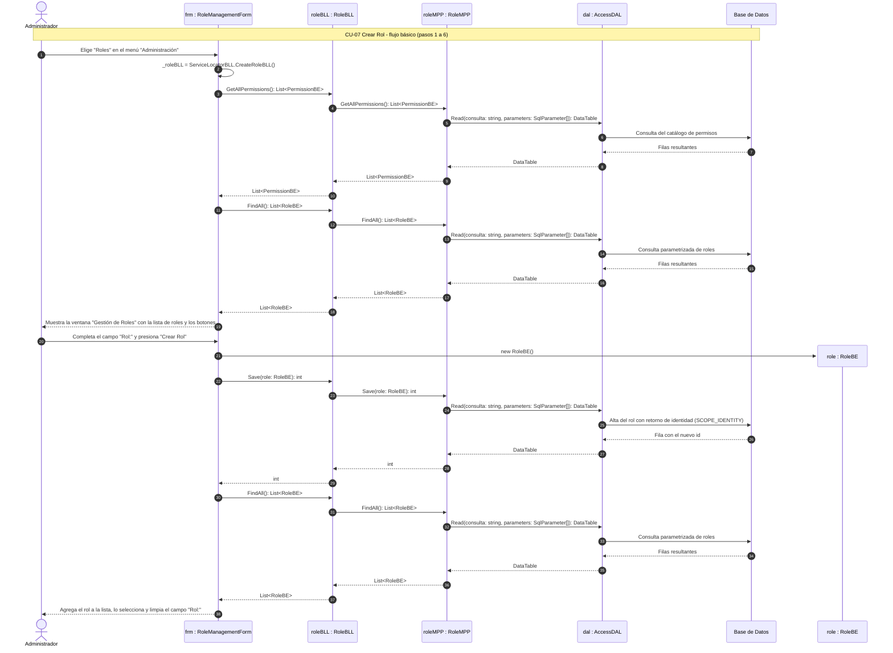
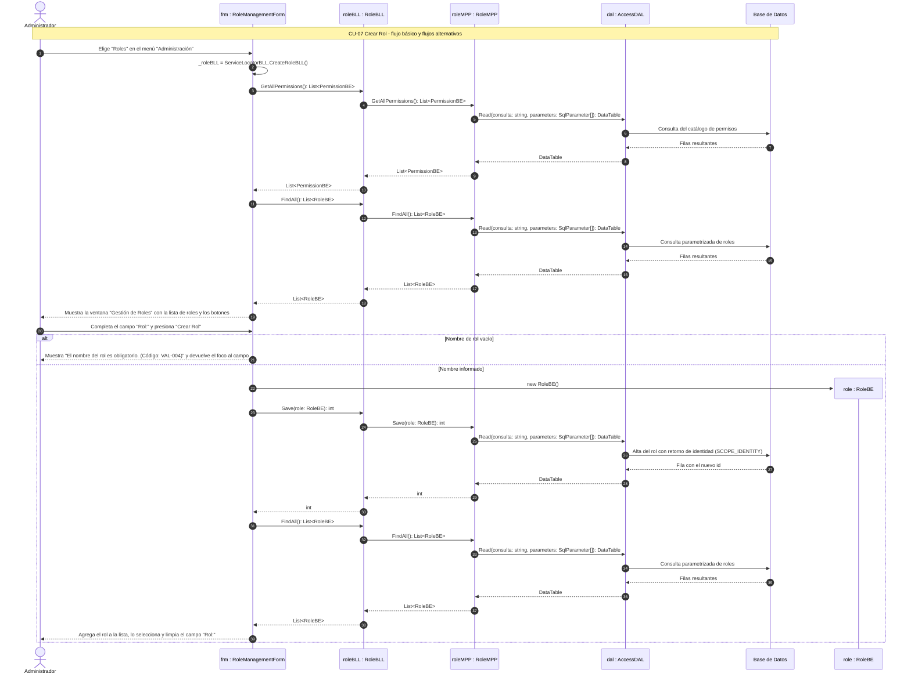

#### 4.7. Especificación de Casos de Uso: CU-07 Crear Rol

#### 4.7.0. Diagramas de Caso de Uso

#### 4.7.1. Carátula

| Campo                   | Valor                                                                                                                                 |
| :---------------------- | :------------------------------------------------------------------------------------------------------------------------------------ |
| **ID y Nombre**         | CU-07 Crear Rol                                                                                                                       |
| **Estado**              | En Revisión                                                                                                                           |
| **Descripción**         | Permite al Administrador registrar un nuevo rol en el sistema para asignarle permisos y controlar qué puede hacer cada usuario.        |
| **Actor Principal**     | Administrador                                                                                                                         |
| **Actores Secundarios** | Ninguno                                                                                                                               |
| **Precondiciones**      | El usuario debe haber iniciado sesión como Administrador.                                                                             |
| **Punto de extensión**  | No aplica                                                                                                                             |
| **Condición**           | El rol queda registrado en el sistema.                                                                                                |

#### 4.7.2. Historial de Revisiones

| Versión | Fecha | Descripción | Autor |
| :--- | :--- | :--- | :--- |
| 1.0 | 29/10/2026 | Creación inicial de la especificación del Caso de Uso (alineada con `RoleManagementForm` y `RoleBLL`) | Darío Zubaray |
| 1.1 | 16/11/2026 | Reestructuración en CU atómico: este documento queda como caso de uso individual de alta de roles | Darío Zubaray |

#### 4.7.3. Objetivo

Permitir al Administrador registrar un nuevo rol en el sistema para controlar el acceso de los usuarios.

#### 4.7.4. Precondiciones

- El usuario debe haber iniciado sesión como Administrador.

#### 4.7.5. Puntos de Extensión y Condiciones

- **Punto de Extensión:** No aplica.
- **Condición:** El nombre del rol está informado.

#### 4.7.6. Descripción analítica del Caso de Uso

**Campos que completa el usuario:**

| Campo | Tipo | Obligatorio | Validación |
| :--- | :--- | :--- | :--- |
| Rol | Texto | Sí | No puede estar vacío. |

Flujo Básico:
1. El usuario elige **Roles** en el menú "Administración".
2. El sistema muestra la ventana "Gestión de Roles" con la lista de roles, el campo "Rol:", los botones "Crear Rol" y "Eliminar", las listas "Disponibles" y "Asignados", los botones ">>" y "<<" y el botón "Guardar".
3. El usuario completa el campo "Rol:".
4. El usuario presiona el botón "Crear Rol".
5. El sistema registra el rol, lo agrega a la lista de roles, lo selecciona y limpia el campo "Rol:".
6. Fin del Caso de Uso.

Flujos Alternativos:
- **4.a Nombre de rol vacío:**
  1. El sistema muestra el mensaje "El nombre del rol es obligatorio. (Código: VAL-004)" y devuelve el foco al campo.
  2. El usuario completa el nombre y vuelve a presionar "Crear Rol".

#### 4.7.7. Modelo de Dominio

Participan las siguientes entidades:
- Rol (con su nombre y su lista de permisos)

#### 4.7.8. Diagramas de Secuencia

DSS (simple): 

DSD (detallado): 

