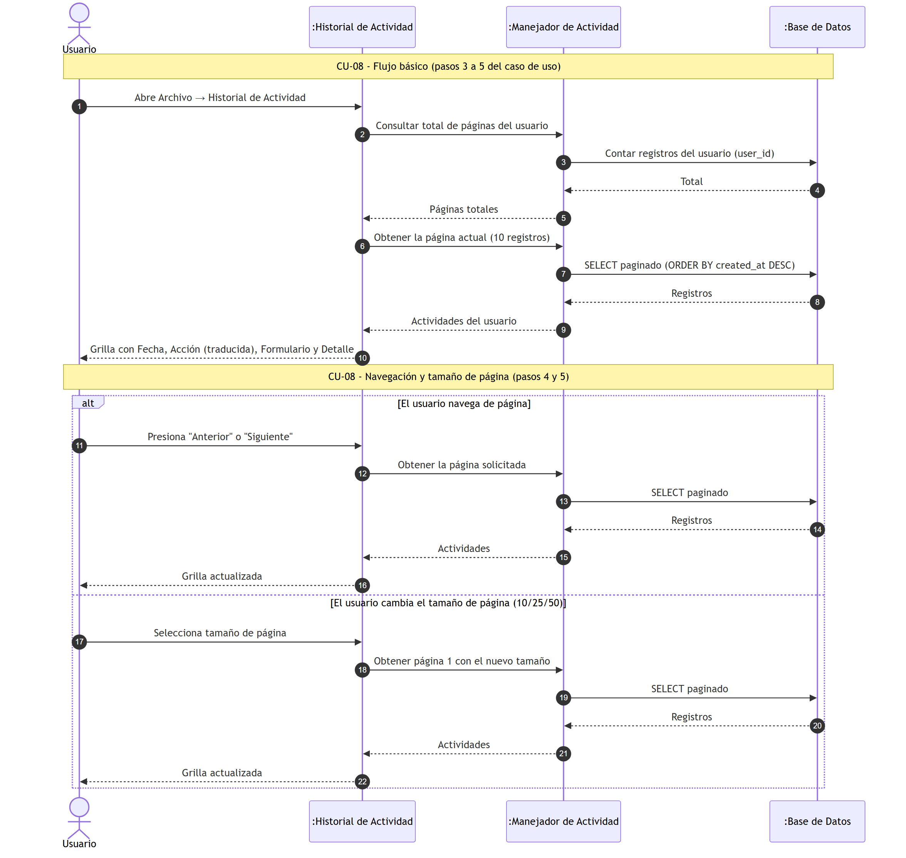
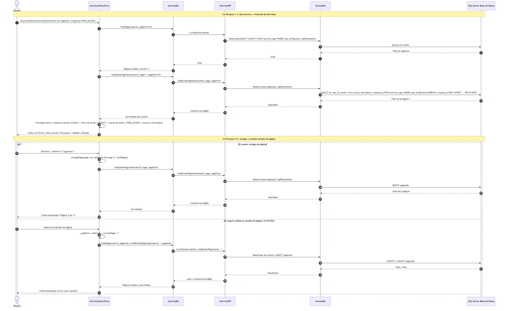
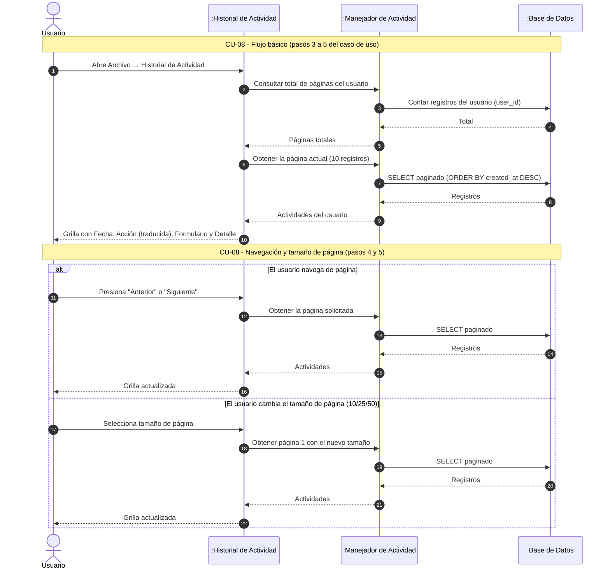

#### 4.7. Especificación de Casos de Uso: CU-08 Ver Historial de Actividad

#### 4.7.1. Carátula

| Campo                   | Valor                                                                                                                                                                         |
| :---------------------- | :---------------------------------------------------------------------------------------------------------------------------------------------------------------------------- |
| **ID y Nombre**         | CU-08 Ver Historial de Actividad                                                                                                                                              |
| **Estado**              | En Revisión                                                                                                                                                                   |
| **Descripción**         | Permite al usuario consultar en forma paginada el registro cronológico de sus propias actividades (logins, logouts y accesos a formularios), con orden descendente por fecha. |
| **Actor Principal**     | Usuario autenticado (cualquier rol)                                                                                                                                           |
| **Actores Secundarios** | Ninguno                                                                                                                                                                       |
| **Precondiciones**      | El usuario debe haber iniciado sesión en el sistema y existen al menos un registro de actividad propio en la base de datos.                                                   |
| **Punto de extensión**  | No aplica                                                                                                                                                                     |
| **Condición**           | El historial es siempre del usuario logueado (no existe vista de historial de terceros); la consulta se pagina con un tamaño configurable (10/25/50)                          |

#### 4.7.2. Historial de Revisiones

| Versión | Fecha      | Descripción                                           | Autor         |
| :------ | :--------- | :---------------------------------------------------- | :------------ |
| 1.0     | 19/10/2026 | Creación inicial de la especificación del Caso de Uso | Darío Zubaray |

#### 4.7.3. Objetivo

Consultar el registro cronológico de las propias actividades (logins, logouts y accesos a formularios), permitiendo paginar el listado y elegir el tamaño de página.

#### 4.7.4. Precondiciones

- El usuario ha iniciado sesión en el sistema.
- La tabla `activity_logs` tiene al menos un registro propio (los logs LOGIN/LOGOUT se generan al iniciar/cerrar sesión; los FORM_ACCESS se generan al abrir formularios).

#### 4.7.5. Puntos de Extensión y Condiciones

- **Punto de Extensión:** No aplica.
- **Condición:** Solo se muestran los registros del usuario logueado (filtro por `user_id`); no hay exportación ni edición.

#### 4.7.6. Descripción analítica del Caso de Uso

Flujo básico:
1. El usuario elige **Archivo → Historial de Actividad** en el menú principal.
2. El sistema abre el formulario "Historial de Actividad" (MDI hijo; si ya hay una instancia abierta la enfoca en lugar de abrir otra).
3. El sistema carga la primera página (10 registros por defecto) con los registros más recientes primero y muestra las columnas: *Fecha y Hora*, *Acción* (LOGIN/LOGOUT/FORM_ACCESS, traducida al idioma activo), *Formulario / Detalle* y *Detalle*.
4. El usuario navega con los botones **‹ Anterior** y **Siguiente ›**.
5. El usuario puede cambiar el **Tamaño de página** (10/25/50); el sistema vuelve a la primera página con el nuevo tamaño.
6. El usuario cierra el formulario.

Flujo alternativo:
- **3.a Sin registros:**
  1. El sistema muestra la grilla vacía con "Página 1 de 1".
- **4.a Página fuera de rango:**
  1. El sistema ignora la navegación (el botón queda inactivo en los límites).
- **3.b Acción desconocida en el registro:**
  1. El sistema muestra el valor crudo de la acción sin traducir.

#### 4.7.7. Modelo de Dominio

Participan las siguientes entidades:
- Registro de Actividad (acción, formulario, detalle, fecha/hora)
- Usuario (dueño de los registros)

#### 4.7.8. Diagramas de Secuencia

Diagrama simple: 

Diagrama detallado: 

