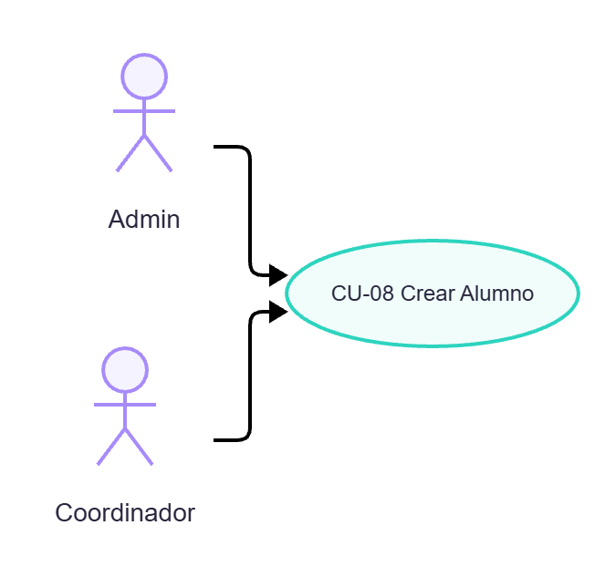
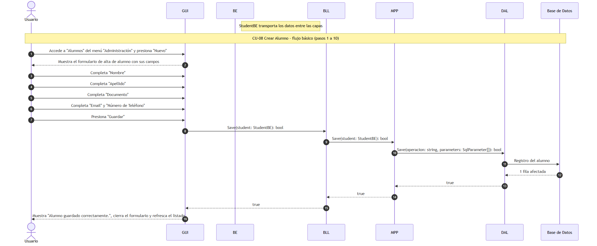
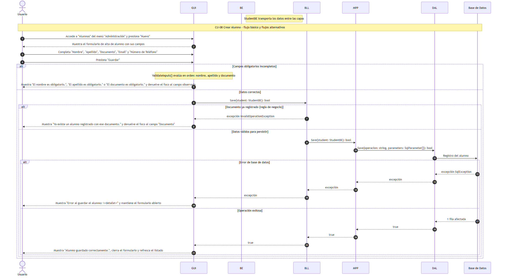
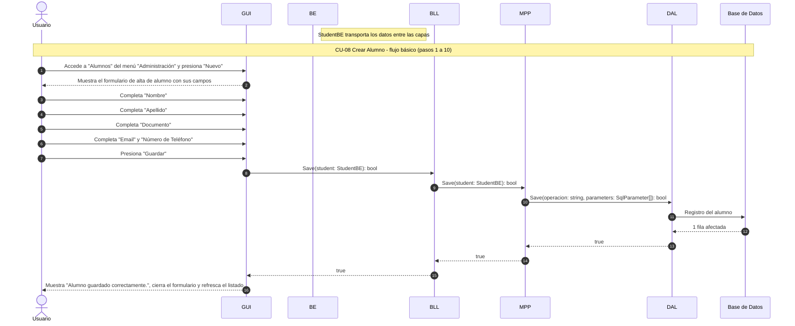
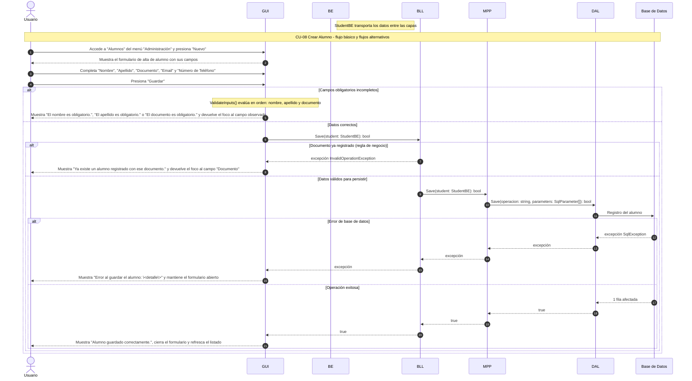

#### 4.8. Especificación de Casos de Uso: CU-08 Crear Alumno

#### 4.8.0. Diagramas de Caso de Uso

#### 4.8.1. Carátula

| Campo                   | Valor                                                                                                                                     |
| :---------------------- | :---------------------------------------------------------------------------------------------------------------------------------------- |
| **ID y Nombre**         | CU-08 Crear Alumno                                                                                                                        |
| **Estado**              | En Revisión                                                                                                                               |
| **Descripción**         | Permite al Coordinador registrar un nuevo alumno dentro del sistema, asignándole nombre, apellido, documento, email y numero de contacto. |
| **Actor Principal**     | Coordinador                                                                                                                               |
| **Actores Secundarios** | Ninguno                                                                                                                                   |
| **Precondiciones**      | El usuario debe haber iniciado sesión con el rol correspondiente.                                                                         |
| **Punto de extensión**  | No aplica                                                                                                                                 |
| **Condición**           | Los datos obligatorios son válidos y el alumno queda registrado activo.                                                                   |

#### 4.8.2. Historial de Revisiones

| Versión | Fecha      | Descripción                                           | Autor         |
| :------ | :--------- | :---------------------------------------------------- | :------------ |
| 1.0     | 29/10/2026 | Creación inicial de la especificación del Caso de Uso | Darío Zubaray |

#### 4.8.3. Objetivo

Permitir el alta de un nuevo alumno en el sistema para que quede disponible en los registros académicos.

#### 4.8.4. Precondiciones

- El usuario debe estar autenticado como Coordinador.

#### 4.8.5. Puntos de Extensión y Condiciones

- **Punto de Extensión:** No aplica.
- **Condición:** Los datos ingresados cumplen las reglas de validación del formulario.

#### 4.8.6. Descripción analítica del Caso de Uso

**Campos que completa el usuario:**

| Campo              | Tipo                  | Obligatorio | Validación                                                                                                       |
| :----------------- | :-------------------- | :---------- | :--------------------------------------------------------------------------------------------------------------- |
| Nombre             | Texto                 | Sí          | No puede estar vacío.                                                                                            |
| Apellido           | Texto                 | Sí          | No puede estar vacío.                                                                                            |
| Documento          | Texto                 | Sí          | Debe ser un documento válido.                                                                                    |
| Email              | Texto                 | No          | Sin validación (campo opcional).                                                                             |
| Número de Teléfono | Texto                 | No          | Sin validación (campo opcional).                                                                                      |

Flujo Básico:
1. El usuario accede al formulario "Alumnos" del menú "Administración" y presiona "Nuevo".
2. El sistema muestra el formulario de alta de alumno con sus campos.
3. El usuario completa el campo "Nombre".
4. El usuario completa el campo "Apellido".
5. El usuario completa el campo "Documento".
6. El usuario completa el campo "Email".
7. El usuario selecciona el campo "Número de Teléfono".
8. El usuario presiona el botón "Guardar".
9. El sistema muestra el mensaje "Alumno guardado correctamente.", cierra el formulario y el alumno aparece en el listado.
10. Fin del Caso de Uso.

Flujos Alternativos:
- **8.a Campos obligatorios incompletos:**
  1. El sistema muestra el mensaje del primer campo observado ("El nombre es obligatorio.", "El apellido es obligatorio." o "El documento es obligatorio.") y devuelve el foco a ese campo.
  2. El usuario corrige los datos señalados y vuelve a presionar "Guardar".
- **8.b Documento ya registrado:**
  1. El sistema muestra el mensaje "Ya existe un alumno registrado con ese documento."
  2. El usuario modifica el campo "Documento" o presiona "Cancelar" para abandonar el alta.
- **8.c Error de base de datos al guardar:**
  1. El sistema muestra el mensaje "Error al guardar el alumno: \<detalle\>".
  2. El usuario corrige la situación (o reintenta) y vuelve a presionar "Guardar", o presiona "Cancelar" para abandonar el alta.

#### 4.8.7. Modelo de Dominio

Participan las siguientes entidades:
- Alumno
- Usuario

#### 4.8.8. Diagramas de Secuencia

DSS (simple): 

DSD (detallado): 

