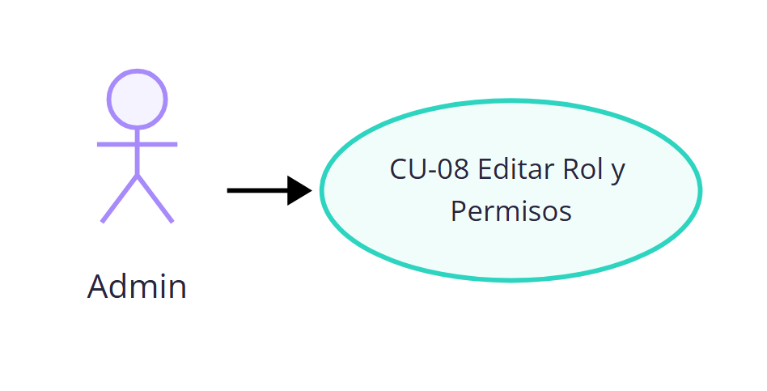
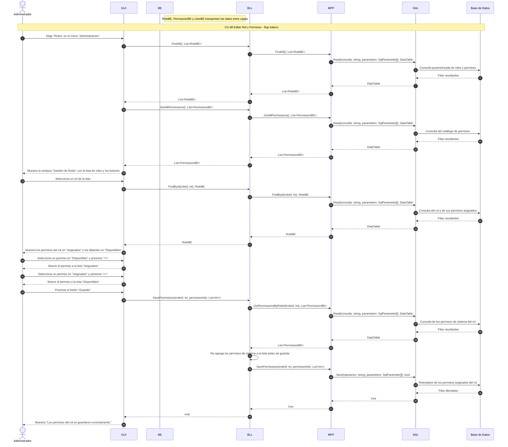
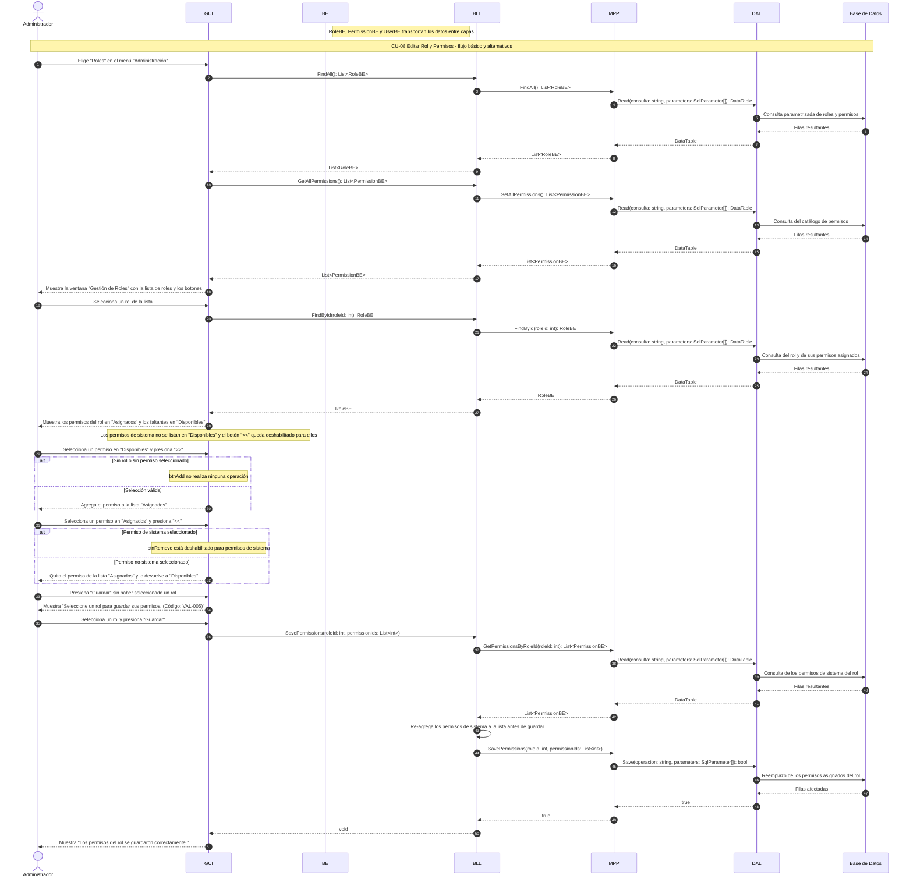

#### 4.8. Especificación de Casos de Uso: CU-08 Editar Rol y Permisos

#### 4.8.0. Diagramas de Caso de Uso

#### 4.8.1. Carátula

| Campo                   | Valor                                                                                                                                                                              |
| :---------------------- | :--------------------------------------------------------------------------------------------------------------------------------------------------------------------------------- |
| **ID y Nombre**         | CU-08 Editar Rol y Permisos                                                                                                                                                        |
| **Estado**              | En Revisión                                                                                                                                                                        |
| **Descripción**         | Permite al Administrador editar los permisos de un rol: asignar permisos de la lista "Disponibles" y quitarlos de "Asignados". Los permisos de sistema no pueden quitarse de un rol. |
| **Actor Principal**     | Administrador                                                                                                                                                                      |
| **Actores Secundarios** | Ninguno                                                                                                                                                                            |
| **Precondiciones**      | El usuario debe haber iniciado sesión como Administrador y debe existir al menos un rol registrado.                                                                                |
| **Punto de extensión**  | No aplica                                                                                                                                                                          |
| **Condición**           | Los permisos del rol quedan actualizados en el sistema.                                                                                                                            |

#### 4.8.2. Historial de Revisiones

| Versión | Fecha | Descripción | Autor |
| :--- | :--- | :--- | :--- |
| 1.0 | 29/10/2026 | Creación inicial de la especificación del Caso de Uso (alineada con `RoleManagementForm` y `RoleBLL`) | Darío Zubaray |
| 1.1 | 16/11/2026 | Reestructuración en CU atómico: este documento queda como caso de uso individual de edición de permisos de un rol | Darío Zubaray |

#### 4.8.3. Objetivo

Permitir al Administrador ajustar los permisos de un rol para que sus usuarios tengan exactamente los accesos que necesitan.

#### 4.8.4. Precondiciones

- El usuario debe haber iniciado sesión como Administrador.
- Debe existir al menos un rol registrado en el sistema.

#### 4.8.5. Puntos de Extensión y Condiciones

- **Punto de Extensión:** No aplica.
- **Condición:** El rol está seleccionado y los permisos de sistema se conservan al guardar.

#### 4.8.6. Descripción analítica del Caso de Uso

**Campos que completa el usuario:**

| Campo | Tipo | Obligatorio | Validación |
| :--- | :--- | :--- | :--- |
| Permisos (lista "Disponibles") | Lista simple | No | Para asignar, se selecciona un permiso y se presiona ">>". |
| Permisos (lista "Asignados") | Lista simple | No | Para quitar, se selecciona un permiso y se presiona "<<". Los permisos de sistema no pueden quitarse (el botón "<<" queda deshabilitado). |

Flujo Básico:
1. El usuario elige **Roles** en el menú "Administración".
2. El sistema muestra la ventana "Gestión de Roles" con la lista de roles, el campo "Rol:", los botones "Crear Rol" y "Eliminar", las listas "Disponibles" y "Asignados", los botones ">>" y "<<" y el botón "Guardar".
3. El usuario selecciona un rol de la lista.
4. El sistema muestra en "Asignados" los permisos del rol y en "Disponibles" los permisos faltantes (sin permisos de sistema).
5. El usuario selecciona un permiso en "Disponibles" y presiona ">>".
6. El sistema mueve el permiso a "Asignados".
7. El usuario selecciona un permiso en "Asignados" y presiona "<<".
8. El sistema mueve el permiso a "Disponibles".
9. El usuario presiona el botón "Guardar".
10. El sistema muestra el mensaje "Los permisos del rol se guardaron correctamente."
11. Fin del Caso de Uso.

Flujos Alternativos:
- **7.a Permiso de sistema en "Asignados":**
  1. El sistema deja deshabilitado el botón "<<" para los permisos de sistema; no se permite quitarlos del rol.
  2. El usuario selecciona un permiso que no sea de sistema y vuelve a presionar "<<".
- **9.a Sin rol seleccionado (guardar permisos):**
  1. El sistema muestra el mensaje "Seleccione un rol para guardar sus permisos. (Código: VAL-005)".
  2. El usuario selecciona un rol de la lista y vuelve a presionar "Guardar".

> Nota: los permisos de sistema no se listan en "Disponibles" y siempre se conservan al guardar los permisos del rol.

#### 4.8.7. Modelo de Dominio

Participan las siguientes entidades:
- Rol (con su lista de permisos)
- Permiso (catálogo del sistema; algunos son de sistema y no se pueden quitar)

#### 4.8.8. Diagramas de Secuencia

DSS (simple): 

DSD (detallado): 

