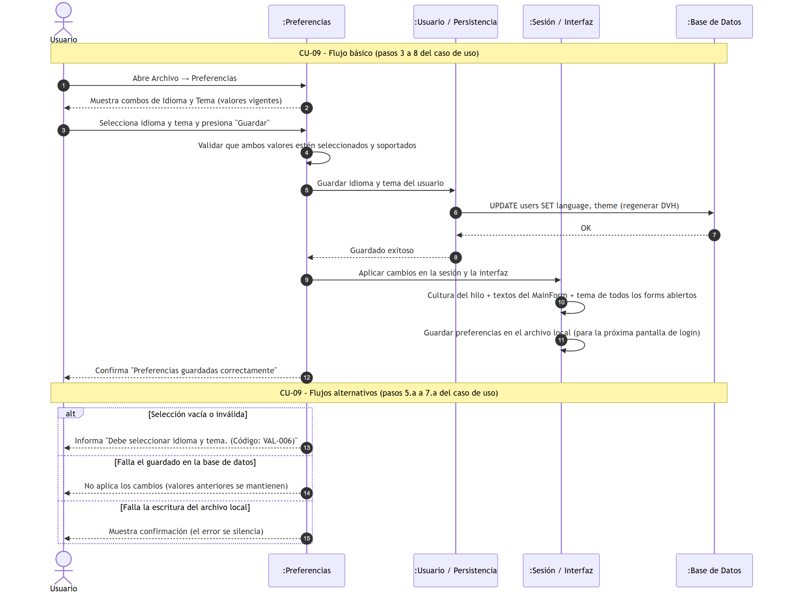
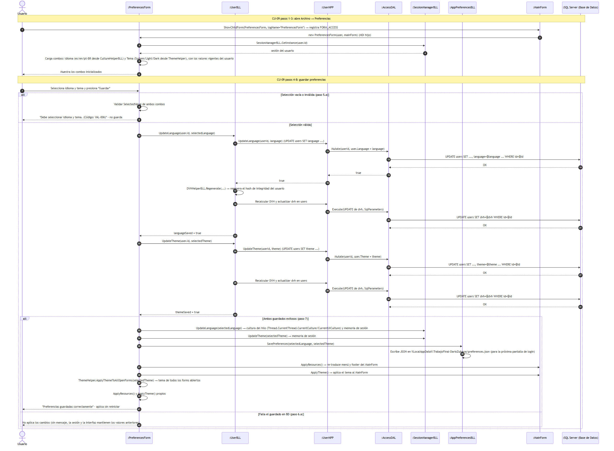
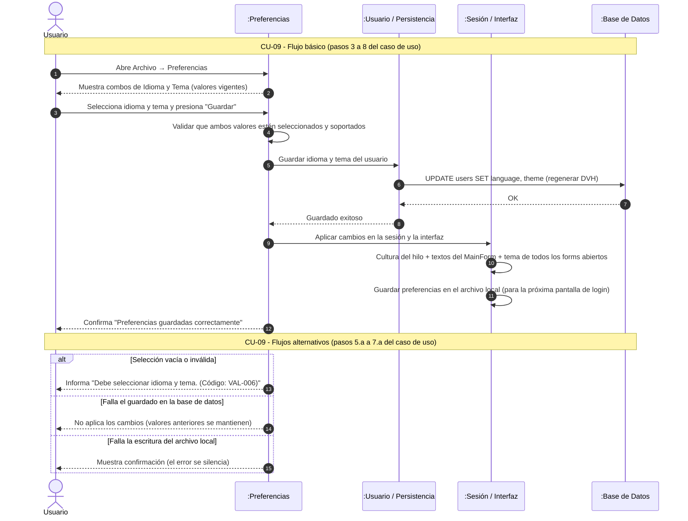

#### 4.8. Especificación de Casos de Uso: CU-09 Preferencias de Usuario

#### 4.8.1. Carátula

| Campo | Valor |
| :--- | :--- |
| **ID y Nombre** | CU-09 Preferencias de Usuario |
| **Estado** | En Revisión |
| **Descripción** | Permite al usuario configurar su idioma (es/en/pt-BR) y su tema visual (Sistema/Claro/Oscuro), aplicándolos de inmediato a la sesión y persistiéndolos en la base de datos (por usuario) y en un archivo local (para la pantalla de login). |
| **Actor Principal** | Usuario autenticado (cualquier rol) |
| **Actores Secundarios** | Ninguno |
| **Precondiciones** | El usuario debe haber iniciado sesión en el sistema. |
| **Punto de extensión** | No aplica |
| **Condición** | El idioma y el tema deben ser valores soportados (es, en, pt-BR / System, Light, Dark); el cambio se aplica sin reiniciar la aplicación |

#### 4.8.2. Historial de Revisiones

| Versión | Fecha | Descripción | Autor |
| :--- | :--- | :--- | :--- |
| 1.0 | 19/10/2026 | Creación inicial de la especificación del Caso de Uso | Darío Zubaray |

#### 4.8.3. Objetivo

Configurar el idioma y el tema visual de la aplicación para el usuario actual, aplicando los cambios de inmediato y persistiéndolos para futuras sesiones (BD por usuario) y para la pantalla de login (archivo local).

#### 4.8.4. Precondiciones

- El usuario ha iniciado sesión en el sistema.
- El usuario existe en la tabla `users` con columnas `language` y `theme`.

#### 4.8.5. Puntos de Extensión y Condiciones

- **Punto de Extensión:** No aplica.
- **Condición:** Ambos valores (idioma y tema) deben ser válidos y estar seleccionados; el guardado se realiza en la base de datos (con regeneración del DVH del usuario) y en el archivo local `preferences.json`.

#### 4.8.6. Descripción analítica del Caso de Uso

Flujo básico:
1. El usuario elige **Archivo → Preferencias** en el menú principal.
2. El sistema abre el formulario "Preferencias" (MDI hijo; si ya hay una instancia abierta la enfoca en lugar de abrir otra).
3. El sistema muestra dos combos: **Idioma** (Español / English / Português (Brasil)) y **Tema** (Sistema / Claro / Oscuro), inicializados con los valores vigentes del usuario.
4. El usuario selecciona el idioma y el tema deseados y presiona **Guardar**.
5. El sistema valida que ambos valores estén seleccionados y sean soportados.
6. El sistema persiste el idioma y el tema en la base de datos (por usuario, con regeneración del DVH).
7. El sistema aplica los cambios de inmediato: cultura del hilo, textos del formulario principal y de preferencias, tema de todos los formularios abiertos, y guarda las preferencias en el archivo local `preferences.json` (para la próxima pantalla de login).
8. El sistema muestra la confirmación "Preferencias guardadas correctamente".

Flujo alternativo:
- **5.a Selección vacía o inválida:**
  1. El sistema muestra "Debe seleccionar idioma y tema. (Código: VAL-006)" y no realiza ningún guardado.
- **6.a Falla el guardado en la base de datos:**
  1. El sistema no aplica los cambios (no hay mensaje de error adicional; la sesión y la interfaz mantienen los valores anteriores).
- **7.a Falla la escritura del archivo local:**
  1. El sistema continúa con la aplicación en memoria (el error se silencia); la confirmación se muestra igualmente.
- **4.a Cierre sin guardar:**
  1. El usuario cierra el formulario sin presionar Guardar; no se persiste ningún cambio.

#### 4.8.7. Modelo de Dominio

Participan las siguientes entidades:
- Usuario (idioma, tema)
- Preferencias de sesión (cultura, tema activo)
- Archivo local de preferencias (última preferencia usada, aplica antes del login)

#### 4.8.8. Diagramas de Secuencia

Diagrama simple: 

Diagrama detallado: 

