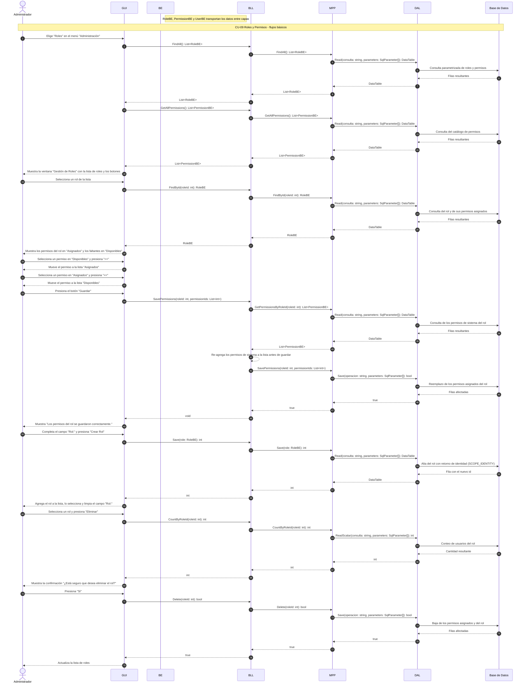
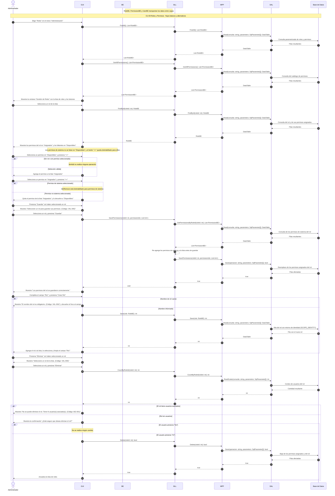

#### 4.8. Especificación de Casos de Uso: CU-09 Roles y Permisos

> Convención de estructura y estilo: [`convenciones-cu-y-secuencia.md`](convenciones-cu-y-secuencia.md).

#### 4.8.1. Carátula

| Campo | Valor |
| :--- | :--- |
| **ID y Nombre** | CU-09 Roles y Permisos |
| **Estado** | En Revisión |
| **Descripción** | Permite al Administrador administrar los roles del sistema: crear roles, asignar o quitar permisos a un rol y eliminar roles sin usuarios asociados. Los permisos marcados como de sistema no pueden quitarse de un rol. |
| **Actor Principal** | Administrador |
| **Actores Secundarios** | Ninguno |
| **Precondiciones** | El usuario debe haber iniciado sesión como Administrador. |
| **Punto de extensión** | No aplica |
| **Condición** | El rol queda creado o eliminado, o sus permisos quedan actualizados, en la base de datos. |

#### 4.8.2. Historial de Revisiones

| Versión | Fecha | Descripción | Autor |
| :--- | :--- | :--- | :--- |
| 1.0 | 29/10/2026 | Creación inicial de la especificación del Caso de Uso (alineada con `RoleManagementForm` y `RoleBLL`) | Darío Zubaray |

#### 4.8.3. Objetivo

Permitir al Administrador mantener los roles y sus permisos para controlar qué puede hacer cada usuario del sistema.

#### 4.8.4. Precondiciones

- El usuario debe haber iniciado sesión como Administrador.

#### 4.8.5. Puntos de Extensión y Condiciones

- **Punto de Extensión:** No aplica.
- **Condición:** El nombre del rol está informado y, en la eliminación, el rol no tiene usuarios asociados.

#### 4.8.6. Descripción analítica del Caso de Uso

**Campos que completa el usuario:**

| Campo | Tipo | Obligatorio | Validación |
| :--- | :--- | :--- | :--- |
| Rol | Texto | Sí | No puede estar vacío. |
| Permisos (lista "Disponibles") | Lista simple | No | Para asignar, se selecciona un permiso y se presiona ">>". |
| Permisos (lista "Asignados") | Lista simple | No | Para quitar, se selecciona un permiso y se presiona "<<". Los permisos de sistema no pueden quitarse (el botón "<< " queda deshabilitado). |

Flujo Básico 1 - Asignar y quitar permisos de un rol:
1. El usuario elige **Roles** en el menú "Administración".
2. El sistema muestra la ventana "Gestión de Roles" con la lista de roles, el campo "Rol:", los botones "Crear Rol" y "Eliminar", las listas "Disponibles" y "Asignados", los botones ">>" y "<<" y el botón "Guardar".
3. El usuario selecciona un rol de la lista.
4. El sistema muestra en "Asignados" los permisos del rol y en "Disponibles" los permisos faltantes (sin permisos de sistema).
5. El usuario selecciona un permiso en "Disponibles" y presiona ">>".
6. El sistema mueve el permiso a "Asignados".
7. El usuario selecciona un permiso en "Asignados" y presiona "<<".
8. El sistema mueve el permiso a "Disponibles".
9. El usuario presiona el botón "Guardar".
10. El sistema muestra el mensaje "Los permisos del rol se guardaron correctamente."
11. Fin del Caso de Uso.

Flujo Básico 2 - Crear rol:
1. El usuario completa el campo "Rol:".
2. El usuario presiona el botón "Crear Rol".
3. El sistema registra el rol, lo agrega a la lista de roles, lo selecciona y limpia el campo "Rol:".
4. Fin del Caso de Uso.

Flujo Básico 3 - Eliminar rol:
1. El usuario selecciona un rol de la lista.
2. El usuario presiona el botón "Eliminar".
3. El sistema verifica que el rol no tenga usuarios asociados.
4. El sistema muestra la confirmación "¿Está seguro que desea eliminar el rol '\<nombre\>'?".
5. El usuario presiona "Sí".
6. El sistema elimina el rol con sus permisos asignados y actualiza la lista de roles.
7. Fin del Caso de Uso.

Flujos Alternativos:
- **2.a Nombre de rol vacío:**
  1. El sistema muestra el mensaje "El nombre del rol es obligatorio. (Código: VAL-004)" y devuelve el foco al campo.
  2. El usuario completa el nombre y vuelve a presionar "Crear Rol".
- **3.a Sin rol seleccionado (eliminar):**
  1. El sistema muestra el mensaje "Seleccione un rol de la lista. (Código: VAL-005)".
  2. El usuario selecciona un rol y reintenta.
- **3.b El rol tiene usuarios asociados:**
  1. El sistema muestra el mensaje "No se puede eliminar el rol '\<nombre\>'. Tiene \<n\> usuario(s) asociado(s). (Código: BIZ-001)".
- **3.c El usuario presiona "No" en la confirmación:**
  1. El sistema no realiza ningún cambio.
- **1.a Sin rol seleccionado (guardar permisos):**
  1. El usuario presiona "Guardar" sin haber seleccionado un rol.
  2. El sistema muestra el mensaje "Seleccione un rol para guardar sus permisos. (Código: VAL-005)".
- **1.b Permiso de sistema en "Asignados":**
  1. El sistema deja deshabilitado el botón "<<" para los permisos de sistema; no se permite quitarlos del rol.

> Nota: los permisos de sistema (marcados `IsSystem` en la tabla `permissions`) no se listan en "Disponibles" y siempre se conservan al guardar los permisos del rol (la capa de negocio los re-agrega si faltaran).

#### 4.8.7. Modelo de Dominio

Participan las siguientes entidades:
- Rol (con su lista de permisos)
- Permiso (catálogo del sistema; algunos son de sistema y no se pueden quitar)
- Usuario (solo para verificar cuántos usuarios usa el rol antes de eliminarlo)

#### 4.8.8. Diagramas de Secuencia

DSS (simple): 

DSD (detallado): 

