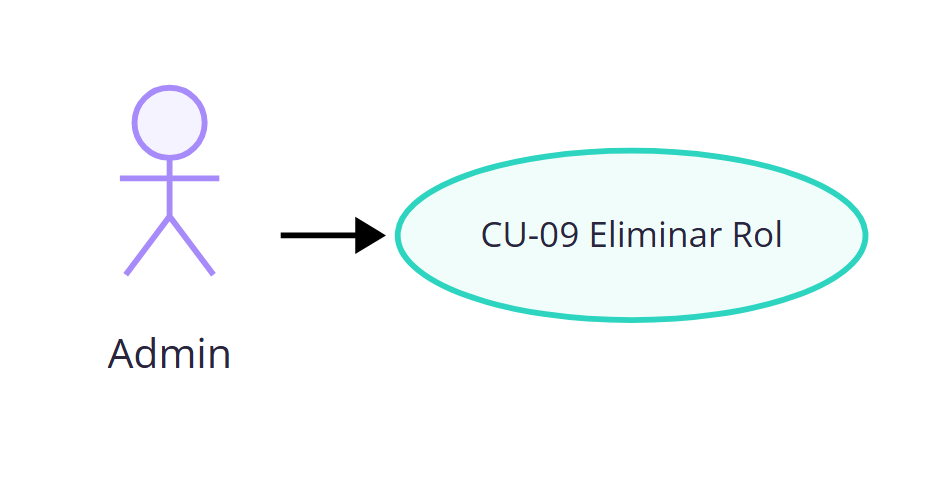
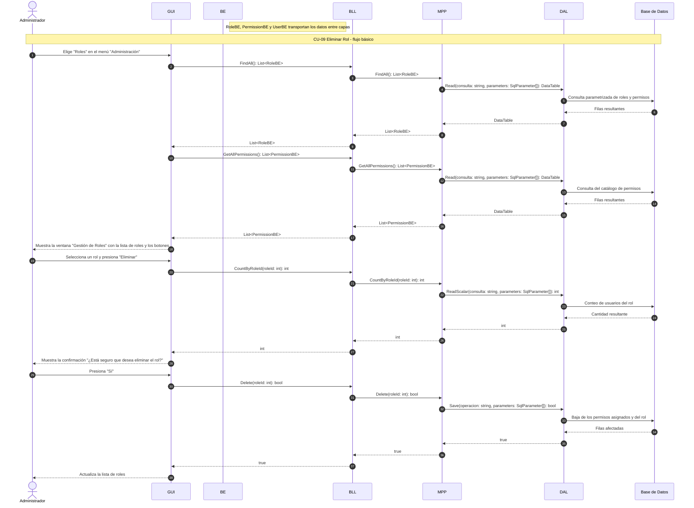
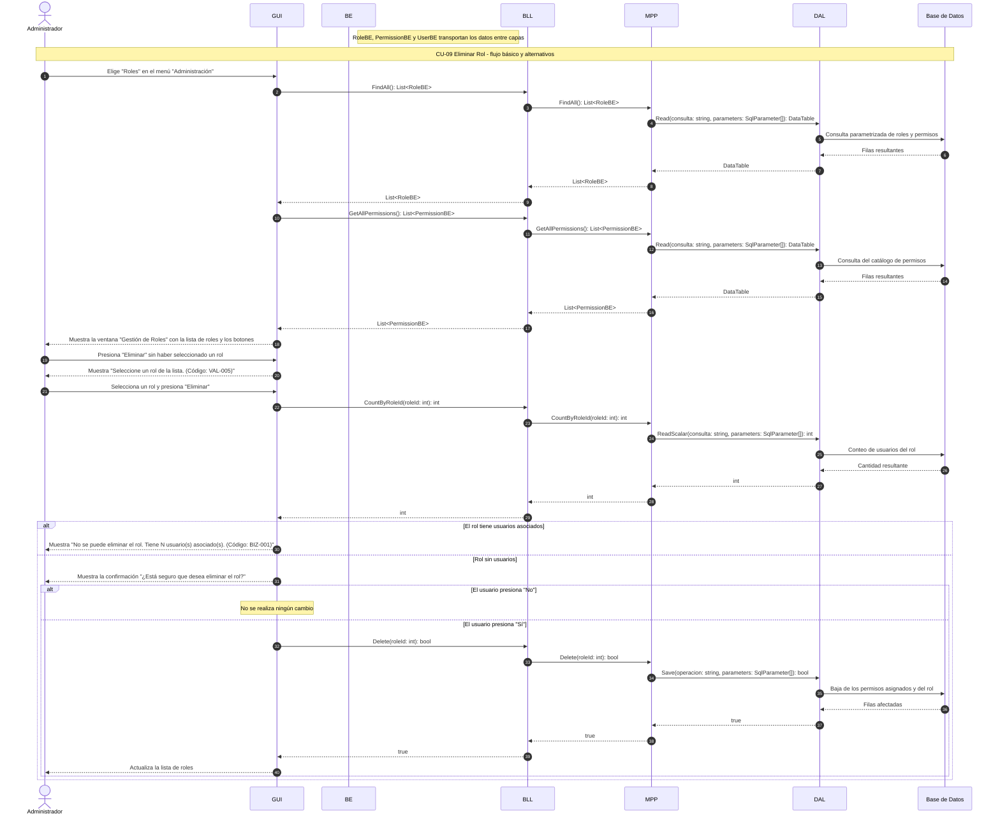

#### 4.9. Especificación de Casos de Uso: CU-09 Eliminar Rol

#### 4.9.0. Diagramas de Caso de Uso

#### 4.9.1. Carátula

| Campo                   | Valor                                                                                                                            |
| :---------------------- | :------------------------------------------------------------------------------------------------------------------------------- |
| **ID y Nombre**         | CU-09 Eliminar Rol                                                                                                               |
| **Estado**              | En Revisión                                                                                                                      |
| **Descripción**         | Permite al Administrador eliminar un rol que no tiene usuarios asociados, junto con sus permisos asignados.                       |
| **Actor Principal**     | Administrador                                                                                                                    |
| **Actores Secundarios** | Ninguno                                                                                                                          |
| **Precondiciones**      | El usuario debe haber iniciado sesión como Administrador y debe existir al menos un rol registrado.                              |
| **Punto de extensión**  | No aplica                                                                                                                        |
| **Condición**           | El rol queda eliminado del sistema junto con sus permisos asignados.                                                             |

#### 4.9.2. Historial de Revisiones

| Versión | Fecha | Descripción | Autor |
| :--- | :--- | :--- | :--- |
| 1.0 | 29/10/2026 | Creación inicial de la especificación del Caso de Uso (alineada con `RoleManagementForm` y `RoleBLL`) | Darío Zubaray |
| 1.1 | 16/11/2026 | Reestructuración en CU atómico: este documento queda como caso de uso individual de baja de roles | Darío Zubaray |

#### 4.9.3. Objetivo

Permitir al Administrador dar de baja un rol sin usuarios asociados para mantener el catálogo de roles del sistema actualizado.

#### 4.9.4. Precondiciones

- El usuario debe haber iniciado sesión como Administrador.
- Debe existir al menos un rol registrado en el sistema.

#### 4.9.5. Puntos de Extensión y Condiciones

- **Punto de Extensión:** No aplica.
- **Condición:** El rol no tiene usuarios asociados.

#### 4.9.6. Descripción analítica del Caso de Uso

**Campos que completa el usuario:**

| Campo | Tipo | Obligatorio | Validación |
| :--- | :--- | :--- | :--- |
| Rol (lista de roles) | Lista simple | Sí | Debe seleccionarse un rol de la lista. |

Flujo Básico:
1. El usuario elige **Roles** en el menú "Administración".
2. El sistema muestra la ventana "Gestión de Roles" con la lista de roles, el campo "Rol:", los botones "Crear Rol" y "Eliminar", las listas "Disponibles" y "Asignados", los botones ">>" y "<<" y el botón "Guardar".
3. El usuario selecciona un rol de la lista.
4. El usuario presiona el botón "Eliminar".
5. El sistema muestra la confirmación "¿Está seguro que desea eliminar el rol '\<nombre\>'?".
6. El usuario presiona "Sí".
7. El sistema elimina el rol con sus permisos asignados y actualiza la lista de roles.
8. Fin del Caso de Uso.

Flujos Alternativos:
- **4.a Sin rol seleccionado:**
  1. El sistema muestra el mensaje "Seleccione un rol de la lista. (Código: VAL-005)".
  2. El usuario selecciona un rol de la lista y vuelve a presionar "Eliminar".
- **4.b El rol tiene usuarios asociados:**
  1. El sistema muestra el mensaje "No se puede eliminar el rol '\<nombre\>'. Tiene \<n\> usuario(s) asociado(s). (Código: BIZ-001)".
  2. El usuario selecciona otro rol o cancela la operación.
- **6.a El usuario presiona "No" en la confirmación:**
  1. El sistema no realiza ningún cambio.
  2. El usuario cancela la operación.

#### 4.9.7. Modelo de Dominio

Participan las siguientes entidades:
- Rol (con sus permisos asignados)
- Permiso (se eliminan junto con el rol)
- Usuario (para verificar cuántos usuarios usa el rol antes de eliminarlo)

#### 4.9.8. Diagramas de Secuencia

DSS (simple): 

DSD (detallado): 

