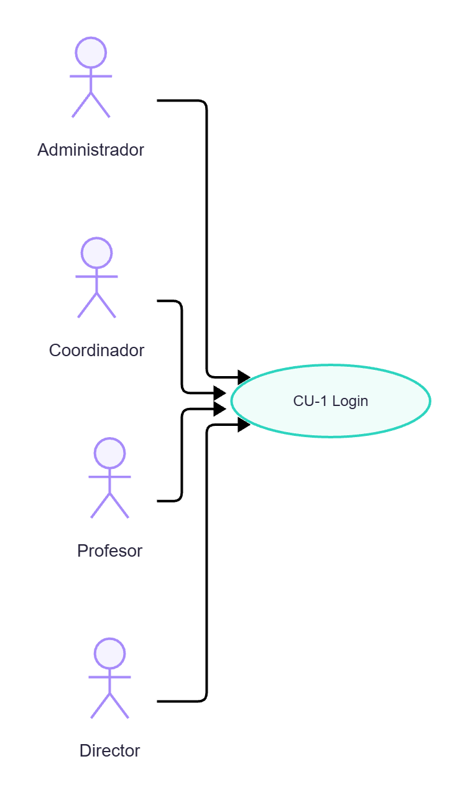
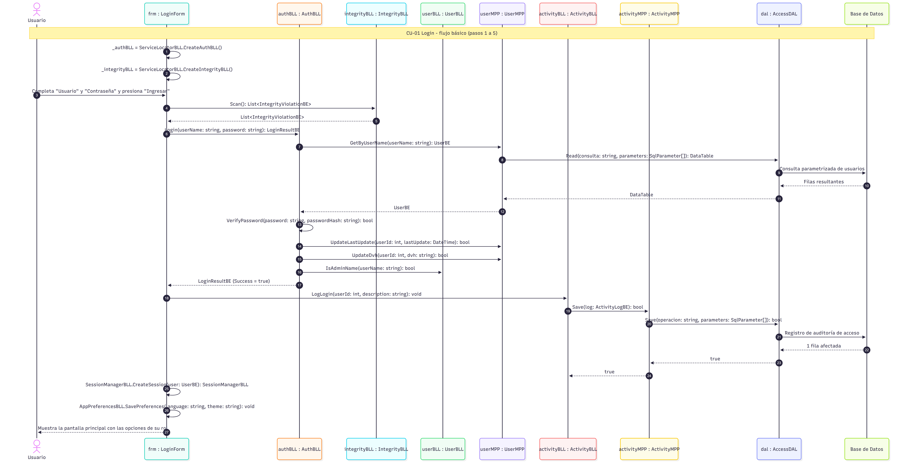
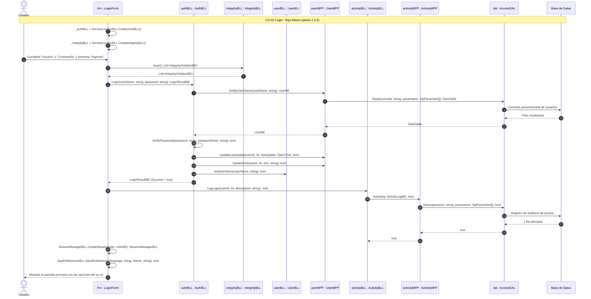

#### 6.1. Especificación de Casos de Uso: CU-01 Login

#### 6.1.0. Diagramas de Caso de uso

#### 6.1.1. Carátula

| Campo | Valor |
| :--- | :--- |
| **ID y Nombre** | CU-01 Login |
| **Estado** | En Revisión |
| **Descripción** | Permitir que cualquier usuario del sistema acceda autenticándose con su nombre de usuario y contraseña. |
| **Actor Principal** | Administrador, Coordinador, Profesor, Director |
| **Actores Secundarios** | Ninguno |
| **Precondiciones** | La base de datos del sistema está disponible. |
| **Punto de extensión** | No aplica |
| **Condición** | El usuario queda autenticado y se abre la pantalla principal con las opciones habilitadas según su rol. |

#### 6.1.2. Historial de Revisiones

| Versión | Fecha      | Descripción                                                                                                                           | Autor         |
| :------ | :--------- | :------------------------------------------------------------------------------------------------------------------------------------ | :------------ |
| 1.0     | 13/09/2026 | Creación inicial de la especificación del Caso de Uso                                                                                 | Darío Zubaray |
| 1.1     | 08/10/2026 | Se detalla el procedimiento de 3 reintentos previo al bloqueo de la cuenta (flujos alternativos 3.b/3.c y diagramas de secuencia)     | Darío Zubaray |
| 1.2     | 28/10/2026 | Incorporación del dígito de verificación de integridad horizontal (DVH) y actores, y regeneración de los diagramas por capa (DSS/DSD) | Darío Zubaray |
| 1.3     | 29/10/2026 | Ajuste de actores al modelo final con 4 roles.                                                                                        | Darío Zubaray |
| 1.1     | 16/11/2026 | Alternativas reancladas al flujo básico (Fase 2) | Darío Zubaray |

#### 6.1.3. Objetivo

Permitir que un usuario registrado acceda a la plataforma autenticando su identidad mediante el ingreso de su nombre de usuario y contraseña.

#### 6.1.4. Precondiciones

- La base de datos del sistema está disponible.
- El usuario se encuentra registrado en la base de datos (si no lo está, ver flujo alternativo 4.b).

#### 6.1.5. Puntos de Extensión y Condiciones

- **Punto de Extensión:** No aplica.
- **Condición:** Las credenciales ingresadas son válidas y la cuenta está activa.

#### 6.1.6. Descripción analítica del Caso de Uso

**Campos que completa el usuario:**

| Campo      | Tipo           | Obligatorio | Validación            |
| :--------- | :------------- | :---------- | :-------------------- |
| Usuario    | Texto          | Sí          | No puede estar vacío. |
| Contraseña | Texto (oculta) | Sí          | No puede estar vacía. |

Flujo Básico:
1. El usuario inicia el programa y se muestra la pantalla de inicio de sesión.
2. El usuario completa el campo "Usuario".
3. El usuario completa el campo "Contraseña".
4. El usuario presiona el botón "Ingresar".
5. El sistema muestra la pantalla principal con las opciones habilitadas según el rol del usuario.
6. Fin del Caso de Uso.

Flujos Alternativos:
- **4.a Campos obligatorios incompletos:**
  1. El sistema muestra el mensaje "Usuario y contraseña son obligatorios. (Código: AUTH-001)".
  2. El usuario completa los campos y vuelve a presionar "Ingresar".
- **4.b Credenciales incorrectas con intentos disponibles (1er y 2do fallo):**
  1. El sistema muestra el mensaje "Usuario o contraseña incorrectos. Intentos restantes: N (Código: AUTH-005)" (N = 2 tras el primer fallo, N = 1 tras el segundo).
  2. Los intentos fallidos se acumulan entre sesiones hasta que el usuario ingrese correctamente.
  3. El usuario reingresa las credenciales y vuelve a presionar "Ingresar".
- **4.c Credenciales incorrectas en el tercer intento (cuenta bloqueada):**
  1. Al tercer intento fallido el sistema desactiva la cuenta y muestra el mensaje "Usuario bloqueado por exceso de intentos fallidos. Contacte al administrador. (Código: AUTH-004)".
  2. Fin del Caso de Uso: la cuenta queda desactivada.
- **4.d Cuenta bloqueada al ingresar:**
  1. El sistema muestra el mensaje "Usuario bloqueado. Contacte al administrador. (Código: AUTH-003)".
  2. Fin del Caso de Uso: la cuenta permanece bloqueada.
- **4.e Segundo factor de autenticación (solo Administrador):**
  1. El sistema muestra el diálogo "Doble Factor de Autenticación".
  2. El usuario ingresa el código de verificación y presiona "Aceptar".
  3. Si el código es inválido, el sistema muestra el mensaje "Código de doble factor inválido. (Código: AUTH-006)" y vuelve al paso 1 de este flujo.
  4. Si el usuario presiona "Cancelar", el sistema vuelve a la pantalla de inicio de sesión sin autenticar y fin del Caso de Uso.

Nota: un inicio de sesión exitoso restablece los reintentos de la cuenta. El Administrador nunca acumula reintentos fallidos (su cuenta no se bloquea por contraseña incorrecta).

#### 6.1.7. Modelo de Dominio

Participan las siguientes entidades:
- Usuario
- Rol
- Permiso
- Bitácora de actividad

#### 6.1.8. Diagramas de Secuencia

```mermaid
sequenceDiagram
    autonumber
    actor Usuario
    participant frm as frm : LoginForm
    participant authBLL as authBLL : AuthBLL
    participant integrityBLL as integrityBLL : IntegrityBLL
    participant userBLL as userBLL : UserBLL
    participant userMPP as userMPP : UserMPP
    participant activityBLL as activityBLL : ActivityBLL
    participant activityMPP as activityMPP : ActivityMPP
    participant dal as dal : AccessDAL
    participant bd as Base de Datos

    Note over Usuario,bd: CU-01 Login - flujo básico y flujos alternativos

    frm->>frm: _authBLL = ServiceLocatorBLL.CreateAuthBLL()
    frm->>frm: _integrityBLL = ServiceLocatorBLL.CreateIntegrityBLL()
    Usuario->>frm: Completa "Usuario" y "Contraseña" y presiona "Ingresar"

    alt Campos "Usuario" o "Contraseña" vacíos
        frm-->>Usuario: Muestra "Usuario y contraseña son obligatorios. (AUTH-001)"
    else Campos completos
        frm->>integrityBLL: Scan(): List<IntegrityViolationBE>
        integrityBLL-->>frm: List<IntegrityViolationBE>
        Note over authBLL: Evalúa el estado de integridad registrado por Scan (IntegrityStateBLL)

        frm->>authBLL: Login(userName: string, password: string): LoginResultBE

        alt Integridad violada y userName no es el Administrador
            authBLL-->>frm: LoginResultBE (Success = false, ErrorCode = INT-001)
            frm-->>Usuario: Muestra "Acceso bloqueado: se detectaron inconsistencias en la base de datos. Solo el administrador del sistema puede ingresar. (INT-001)"
        else userName válido o integridad correcta
            authBLL->>userMPP: GetByUserName(userName: string): UserBE
            userMPP->>dal: Read(consulta: string, parameters: SqlParameter[]): DataTable
            dal->>bd: Consulta parametrizada de usuarios
            bd-->>dal: Filas resultantes
            dal-->>userMPP: DataTable
            userMPP-->>authBLL: UserBE

            alt Usuario inexistente
                authBLL-->>frm: LoginResultBE (Success = false, ErrorCode = AUTH-002)
                frm-->>Usuario: Muestra "Usuario o contraseña incorrectos. (AUTH-002)"
            else Integridad violada y el usuario recuperado no es el sysadmin
                authBLL-->>frm: LoginResultBE (Success = false, ErrorCode = INT-001)
                frm-->>Usuario: Muestra "Acceso bloqueado: se detectaron inconsistencias en la base de datos. Solo el administrador del sistema puede ingresar. (INT-001)"
            else Cuenta inactiva (distinta del Administrador)
                authBLL-->>frm: LoginResultBE (Success = false, ErrorCode = AUTH-003)
                frm-->>Usuario: Muestra "Usuario bloqueado. Contacte al administrador. (AUTH-003)"
            else Cuenta activa
                authBLL->>authBLL: VerifyPassword(password: string, passwordHash: string): bool

                alt Contraseña inválida y el usuario es el Administrador
                    authBLL-->>frm: LoginResultBE (Success = false, ErrorCode = AUTH-002)
                    frm-->>Usuario: Muestra "Usuario o contraseña incorrectos. (AUTH-002)"
                else Contraseña inválida con reintentos disponibles
                    authBLL->>userMPP: UpdateRetries(userId: int, retriesCount: int): bool
                    userMPP->>dal: Save(operacion: string, parameters: SqlParameter[]): bool
                    dal->>bd: Actualización del contador de reintentos
                    bd-->>dal: 1 fila afectada
                    dal-->>userMPP: true
                    userMPP-->>authBLL: true
                    authBLL->>userMPP: UpdateDvh(userId: int, dvh: string): bool
                    authBLL-->>frm: LoginResultBE (Success = false, ErrorCode = AUTH-005)
                    frm-->>Usuario: Muestra "Usuario o contraseña incorrectos. Intentos restantes: N. (AUTH-005)"
                else Tercer intento fallido (la cuenta queda desactivada)
                    authBLL->>userMPP: Deactivate(userId: int): bool
                    userMPP->>dal: Save(operacion: string, parameters: SqlParameter[]): bool
                    dal->>bd: Desactivación de la cuenta
                    bd-->>dal: 1 fila afectada
                    dal-->>userMPP: true
                    userMPP-->>authBLL: true
                    authBLL->>userMPP: UpdateDvh(userId: int, dvh: string): bool
                    authBLL-->>frm: LoginResultBE (Success = false, ErrorCode = AUTH-004)
                    frm-->>Usuario: Muestra "Usuario bloqueado por exceso de intentos fallidos. Contacte al administrador. (AUTH-004)"
                else Contraseña válida
                    authBLL->>userMPP: UpdateLastUpdate(userId: int, lastUpdate: DateTime): bool
                    alt Cuenta con reintentos acumulados
                        authBLL->>userMPP: UpdateRetries(userId: int, retriesCount: 0): bool
                    end
                    authBLL->>userMPP: UpdateDvh(userId: int, dvh: string): bool
                    authBLL->>userBLL: IsAdminName(userName: string): bool
                    authBLL-->>frm: LoginResultBE (Success = true, RequiresTwoFactor = true si es Administrador)

                    alt Cuenta con segundo factor (Administrador)
                        frm-->>Usuario: Muestra el diálogo "Doble Factor de Autenticación"
                        alt El usuario cancela el diálogo
                            frm-->>Usuario: Vuelve a la pantalla de inicio de sesión sin autenticar
                        else El usuario ingresa un código
                            Usuario->>frm: Ingresa el código y presiona "Aceptar"
                            frm->>authBLL: ValidateTwoFactor(user: UserBE, code: string): bool
                            alt Código inválido
                                authBLL-->>frm: false
                                frm-->>Usuario: Muestra "Código de doble factor inválido. (AUTH-006)" y vuelve al diálogo
                            else Código correcto
                                authBLL-->>frm: true
                            end
                        end
                    end

                    alt Violaciones de integridad pendientes (solo Administrador)
                        frm->>integrityBLL: GetViolations(): List<IntegrityViolationBE>
                        integrityBLL-->>frm: List<IntegrityViolationBE>
                        frm-->>Usuario: Muestra la pantalla "Auditoría de Integridad (DVH)" con las violaciones detectadas
                        Usuario->>frm: Selecciona una fila y presiona "Aceptar y regenerar hash"
                        frm->>integrityBLL: AcceptAndRegenerate(violation: IntegrityViolationBE): bool
                        Note over integrityBLL,userBLL: Delegado en UserDvhVerifierBLL (verificador de la tabla users)
                        integrityBLL->>userBLL: FindById(user: UserBE): UserBE
                        userBLL->>userMPP: FindById(user: UserBE): UserBE
                        userMPP->>dal: Read(consulta: string, parameters: SqlParameter[]): DataTable
                        dal->>bd: Consulta parametrizada de usuarios
                        bd-->>dal: Filas resultantes
                        dal-->>userMPP: DataTable
                        userMPP-->>userBLL: UserBE
                        userBLL-->>integrityBLL: UserBE
                        integrityBLL->>userBLL: Save(user: UserBE): bool
                        userBLL->>userMPP: Save(user: UserBE): bool
                        userMPP->>dal: Save(operacion: string, parameters: SqlParameter[]): bool
                        dal->>bd: Actualización de la fila afectada
                        bd-->>dal: 1 fila afectada
                        dal-->>userMPP: true
                        userMPP-->>userBLL: true
                        userBLL->>userMPP: UpdateDvh(userId: int, dvh: string): bool
                        userBLL-->>integrityBLL: true
                        integrityBLL->>integrityBLL: Scan(): List<IntegrityViolationBE>
                        integrityBLL-->>frm: true
                        frm-->>Usuario: Muestra "Hash regenerado correctamente."
                        Note over frm,Usuario: Mientras queden violaciones el Administrador puede repararlas o elegir continuar igual
                    end

                    frm->>activityBLL: LogLogin(userId: int, description: string): void
                    activityBLL->>activityMPP: Save(log: ActivityLogBE): bool
                    activityMPP->>dal: Save(operacion: string, parameters: SqlParameter[]): bool
                    dal->>bd: Registro de auditoría de acceso
                    bd-->>dal: 1 fila afectada
                    dal-->>activityMPP: true
                    activityMPP-->>activityBLL: true
                    frm->>frm: SessionManagerBLL.CreateSession(user: UserBE): SessionManagerBLL
                    frm->>frm: AppPreferencesBLL.SavePreferences(language: string, theme: string): void
                    frm-->>Usuario: Muestra la pantalla principal con las opciones de su rol
                end
            end
        end
    end
```

DSS (simple): 

DSD (detallado): 

