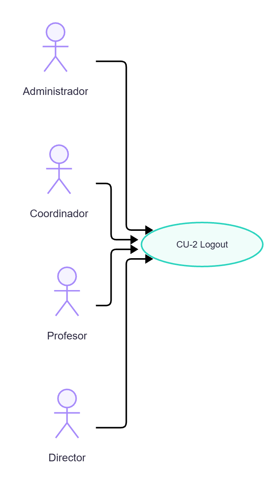
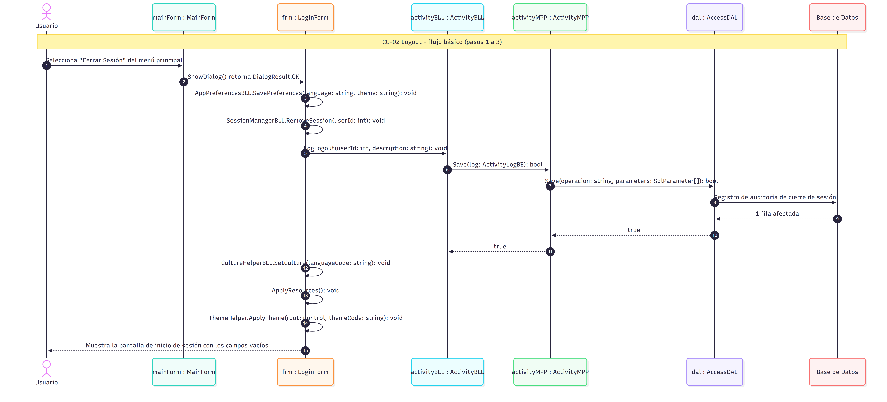
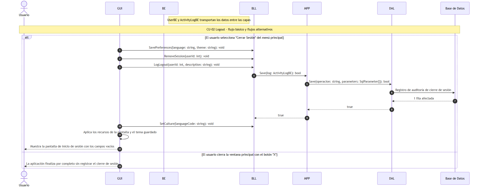
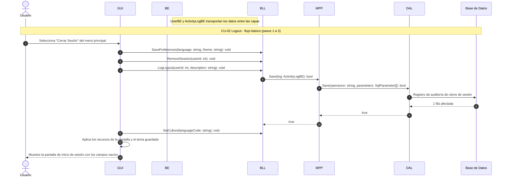
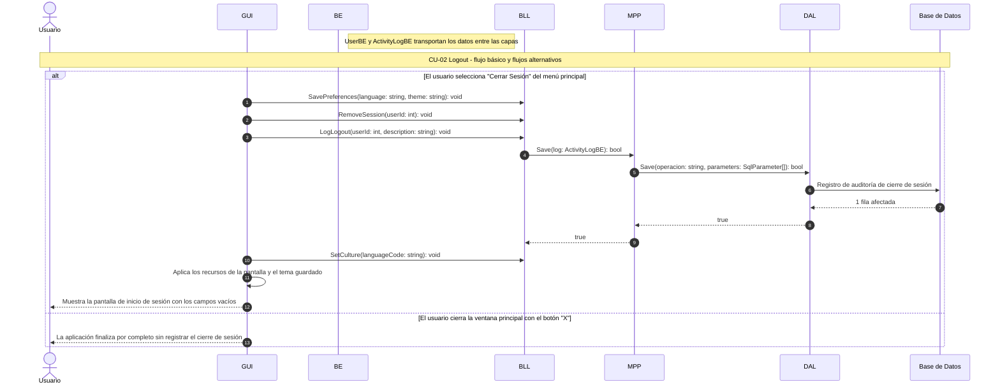

#### 6.2. Especificación de Casos de Uso: CU-02 Logout

#### 6.2.0. Diagramas de Caso de uso

#### 6.2.1. Carátula

| Campo                   | Valor                                                                                    |
| :---------------------- | :--------------------------------------------------------------------------------------- |
| **ID y Nombre**         | CU-02 Logout                                                                             |
| **Estado**              | En Revisión                                                                              |
| **Descripción**         | Permitir que un usuario autenticado finalice su sesión en la plataforma de forma segura. |
| **Actor Principal**     | Administrador, Coordinador, Profesor, Director                                           |
| **Actores Secundarios** | Ninguno                                                                                  |
| **Precondiciones**      | El usuario debe haber iniciado sesión previamente y poseer una sesión activa.            |
| **Punto de extensión**  | No aplica                                                                                |
| **Condición**           | La sesión queda finalizada y se vuelve a la pantalla de inicio de sesión.                |

#### 6.2.2. Historial de Revisiones

| Versión | Fecha      | Descripción                                                                                                                                                                  | Autor         |
| :------ | :--------- | :--------------------------------------------------------------------------------------------------------------------------------------------------------------------------- | :------------ |
| 1.0     | 13/09/2026 | Creación inicial de la especificación del Caso de Uso                                                                                                                        | Darío Zubaray |
| 1.1     | 28/10/2026 | Flujo en ping-pong paso por paso, todos los actores del sistema y regeneración de los diagramas por capa (DSS/DSD) incluyendo el cierre de la ventana como flujo alternativo | Darío Zubaray |
| 1.2     | 29/10/2026 | Ajuste de actores al modelo final con 4 roles                                                                                                                                | Darío Zubaray |
| 1.1     | 16/11/2026 | Alternativas reancladas al flujo básico (Fase 2) | Darío Zubaray |

#### 6.2.3. Objetivo

Permitir que un usuario cierre su sesión de forma segura, finalizando el acceso al sistema y evitando el uso no autorizado de la cuenta.

#### 6.2.4. Precondiciones

- El usuario debe encontrarse autenticado.
- Debe existir una sesión activa.

#### 6.2.5. Puntos de Extensión y Condiciones

- **Punto de Extensión:** No aplica.
- **Condición:** El usuario posee una sesión activa.

#### 6.2.6. Descripción analítica del Caso de Uso

**Campos que completa el usuario:**

Este caso de uso no tiene campos: el usuario solo selecciona una opción del menú.

Flujo Básico:
1. El usuario selecciona la opción "Cerrar Sesión" del menú principal.
2. El sistema muestra la pantalla de inicio de sesión con los campos vacíos; la sesión finalizada queda registrada en la bitácora de actividad.
3. Fin del Caso de Uso.

Flujos Alternativos:
- **1.a El usuario cierra la ventana principal con el botón "X":**
  1. La aplicación finaliza por completo sin registrar el cierre de sesión en la bitácora.
  2. Fin del Caso de Uso.

Nota: al volver a la pantalla de inicio de sesión el sistema restituye el idioma y el tema
guardados, y la sesión del usuario queda finalizada.

#### 6.2.7. Modelo de Dominio

Participan las siguientes entidades:
- Usuario
- Rol
- Permiso
- Bitácora de actividad

#### 6.2.8. Diagramas de Secuencia

DSS (simple): 

DSD (detallado): 

