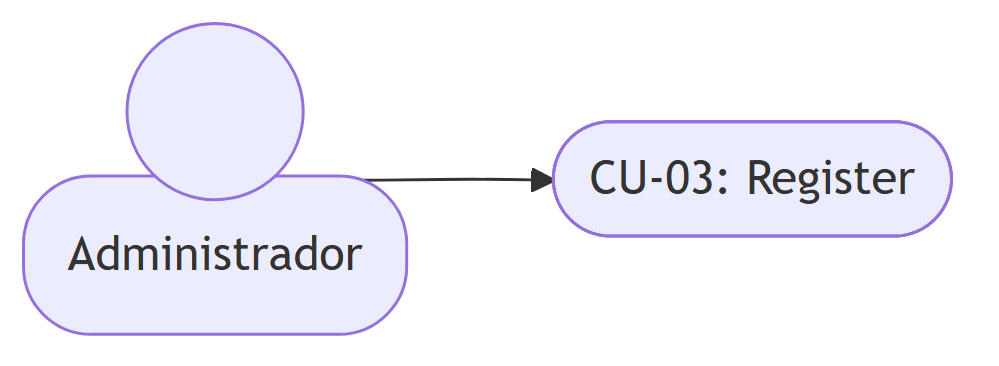
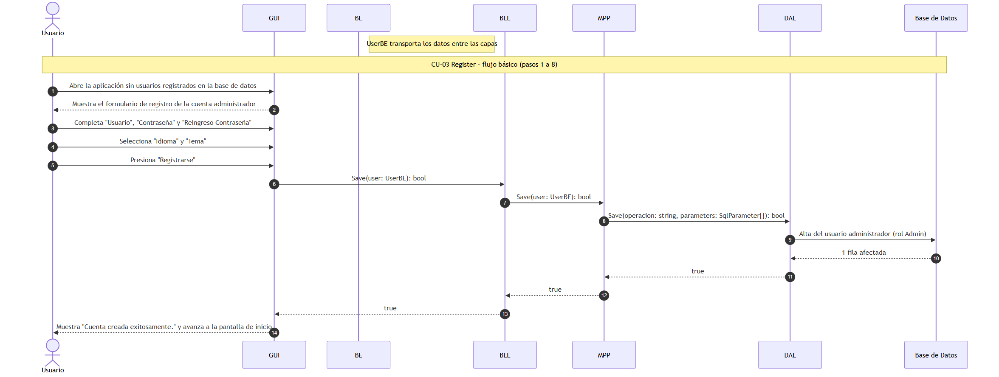
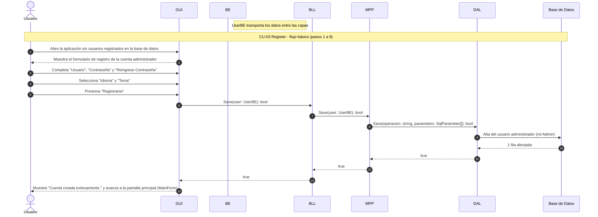
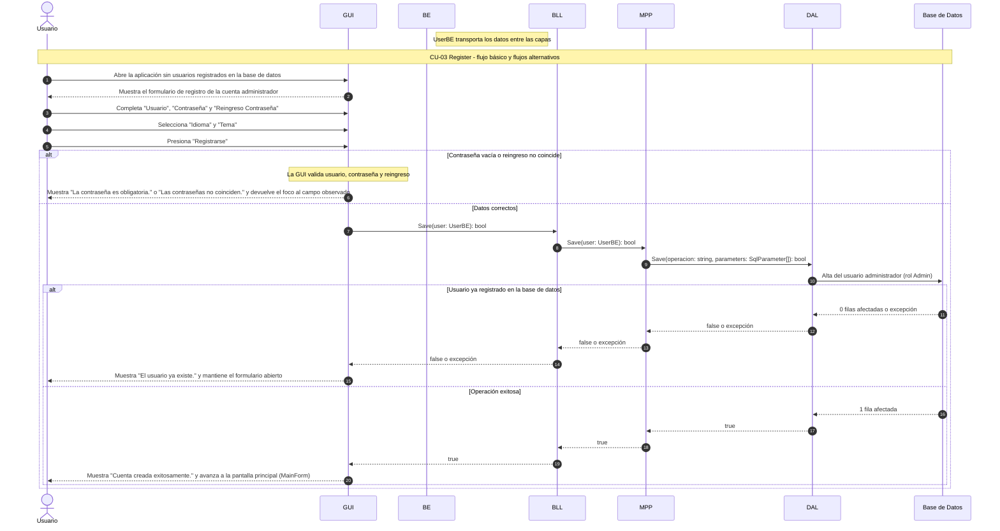

#### 6.3. Especificación de Casos de Uso: CU-03 Register

#### 6.3.0. Diagramas de Caso de uso

#### 6.3.1. Carátula

| Campo                   | Valor                                                            |
| :---------------------- | :--------------------------------------------------------------- |
| **ID y Nombre**         | CU-03 Register                                                 |
| **Estado**              | En Revisión                                                      |
| **Descripción**         | Permitir al usuario administrador crear su cuenta.               |
| **Actor Principal**     | Administrador                                                    |
| **Actores Secundarios** | Ninguno                                                          |
| **Precondiciones**      | El sistema no debe contar con datos de usuarios.                 |
| **Punto de extensión**  | No aplica                                                        |
| **Condición**           | el usuario queda registrado y se avanza a la pantalla principal (MainForm) con la sesión iniciada. |

#### 6.3.2. Historial de Revisiones

| Versión | Fecha      | Descripción                                                                                                                                                                  | Autor         |
| :------ | :--------- | :--------------------------------------------------------------------------------------------------------------------------------------------------------------------------- | :------------ |
| 1.0     | 29/10/2026 | Creación inicial de la especificación del Caso de Uso                                                                                                                        | Darío Zubaray |
| 1.1     | 16/11/2026 | Alternativas reancladas al flujo básico (Fase 2) | Darío Zubaray |

#### 6.3.3. Objetivo

Permitir que un usuario administrador cree su cuenta por primera vez en el sistema.

#### 6.3.4. Precondiciones

- El sistema no debe contar con datos en la tabla de usuarios.

#### 6.3.5. Puntos de Extensión y Condiciones

- **Punto de Extensión:** No aplica.
- **Condición:** El usuario no debe poseer una cuenta activa.

#### 6.3.6. Descripción analítica del Caso de Uso

**Campos que completa el usuario:**

| Campo                | Tipo                                   | Obligatorio | Validación                                                                            |
| :------------------- | :------------------------------------- | :---------- | :------------------------------------------------------------------------------------ |
| Usuario              | Texto                                  | Sí          | No puede estar vacío.                                                                 |
| Contraseña           | Texto (oculta)                         | Sí          | No puede estar vacía.                                                                 |
| Reingreso Contraseña | Texto (oculta)                         | Sí          | No puede estar vacía, debe coincidir con la contraseña ingresada en el paso anterior. |
| Idioma               | Selección (Español, Portugues, Inglés) | No          |                                                                                       |
| Tema                 | Selección (Sistema, claro, oscuro)     | No          |                                                                                       |

Flujo Básico:
1. El usuario abre la aplicación cuando aún no existe ninguna cuenta de usuario registrada.
2. El sistema muestra el formulario de registro de la cuenta administrador.
3. El usuario completa el campo "Usuario".
4. El usuario completa el campo "Contraseña".
5. El usuario completa el campo "Reingreso Contraseña".
6. El usuario selecciona los campos "Idioma" y "Tema".
7. El usuario presiona el botón "Registrarse".
8. El sistema muestra el mensaje "Cuenta creada exitosamente." y avanza a la pantalla principal (MainForm) con la sesión iniciada.
9. Fin del Caso de Uso.

Flujos Alternativos:
- **7.a Usuario vacío:**
  1. El sistema muestra el mensaje "El nombre de usuario es obligatorio. (Código: VAL-001)" y devuelve el foco al campo.
  2. El usuario completa el nombre de usuario y vuelve a presionar "Registrarse".
- **7.b Contraseña vacía:**
  1. El sistema muestra el mensaje "La contraseña es obligatoria. (Código: VAL-002)" y devuelve el foco al campo.
  2. El usuario completa la contraseña y vuelve a presionar "Registrarse".
- **7.c Reingreso de contraseña no coincide:**
  1. El sistema muestra el mensaje "Las contraseñas no coinciden. (Código: VAL-003)" y devuelve el foco al campo.
  2. El usuario corrige el reingreso de la contraseña y vuelve a presionar "Registrarse".
- **7.d El usuario ya existe:**
  1. El sistema muestra el mensaje "El usuario ya existe. (Código: VAL-008)" y mantiene el formulario abierto.
  2. El usuario ingresa otro nombre de usuario y vuelve a presionar "Registrarse".

#### 6.3.7. Modelo de Dominio

Participan las siguientes entidades:
- Usuario
- Rol
- Permiso
- Bitácora de actividad

#### 6.3.8. Diagramas de Secuencia

DSS (simple): 

DSD (detallado): 

