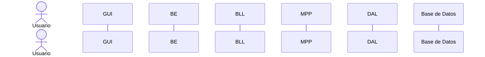

#### 4.x. Especificación de Casos de Uso: CU-0X <Nombre del Caso de Uso>

> Convención de estructura y estilo: [`convenciones-cu-y-secuencia.md`](convenciones-cu-y-secuencia.md).

#### 4.x.1. Carátula

| Campo | Valor |
| :--- | :--- |
| **ID y Nombre** | CU-0X <Nombre> |
| **Estado** | En Revisión |
| **Descripción** |  |
| **Actor Principal** |  |
| **Actores Secundarios** | Ninguno |
| **Precondiciones** |  |
| **Punto de extensión** | No aplica |
| **Condición** |  |

#### 4.x.2. Historial de Revisiones

| Versión | Fecha | Descripción | Autor |
| :--- | :--- | :--- | :--- |
| 1.0 | <fecha> | Creación inicial de la especificación del Caso de Uso | Darío Zubaray |

#### 4.x.3. Objetivo

#### 4.x.4. Precondiciones

#### 4.x.5. Puntos de Extensión y Condiciones

- **Punto de Extensión:** No aplica.
- **Condición:** 

#### 4.x.6. Descripción analítica del Caso de Uso

**Campos que completa el usuario:**

| Campo | Tipo | Obligatorio | Validación |
| :--- | :--- | :--- | :--- |
|  |  |  |  |

Flujo Básico:
1. <El usuario …>
2. <El sistema …>
3. <El usuario completa el campo "X">
4. <El usuario presiona el botón "Guardar">
5. <El sistema …>

Flujos Alternativos:
- **<n>.a <Motivo>:**
  1. <El sistema muestra el mensaje "…">
  2. <El usuario … y vuelve a presionar "Guardar">

#### 4.x.7. Modelo de Dominio

Participan las siguientes entidades:
- 

#### 4.x.8. Diagramas de Secuencia

DSS (simple): 

DSD (detallado): 

