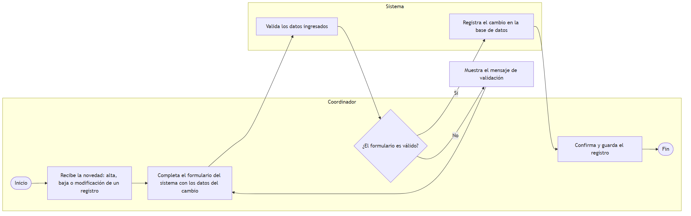
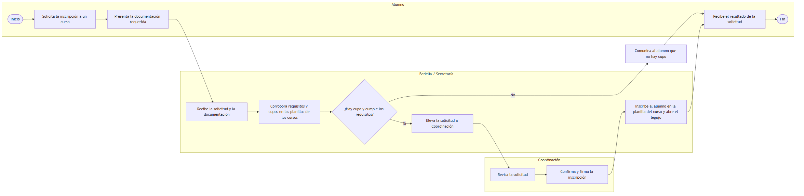
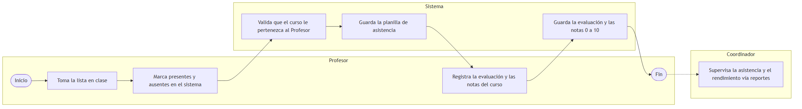
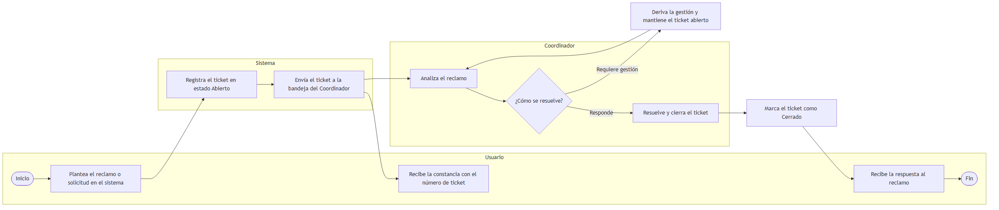
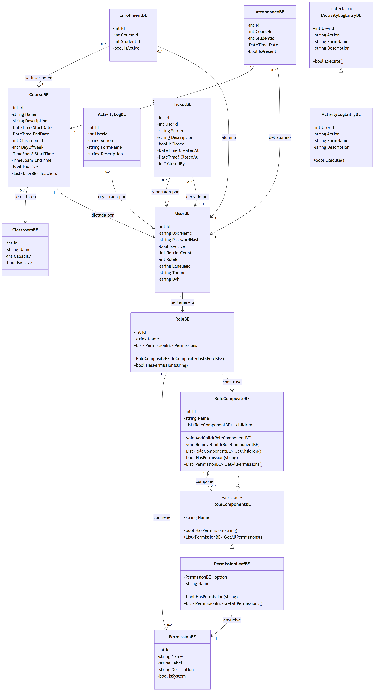

# Texto para el Word — Secciones 1, 2 y 3 (3ra entrega)

> Pegar este texto en el documento Word reemplazando las secciones 1, 2 y 3 actuales.
> Numeración según `indice-documentacion.txt`. Imágenes referenciadas en `docs/mermaid-live/`.

---

## 1. Descripción global del Producto

### 1.1. Descripción global del Producto

El sistema es una herramienta de gestión integral para una academia de idiomas. Centraliza en un único lugar la administración de la oferta académica y de los datos del personal y los alumnos, ordenando los flujos de trabajo del personal de la institución.

Más allá de administrar datos, el sistema los convierte en información de valor: concentra la asistencia, las evaluaciones y las notas de los cursos, y las utiliza para ofrecer seguimiento del rendimiento académico e informes personalizados que apoyan la toma de decisiones. Todo el acceso está protegido por un control de acceso basado en roles, con registro en una bitácora de actividad y verificación de integridad de los datos almacenados.

### 1.2. Propósito

Proporcionar una herramienta informática robusta y centralizada para la automatización de procesos clave dentro de la academia (altas, bajas y modificaciones, inscripción, asistencia, evaluaciones y canalización de reclamos), y a la vez entregar información útil: consultar el desempeño académico y generar informes personalizados en función de la información que el sistema produce.

### 1.3. Descripción Funcional del producto y Alcance

El alcance del sistema abarca los siguientes módulos:

- **Administrativo (ABM):** gestión integral de entidades principales (cursos, aulas, usuarios, roles y permisos), realizada por los roles Administrador y Coordinador.
- **Académico:** registro de asistencia y de evaluaciones con notas a cargo de los docentes a cargo de cada curso.
- **Inscripción a Cursos:** registro de la inscripción de alumnos a los cursos de la oferta académica, realizada por el rol Coordinador, con validación de inscripciones duplicadas y de solape de horarios.
- **Reclamos y Tickets:** registro de tickets (asunto y descripción) por parte de cualquier usuario, con trazabilidad de autor y fechas; el Coordinador lista los tickets de todos los usuarios y los cierra.
- **Informes y Seguimiento:** consulta del rendimiento académico (asistencia y notas por curso, docente y alumno) y generación de informes personalizados, destinados a los roles Coordinador y Director.
- **Seguridad y Control de Acceso:** login/logout con segunda factor de autenticación, permisos basados en roles, dígito verificador (DVH) para la integridad de los datos sensibles y bitácora de actividad.
- **Operación:** respaldo y restauración de la base de datos (rol Administrador).

### 1.4. Definiciones, Acrónimos, y Abreviaciones

- **ABM:** Altas, Bajas y Modificaciones (operaciones de alta, baja y modificación de registros).
- **Ticket:** Registro de consulta o reclamo ingresado por un usuario para su seguimiento, con estado Abierto o Cerrado.
- **Actor:** Entidad externa al sistema (usuario, proceso o hardware) que interactúa directamente con él para cumplir un objetivo.
- **DER (Diagrama Entidad-Relación):** Modelo conceptual de datos que describe la estructura lógica de la base de datos del sistema.
- **CU (Caso de Uso):** Técnica de especificación que describe el comportamiento del software ante una secuencia de interacciones con un actor.
- **DVH (Dígito Verificador Horizontal):** Técnica de integridad de datos: se calcula un hash por registro y se almacena en la tabla; un proceso de verificación periódico detecta modificaciones no autorizadas.
- **2FA (Segundo Factor de Autenticación):** Verificación adicional además de usuario y contraseña; el sistema la exige para la cuenta de administración.
- **Bitácora de actividad:** Registro persistente de las acciones relevantes que realizan los usuarios (ingresos, ABM, cierres de sesión).
- **Rol:** Conjunto de permisos que definen qué puede hacer un usuario en el sistema (Administrador, Coordinador, Profesor, Director).
- **Permiso:** Unidad individual de acceso (por ejemplo, un formulario o una acción) que se asigna a los roles.
- **Evaluación:** Prueba o actividad calificable de un curso, con su fecha y la nota numérica de cada alumno inscripto.
- **Informe personalizado:** Reporte generado a partir de la información del sistema (asistencia, notas, inscripciones) según los criterios que selecciona el usuario.

---

## 2. Descripción de las personas participantes en el desarrollo del sistema de información y los usuarios (Roles)

**Personas consultadas en el relevamiento**

| Rol consultado | Técnica | Fecha | Información aportada |
| :--- | :--- | :--- | :--- |
| Coordinación | Entrevista | 11/08/2026 | Procesos administrativos de la academia: gestión de cursos, aulas, docentes y alumnos; necesidad de control de cupos y de registro de inscripciones. |
| Profesorado | Encuesta y entrevista | 18/08/2026 | Procesos académicos: registro de asistencia por curso y fecha, asignación de docentes a los cursos y registro de notas de evaluaciones. |
| Administración / Bedelía | Observación | 25/08/2026 | Procedimiento presencial de inscripción de los alumnos y disposición de los espacios físicos (aulas). |

**Roles del sistema**

| Rol | Nivel | Descripción | Funcionalidades Principales |
| :--- | :--- | :--- | :--- |
| Administrador | Alto | Responsable de la configuración y operación técnica del sistema. Realiza tareas de inicio y excepcionales. | Gestión de usuarios, roles y permisos; respaldo y restauración de la base de datos; auditoría de integridad (DVH); supervisión general. |
| Coordinador | Medio | Responsable de la administración general de la academia. Realiza las tareas diarias. | Gestión de cursos, aulas, inscripciones y alumnos; consulta de asistencia; gestión de tickets (listado general y cierre); consulta del rendimiento académico y generación de informes personalizados. |
| Profesor | Bajo | Responsable del ámbito académico de los cursos a su cargo. Operador especial de ingreso de datos. | Registro de asistencia de sus cursos; registro de evaluaciones y notas; consulta del rendimiento de sus cursos; creación de tickets. |
| Director | Lectura | Supervisión académica e institucional. | Consulta del rendimiento académico y de informes personalizados. |

> **Nota sobre el Alumno:** el Alumno no es un rol del sistema ni un actor: no inicia sesión ni opera la herramienta. Es una entidad gestionada (tabla `students`): su ABM lo realizan los roles Coordinador y Administrador, y el sistema conserva su historial de asistencia y de notas como beneficiario de los procesos académicos.

---

## 3. Especificación funcional

### 3.1. Especificación por Procesos de Negocio

#### 3.1.1. Identificación de Roles Intervinientes

- **Administrador:** interviene en el mantenimiento de usuarios, roles y permisos y en el respaldo/restauración de la base de datos.
- **Coordinador:** interviene en el mantenimiento de cursos y aulas, en el alta y modificación de alumnos, en la inscripción de alumnos a cursos, en la consulta de asistencia, en la gestión de tickets (listado general y cierre) y en la consulta de rendimiento y generación de informes.
- **Profesor:** interviene en el registro de asistencia y en el registro de evaluaciones y notas de los cursos a su cargo, y en la creación de tickets; su participación en la inscripción es indirecta, ya que los cursos disponibles son los que dicta.
- **Director:** interviene como usuario de consulta: revisa el rendimiento académico y los informes personalizados.
- **Alumno:** no opera el sistema ni es un rol. Es la persona inscripta en la academia cuya inscripción registra Coordinación y cuyo historial académico alimenta los procesos de asistencia, evaluaciones e informes.

#### 3.1.2. Descripción del requisito funcional del proceso (Entrada / Comportamiento / Salida)

**Proceso: Mantenimiento de Aplicativo (ABM)**
- **Entrada:** Datos de la entidad (usuarios, roles y permisos, cursos, aulas).
- **Comportamiento:** Validación de campos obligatorios y de coherencia entre fechas y horarios, verificación de permisos según el rol del usuario y persistencia en la base de datos.
- **Salida:** Confirmación de la operación (creación, edición o baja lógica de registros para usuarios, cursos y aulas; baja física para roles) y listado actualizado.

**Proceso: Inscripción a Cursos**
- **Entrada:** Selección del alumno a inscribir y del curso solicitado.
- **Comportamiento:** Verificación de que el alumno no posea una inscripción activa en el curso y de que no exista solape de horario con sus cursos vigentes; registro de la inscripción.
- **Salida:** Mensaje de inscripción en pantalla y actualización de la lista de inscriptos del curso.

**Proceso: Registro de Asistencias**
- **Entrada:** Selección de curso y fecha, lista de alumnos matriculados y marcado de cada alumno como presente o ausente.
- **Comportamiento:** Registro por alumno sobre la plantilla del curso, restringido al docente a cargo del curso.
- **Salida:** Planilla de asistencia guardada y disponible para su consulta.

**Proceso: Registro de Evaluaciones y Notas** *(alcance de la 3ra entrega)*
- **Entrada:** Selección de curso, datos de la evaluación (nombre y fecha) y nota numérica de cada alumno inscripto.
- **Comportamiento:** Verificación de que el docente dicta el curso y de que las notas se encuentren dentro del rango permitido; persistencia de la evaluación y de las notas.
- **Salida:** Evaluación registrada con las notas del curso y disponibles para los informes de rendimiento.

**Proceso: Consulta de Rendimiento e Informes Personalizados** *(alcance de la 3ra entrega)*
- **Entrada:** Criterios de selección del informe (curso, docente, alumno y/o periodo).
- **Comportamiento:** Cruce de la información de inscripciones, asistencia y notas para calcular indicadores (porcentaje de asistencia, promedio de notas, etc.).
- **Salida:** Reporte en pantalla con los indicadores calculados, exportable para su impresión.

**Proceso: Gestión de Tickets de Reclamo**
- **Entrada:** Asunto y descripción redactados por el usuario que reporta el problema o solicitud.
- **Comportamiento:** Alta del ticket en estado *Abierto* asociado al usuario logueado y a la fecha; para el rol Coordinador, cierre del ticket con registro de fecha y autor del cierre.
- **Salida:** Ticket registrado, visible en la grilla de tickets con su estado y su trazabilidad.

**Proceso: Respaldo y Restauración de la Base de Datos** *(alcance de la 3ra entrega)*
- **Entrada:** Solicitud de generación de un respaldo o de restauración de la base de datos.
- **Comportamiento:** Generación del archivo de respaldo o carga del archivo seleccionado, con verificación de su correcta aplicación.
- **Salida:** Archivo de respaldo generado o base de datos restaurada, con confirmación del resultado.

#### 3.1.3. Diagrama de Proceso

Diagramas de los procesos actuales del sistema:

- Mantenimiento de Aplicativo (ABM): 
- Inscripción a Cursos: 
- Registro de Asistencias: 
- Gestión de Tickets de Reclamo: 

> Los diagramas de proceso de *Registro de Evaluaciones y Notas*, *Rendimiento e Informes* y *Respaldo y Restauración* se incorporan junto con la implementación de esos módulos.

#### 3.1.4. Modelo Conceptual

El modelo describe las entidades centrales del sistema: usuarios, roles y permisos (seguridad); cursos, aulas, inscripciones y asistencia (ámbito académico); tickets (reclamos) y la bitácora de actividad (trazabilidad). Las entidades de evaluaciones y notas se agregan al modelo junto con ese módulo.
